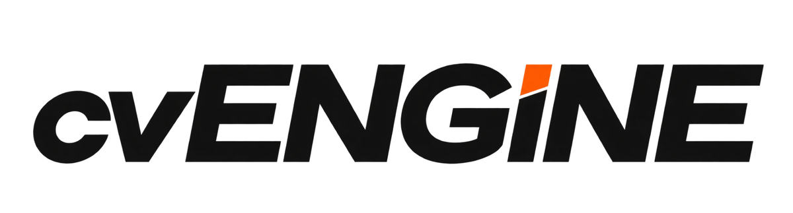
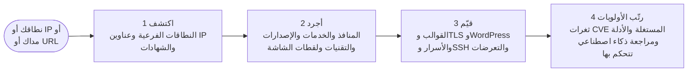

<p align="center">
  
</p>

<h3 align="center">منصة تقييم سطح الهجوم الخارجي الأكثر تطورًا.</h3>

<p align="center">اكتشف الأصول التي تعرضها وارسِمها في جرد بأسلوب Shodan.</p>

<p align="center">قيّم كل مضيف باستخدام ماسحات قياسية في المجال، وأصلِح أولًا ما يهم حقًا.</p>

<p align="center">
  <a href="CHANGELOG.md"></a>
  <a href="LICENSE"></a>
  
</p>

<p align="center">
  
</p>

<p align="center"><sub>cvENGINE 1.4.1 على بيانات تجريبية.</sub></p>

---

**يراقب cvENGINE خلاصات CVE على مدار الساعة ويُريك، بالأدلة، أي ثغرات CVE جديدة تصل فعلًا إلى مضيفيك.**

### كل CVE جديد، يُفحص مقابل مضيفيك

1. **راقب الخلاصات.** تصل ثغرات CVE الجديدة وأخبار الاستغلال الطازجة طوال اليوم من المصادر المهمة.
2. **اعثر على المعرضين.** تُطابق كل CVE مع المضيفين الذين يشغّلون المنتج والإصدار المتأثرين.
3. **اكتب الفحص.** عندما لا يوجد فحص معتمد، يكتب ذكاؤك الاصطناعي مسودة فحص للقراءة فقط يتحقق منها cvENGINE أولًا.
4. **أثبِته على مضيفيك.** يعيد Sentinel إنتاج كل تطابق بفحص للقراءة فقط ويحتفظ بالدليل.
5. **قلّل الضجيج.** يراجع الذكاء الاصطناعي الأدلة، فيرتفع الحقيقي ويهبط ما يُرجَّح أنه إيجابي كاذب.

**أحضر ذكاءك الاصطناعي:** Anthropic أو OpenAI أو OpenRouter بمفتاحك الخاص، أو محليًا بالكامل عبر Ollama أو LM Studio أو vLLM. يبقى مغلقًا حتى تشغّله، ولا يغلق أبدًا نتيجة أثبتها فحص. بدون نموذج، لا يزال cvENGINE يكتشف ويفحص ويطابق ويتحقق.

<details>
<summary><b>كيف يعمل، بدقة</b></summary>

- **الخلاصات.** تُقرأ خلاصة [cve.now](https://cve.now) كل 30 دقيقة. وتُقرأ CISA KEV وENISA EUVD وFIRST EPSS وExploit-DB وMetasploit و—بمفتاح—VulnCheck KEV كل ساعة، لذا فإن CVE التي يبدأ استغلالها تصبح hot خلال ساعة.
- **المطابقة.** لا تصبح CVE تطابقًا إلا عندما يشغّل مضيفٌ المنتجَ نفسه بإصدار داخل نطاق متأثر محدد. المنتج الذي يُرى بدون إصدار لا يُنتج تطابقًا أبدًا.
- **الفحوص التي يكتبها الذكاء الاصطناعي.** بالنسبة لثغرات CVE الساخنة، وضمن ميزانية يومية، يقرأ الذكاء الاصطناعي النشرة ويسجّل كيفية اكتشافها. عندما لا يوجد قالب Nuclei معتمد، يمكنه كتابة مسودة قالب للقراءة فقط، لا يعمل على مضيف إلا بعد أن يتحقق منه النظام: الصياغة وفحص loopback غير ضار على Sentinel، واختبار دون اتصال مقابل استجابة متأثرة واستجابة مُصلَحة، ومرور ذكاء اصطناعي ثانٍ. يُشحَن هذا مغلقًا: يفعّل مديرٌ خيار **التحقق تلقائيًا من الفحوص التي يكتبها الذكاء الاصطناعي**.
- **الدليل.** كل خمس دقائق، يُعاد إنتاج حتى 20 تطابقًا — fire أولًا — على Sentinel بواحد من ستة فحوص للقراءة فقط: قالب Nuclei معتمد، أو `nmap -sV` على المنفذ الواحد، أو طلب بانر الإصدار، أو فحص قاعدة البيانات بدون بيانات اعتماد، أو مسبار الإصدار والهوية، أو قراءة مكتبة JavaScript. يُحتفظ بالأمر والنتيجة الدقيقين. الفحص الذي لا يعيد إنتاج نتيجة لا يخفضها أبدًا.
- **الفرز.** تُصنَّف تطابقات CVE ونتائج الماسحات وقواعد البيانات المفتوحة ومسارات الإدارة المفتوحة والمسارات التي تكشف بيانات الاعتماد ونتائج النظافة متوسطة الخطورة أو أسوأ على أنها confirmed أو likely أو needs validation أو likely false positive أو not applicable، ضمن حدود يومية (افتراضيًا 500 لكل مشروع و2,000 إجمالًا).
- **مراجع الذكاء الاصطناعي.** يقرأ كل نتيجة مفتوحة مرة واحدة، حتى 300 يوميًا افتراضيًا، ويسجّل هل هي حقيقية. لا يغلق إيجابيًا كاذبًا إلا عندما تسمح أنت، وفقط عندما لا تملك النتيجة دليلًا قويًا ولم يعمل عليها أي شخص.
- **الحدود الدنيا.** الدليل القوي يضع حدًا أدنى لا يمكن للنموذج النزول دونه: إصابة قالب أو قاعدة بيانات أجابت أو إصابة تحقق هي confirmed، والإصدار داخل النطاق المتأثر هو على الأقل needs validation. لا يمكن للنموذج وحده أن يؤكد نتيجة أبدًا.
- **ذكاؤك الاصطناعي، وأدواتك أنت.** في الفرز والمراجعة، يرى النموذج أدلة منظمة مع حجب أسماء المضيفين، ولا يملك أدوات، ويفحص الخادم كل إجابة قبل اعتمادها. لمهام الذكاء الاصطناعي حدود يومية، وتعرض صفحة الاستخدام النداءات والرموز وتقديرات التكلفة. يُشحَن مراجع الذكاء الاصطناعي والفحوص التي يكتبها الذكاء الاصطناعي وauto-fire (تأكيد واختبارات الذكاء الاصطناعي فور هبوط CVE ساخنة جديدة) مغلقةً جميعها.

المزيد في [Pipeline](docs/PIPELINE.md#triage-and-validation) و[استخبارات CVE](docs/PIPELINE.md#cve-intelligence) و[مراجع الذكاء الاصطناعي](docs/AI-REVIEWER.md).

</details>

### اعرف كل ما تعرضه

cvENGINE منصة ذاتية الاستضافة لتقييم سطح الهجوم الخارجي والثغرات. أعطِها نطاقاتك وستواصل اكتشاف النطاقات الفرعية والعناوين والشهادات التي تعرضها، في جرد قابل للبحث بأسلوب Shodan لكل مضيف ومنفذ وخدمة وتقنية وشهادة. تظهر الأصول المنسية والظل، وتهبط المضيفات الجديدة والمنافذ المفتوحة وتغييرات الإصدارات على خط زمني فور رؤيتها بالفحص. يُقيَّم كل مضيف بماسحات مفتوحة المصدر قياسية في المجال، ويرتّب [Situations](docs/SITUATIONS.md) ما يجب إصلاحه أولًا: الدليل قبل الاحتمال، والاستغلال المعروف قبل الخطورة وحدها.

## cvENGINE 1.4.0 هنا

| | |
| --- | --- |
| **افحص من حيث تحتاج** | أنت تختار مكان الفحص: على خادمك، بالماسح المدمج الذي يأتي مع كل تثبيت في حاويته الخاصة؛ أو على [Sentinels](docs/SENTINELS.md) البعيدة التي تضعها في أي مكان — في سحابات أو مناطق أخرى أو داخل شبكات خاصة للوصول إلى الأصول الداخلية؛ أو كلاهما. أضف Sentinels للتوسع. |
| **ذكاء اصطناعي يقلل الإيجابيات الكاذبة** | مراجع الذكاء الاصطناعي الجديد، في حاويته المعزولة، يقرأ كل نتيجة مفتوحة مرة واحدة (حتى حد يومي) ويسجّل هل هي حقيقية، وتتحقق المنظومة من الفحوص التي يكتبها الذكاء الاصطناعي قبل تشغيلها، بما في ذلك على Sentinels الخاصة بك. يبقى كلاهما مغلقين حتى تشغّلهما. |
| **الإعداد في المتصفح** | `install.sh` مجرد إقلاع رفيع. يأخذ [معالج الإعداد](docs/DEPLOYMENT.md#setup-wizard) مؤسستك ومشروعك ونطاقك الأول، ويبدأ الاكتشاف فورًا. |
| **ما يحتاجك، مرتَّبًا** | يسرد [Situations](docs/SITUATIONS.md) المضيفات التي تحتاج شخصًا، الأكثر إلحاحًا أولًا. النتائج التي أعاد فحصٌ إنتاجها تعرض دليلها أولًا، والنتيجة المعلمة كمُصلَحة يُعاد فحصها. |
| **الأسرار المكشوفة وSSH** | جرد أسرار للمشروع تغذيه Kingfisher، وتفتيش SSH عبر sshamble الذي يقارن مفاتيح المضيف بقائمة مفاتيح سيئة معروفة ولا يسجّل الدخول أبدًا. |
| **لا شيء يعمل دون أن يُرى** | فحوص بيانات الاعتماد ومراجع الذكاء الاصطناعي وأي شيء آخر يكلف مالًا أو يوسّع الفحص تبقى مغلقة حتى يوافق مدير. لا تستطيع رموز API ووكلاء الذكاء الاصطناعي تشغيلها. |
| **يعمل بنفسه** | [مراقب](docs/WATCHDOG.md) يصلح العمال العالقين، ويفحص الضبط التلقائي كل تغيير يجريه ويرجع ما ضرّ، ويمكنك النشر عبر [Cloudflare Tunnel](docs/HOSTING-ONLINE.md) دون منفذ وارد. |

ترقية من 1.3؟ اقرأ أولًا [الترقية إلى 1.4](docs/UPGRADE.md#upgrading-to-14) و[ملاحظات المشغّل](docs/1.4-OPERATOR-NOTES.md): خذ نسخة احتياطية، وتحقق من مساحة القرص الحرة، وحدّث Sentinels الخاصة بك. كل التغييرات في [سجل التغييرات](CHANGELOG.md).

## من النطاق إلى الحكم



1. **اكتشف.** وجّه cvENGINE إلى نطاق، وسيجد النطاقات الفرعية والعناوين والشهادات التي تخصك، ويواصل مراقبة شفافية الشهادات، ويكرر مسحًا عميقًا كل أسبوع.
2. **أجرد.** كل مضيف ومنفذ مفتوح وخدمة وإصدار منتج وتقنية وشهادة وصفحة أمامية تدخل جردًا واحدًا يمكنك [البحث فيه كما في Shodan](docs/SEARCH.md): `port:3389 -host:vpn` و`tech:"apache tomcat" sev:high`. المضيفات الجديدة والمنافذ المفتوحة وتغييرات الإصدارات تهبط على خط زمني.
3. **قيّم.** يُختبر كل مضيف بماسحات قياسية في المجال وبفحوص cvENGINE الخاصة للقراءة فقط، ولا تُطابق CVE مع مضيف إلا عندما يكون المنتج هو نفسه ويقع إصداره داخل النطاق المتأثر.
4. **رتّب الأولويات.** تُقيَّم كل CVE على أنها [fire أو smoke أو ice](docs/FIRE-SMOKE-ICE.md) من بيانات استغلال حقيقية، ويحصل كل مضيف على درجة من 0 إلى 100، وفرز الذكاء الاصطناعي — عندما تشغّله — يصنف النتائج إلى confirmed أو likely أو needs validation. لا يغلق الذكاء الاصطناعي أبدًا نتيجة أثبتها فحص.

يعمل الفحص حيث تختار: في الماسح المدمج على خادمك، أو على [Sentinels](docs/SENTINELS.md) الموضوعة في مكان آخر، أو كليهما. يصف [خط الأنابيب](docs/PIPELINE.md) كل مرحلة.

## الأدوات وراء ذلك

يشغّل cvENGINE أفضل أدوات الأمان مفتوحة المصدر. تثبّت صورة الماسح كل أداة تثبتها على إصدار محدد، وتُفحص التثبيتات قبل كل إصدار. تعرض صفحة About في تثبيتك الأدوات مع إصداراتها، ويعطي [THIRD-PARTY.md](THIRD-PARTY.md) كل رخصة.

| المرحلة | الأداة | استخدام cvENGINE لها |
| --- | --- | --- |
| **الاكتشاف** | [bbot](https://github.com/blacklanternsecurity/bbot) | اكتشاف النطاقات الفرعية والعناوين والأصول، يُبث إلى الجرد أثناء العمل |
| | [baddns](https://github.com/blacklanternsecurity/baddns) | مرشحو DNS المعلّق واختطاف النطاقات الفرعية، يعمل داخل bbot |
| | [crt.sh](https://crt.sh) | استعلامات شفافية الشهادات التي تلتقط الأسماء الجديدة بين الفحوصات |
| **الجرد والبصمة** | [naabu](https://github.com/projectdiscovery/naabu) | مسح لكل منافذ TCP البالغ عددها 65,535 لكل عنوان |
| | [Nmap](https://nmap.org) | بصمات الخدمات والإصدارات وأنظمة التشغيل، وسكربتات مراجعة، وفحص تعرض UDP بطيء |
| | [Nuclei](https://github.com/projectdiscovery/nuclei) | مرور تقني يسمّي ما يشغّله كل مضيف ويب |
| | [wafw00f](https://github.com/EnableSecurity/wafw00f) | يسمّي جدار حماية تطبيقات الويب أمام الموقع |
| | [Playwright](https://playwright.dev) مع Chromium دون واجهة | لقطات شاشة لكل صفحة ويب يقدمها المضيف |
| | [gowitness](https://github.com/sensepost/gowitness) | لقطات الصفحة الأمامية أثناء الاكتشاف، يثبته bbot |
| | [aardwolf](https://github.com/skelsec/aardwolf) | لقطة شاشة تسجيل الدخول لخادم RDP يسمح بها دون بيانات اعتماد |
| **التقييم** | [Nuclei](https://github.com/projectdiscovery/nuclei) و[nuclei-templates](https://github.com/projectdiscovery/nuclei-templates) | مكتبة القوالب المجتمعية، ومرورات موجهة بالذكاء الاصطناعي، وفحوص لكل CVE؛ تُستبعد قوالب الحرمان من الخدمة وبيانات الاعتماد افتراضيًا |
| | [testssl.sh](https://github.com/testssl/testssl.sh) | البروتوكولات والتشفير وثغرات TLS المعروفة على كل منفذ TLS |
| | [WPScan](https://github.com/wpscanteam/wpscan) | ثغرات نواة WordPress والإضافات والقوالب (أضف رمز [wpscan.com](https://wpscan.com/) لبيانات الثغرات) |
| | [Kingfisher](https://github.com/mongodb/kingfisher) | مفاتيح API والرموز والمفاتيح الخاصة التي تقدمها صفحاتك وسكربتاتك، محفوظة في جرد الأسرار |
| | [sshamble](https://github.com/runZeroInc/sshamble) | مصافحة SSH ومفاتيح المضيف، مقارنة بقائمة حظر [badkeys](https://badkeys.info)؛ لا يسجّل الدخول أبدًا |
| | [كاشف node2shell](https://github.com/assetnote/node2shell-scanner) | فحص Assetnote للقراءة فقط لـCVE-2026-111497؛ مغلق افتراضيًا |
| | فحوص cvENGINE الخاصة | قواعد البيانات المكشوفة، والتخزين السحابي العام والمعلّق (S3 وGoogle Cloud Storage وAzure Blob)، ومسارات الويب وحالة تسجيل الدخول فيها، ومسبارات الإصدارات، ونظافة DNS والبريد المبنية على [MailFail](https://github.com/ACK-J/MailFail) |
| **استخبارات الاستغلال** | [cve.now](https://cve.now) و[CISA KEV](https://www.cisa.gov/known-exploited-vulnerabilities-catalog) و[ENISA EUVD](https://euvd.enisa.europa.eu/) و[VulnCheck KEV](https://vulncheck.com) و[FIRST EPSS](https://www.first.org/epss/) و[Exploit-DB](https://gitlab.com/exploit-database/exploitdb) و[Metasploit](https://github.com/rapid7/metasploit-framework) و[CVE List V5](https://github.com/CVEProject/cvelistV5) و[OSV](https://osv.dev) و[متتبع أمان Debian](https://security-tracker.debian.org) | أي ثغرات CVE تُستغل اليوم، وأي إصلاحات نقلتها التوزيعة بأثر رجعي |
| **إضافات اختيارية** | [OpenVAS](https://greenbone.github.io/docs/latest/) (Greenbone Community Edition) | ماسح ثغرات شبكي ثانٍ على Sentinel لأكثر مضيفيك سخونة. مغلق افتراضيًا ([OpenVAS](docs/OPENVAS.md)) |
| | [Tailscale](https://github.com/tailscale/tailscale) | اختياري: انضم إلى tailnet واستورد أجهزتها وافحصها وتحقق من إعداداتها ([Tailscale](docs/TAILSCALE.md)) |
| | [runZero](https://www.runzero.com) | اختياري: مزامنة مجدولة لبيانات أصول runZero برمزك الخاص ([الإعداد](docs/CONFIGURATION.md#runzero)) |
| | مصادر bbot ذات المفاتيح | اختياري: Shodan وCensys وVirusTotal وSecurityTrails وGitHub وChaos والمزيد، بمفاتيح API الخاصة بك ([الإعداد](docs/CONFIGURATION.md#api-keys)) |
| **الذكاء الاصطناعي (أحضر خاصتك، مغلق حتى تختار)** | [Anthropic](https://www.anthropic.com) و[OpenAI](https://openai.com) و[OpenRouter](https://openrouter.ai) و[Ollama](https://github.com/ollama/ollama) و[LM Studio](https://lmstudio.ai) و[vLLM](https://github.com/vllm-project/vllm) | فرز النتائج وتوجيه Nuclei و[مراجع الذكاء الاصطناعي](docs/AI-REVIEWER.md) في حاويته. بدون نموذج، يكتشف cvENGINE ويفحص ويطابق |
| | [Model Context Protocol](https://modelcontextprotocol.io) | خادم MCP وواجهة REST API لوكلائك أنت ([Agent API](docs/AGENT-API.md)) |

## ثبّته في دقائق

تحتاج خادم Linux (Debian أو Ubuntu أسهل) بذاكرة لا تقل عن 4 جيجابايت (8 جيجابايت للراحة) و20 جيجابايت من مساحة القرص الحرة.

```bash
git clone https://github.com/hevnsnt/CVEngine.git
cd CVEngine
sudo ./install.sh
```

يضيف المثبّت ما ينقص، ويولّد كل الأسرار، وينشئ شهادة HTTPS، ويشغّل cvENGINE مع ماسحه المدمج، ويطبع العنوان ومكان كلمة مرور المدير المولدة. سجّل الدخول ويكمل معالج الإعداد الباقي. يمكن للأتمتة تمرير `--sentinels=internal|both|external` و`-n`. لا يثبت OpenVAS أبدًا. سيحذرك متصفحك من الشهادة الخاصة حتى تثق بـ`secrets/certs/ca.crt`.

اسم عام بشهادة موثوقة، وCloudflare Tunnel، وMac وWindows: انظر [النشر](docs/DEPLOYMENT.md) و[الاستضافة عبر الإنترنت](docs/HOSTING-ONLINE.md).

## آمن بالتصميم

- **قراءة فقط افتراضيًا.** لا قوائم كلمات مرور. الفحوص التي ترسل بيانات اعتماد (قوالب Nuclei لتسجيل الدخول الافتراضي والقوة الغاشمة) مغلقة حتى يسمح بها مدير التطبيق، وتُستبعد قوالب الحرمان من الخدمة.
- **أنت ترسم الحدود.** لا تُفحص أبدًا عناوين loopback وlink-local وبيانات السحابة الوصفية، وتحتفظ كل مؤسسة بقائمة [عناوين يجب ألا نفحصها أبدًا](docs/1.4-OPERATOR-NOTES.md#addresses-we-must-never-scan) تضم كل اسم يقود إليها.
- **المفاتيح في يدك.** يبدأ التحقق بالذكاء الاصطناعي ومراجع الذكاء الاصطناعي وOpenVAS وأي شيء آخر يكلف مالًا مغلقًا، ويسأل التحديث قبل تغييرها.
- **مقفول.** بيانات المؤسسة معزولة، والأسرار المخزنة مشفرة، والوصول محمي بتسجيل دخول من خطوتين وقائمة IP مسموح وسجل تدقيق.

افحص فقط الأنظمة التي تملكها أو التي لديك إذن باختبارها.

## التوثيق

| المستند | ما يغطيه |
| --- | --- |
| [النشر](docs/DEPLOYMENT.md) و[الاستضافة عبر الإنترنت](docs/HOSTING-ONLINE.md) | التثبيت وHTTPS وCloudflare والنسخ الاحتياطية والمضيفات الصغيرة |
| [التحديثات](docs/UPDATES.md) و[الترقية](docs/UPGRADE.md) و[ملاحظات مشغّل 1.4](docs/1.4-OPERATOR-NOTES.md) | البقاء حديثًا وما تغيّره 1.4 للمشغّل |
| [Sentinels](docs/SENTINELS.md) و[الماسح المدمج](docs/BUILTIN-SCANNER.md) | مكان كل فحص والتوسع وفحص الشبكات الخاصة |
| [خط الأنابيب](docs/PIPELINE.md) و[المعمارية](docs/ARCHITECTURE.md) | كيف يعمل، مرحلة بمرحلة |
| [البحث](docs/SEARCH.md) و[Situations](docs/SITUATIONS.md) و[Fire وsmoke وice](docs/FIRE-SMOKE-ICE.md) | إيجاد ما يهم وكيف تُقيَّم ثغرات CVE |
| [الإعداد](docs/CONFIGURATION.md) | كل إعداد |
| [مراجع الذكاء الاصطناعي](docs/AI-REVIEWER.md) و[استخدام الذكاء الاصطناعي](docs/AI-USAGE.md) و[الأسرار](docs/SECRETS-PLAN.md) | المراجع المعزول وتكلفة الذكاء الاصطناعي وجرد الأسرار المكشوفة |
| [OpenVAS](docs/OPENVAS.md) و[Tailscale](docs/TAILSCALE.md) | الإضافات الاختيارية |
| [التعددية](docs/TENANCY.md) و[Agent API](docs/AGENT-API.md) و[جرد المضيفين](docs/HOST-INVENTORY.md) | الفرق والأدوار وREST API وMCP والمضيفات التي تبلغ عن حزمها |
| [مكافآت الثغرات](docs/BUG-BOUNTY.md) و[المراقب](docs/WATCHDOG.md) و[الواجهة الأمامية](docs/FRONTEND.md) | منضدة المكافآت والإصلاح الذاتي والواجهة |

## المساهمة والأمان

نرحب بالمشكلات وطلبات السحب: انظر [CONTRIBUTING](.github/CONTRIBUTING.md). يرجى الإبلاغ عن الثغرات بشكل خاص عبر تبويب **Security** في المستودع، كما تشرح [سياسة الأمان](.github/SECURITY.md).

## الشكر والترخيص

cvENGINE تفرّع من [reNgine](https://github.com/yogeshojha/rengine) 2.x لـYogesh Ojha ومساهميه، ويبني على المشاريع أعلاه. يعيش عميل Sentinel في [hevnsnt/cvENGINE-sentinel](https://github.com/hevnsnt/cvENGINE-sentinel). شكرًا لمختبري النسخة التجريبية، وعلى رأسهم [camstork](https://github.com/camstork) الذي شكلت تقاريره الدقيقة الإصدار 1.3. انظر [سجل التغييرات](CHANGELOG.md) و[المساهمين](CONTRIBUTORS.md) و[برمجيات الطرف الثالث](THIRD-PARTY.md).

«بأسلوب Shodan» يصف نوع البحث؛ وcvENGINE غير تابع لـShodan.

صادر تحت GPL-3.0. انظر [LICENSE](LICENSE).

[](https://m8ven.ai/mcp/hevnsnt-cvengine-s24yvi?s=readme)
