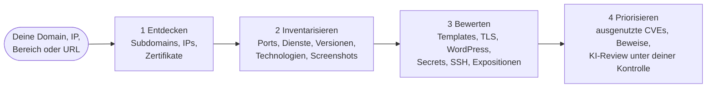

<p align="center">
  
</p>

<h3 align="center">Die fortschrittlichste Plattform zur Bewertung externer Angriffsflächen.</h3>

<p align="center">Entdecke die Assets, die du exponierst, und mappe sie in einem Inventar im Shodan-Stil.</p>

<p align="center">Bewerte jeden Host mit branchenüblichen Scannern und behebe zuerst, was wirklich zählt.</p>

<p align="center">
  <a href="CHANGELOG.md"></a>
  <a href="LICENSE"></a>
  
</p>

<p align="center">
  
</p>

<p align="center"><sub>cvENGINE 1.4.1 mit Demo-Daten.</sub></p>

---

**cvENGINE beobachtet die CVE-Feeds rund um die Uhr und zeigt dir mit Beweisen, welche neuen CVEs tatsächlich deine Hosts erreichen.**

### Jeder neue CVE, gegen deine Hosts geprüft

1. **Beobachte die Feeds.** Neue CVEs und frische Exploit-Nachrichten kommen den ganzen Tag aus den Quellen, die zählen.
2. **Finde, wer exponiert ist.** Jeder CVE wird mit den Hosts abgeglichen, die das betroffene Produkt in der betroffenen Version ausführen.
3. **Schreibe den Check.** Wenn kein geprüfter Check existiert, entwirft deine KI einen schreibgeschützten, den cvENGINE zuerst validiert.
4. **Beweise es auf deinen Hosts.** Ein Sentinel reproduziert jeden Treffer mit einem schreibgeschützten Check und behält den Beweis.
5. **Schneide das Rauschen ab.** Die KI prüft die Beweise: Echtes steigt auf, wahrscheinliche Fehlalarme sinken ab.

**Bring deine eigene KI mit:** Anthropic, OpenAI oder OpenRouter mit deinem eigenen Schlüssel, oder komplett lokal mit Ollama, LM Studio oder vLLM. Sie ist aus, bis du sie einschaltest, und sie schließt niemals einen Fund, den ein Check bewiesen hat. Ohne Modell entdeckt, scannt, matcht und validiert cvENGINE trotzdem.

<details>
<summary><b>Wie es genau funktioniert</b></summary>

- **Feeds.** Der [cve.now](https://cve.now)-Feed wird alle 30 Minuten gelesen. CISA KEV, ENISA EUVD, FIRST EPSS, Exploit-DB, Metasploit und, mit Schlüssel, VulnCheck KEV werden stündlich gelesen – ein CVE, der ausgebeutet wird, wird also innerhalb einer Stunde hot.
- **Matching.** Ein CVE wird nur dann zum Treffer, wenn ein Host dasselbe Produkt in einer Version innerhalb eines begrenzten betroffenen Bereichs ausführt. Ein Produkt ohne Version erzeugt nie einen Treffer.
- **KI-geschriebene Checks.** Für heiße CVEs liest die KI innerhalb eines Tagesbudgets die Advisory und notiert, wie sie zu erkennen ist. Wenn kein geprüftes Nuclei-Template existiert, kann sie ein schreibgeschütztes entwerfen, das erst nach Validierung durch das System auf einem Host läuft: Syntax und ein harmloser Loopback-Test auf einem Sentinel, ein Offline-Test gegen eine betroffene und eine gepatchte Antwort sowie ein zweiter KI-Durchgang. Das wird ausgeschaltet ausgeliefert: Ein Administrator aktiviert **KI-geschriebene Checks automatisch validieren**.
- **Beweis.** Alle fünf Minuten werden bis zu 20 Treffer, zuerst die fire, auf einem Sentinel mit einem von sechs schreibgeschützten Checks reproduziert: ein geprüftes Nuclei-Template, `nmap -sV` auf dem einen Port, eine Versions-Banner-Anfrage, der Check ohne Zugangsdaten für Datenbanken, eine Versions- und Identitätssonde oder ein JavaScript-Bibliotheks-Read. Befehl und Ergebnis werden exakt festgehalten. Ein Check, der einen Fund nicht reproduziert, stuft ihn nie herab.
- **Triage.** CVE-Treffer, Scanner-Funde, offene Datenbanken, offene Admin-Routen, Routen mit exponierten Zugangsdaten und Hygiene-Funde mittlerer oder schlechterer Schwere werden als confirmed, likely, needs validation, likely false positive oder not applicable eingestuft, innerhalb von Tageslimits (standardmäßig 500 pro Projekt und 2.000 insgesamt).
- **KI-Reviewer.** Liest jeden offenen Fund einmal, standardmäßig bis zu 300 pro Tag, und notiert, ob er echt ist. Einen Fehlalarm schließt er nur, wenn du es erlaubst, und nur wenn der Fund keine harten Beweise hat und keine Person daran gearbeitet hat.
- **Untergrenzen.** Harte Beweise setzen eine Untergrenze, die das Modell nicht unterschreiten kann: Ein Template-Treffer, eine antwortende Datenbank oder ein Validierungstreffer ist confirmed, und eine Version im betroffenen Bereich ist mindestens needs validation. Das Modell allein kann einen Fund niemals bestätigen.
- **Deine KI, deine Kontrolle.** Für Triage und Review sieht das Modell strukturierte Beweise mit geschwärzten Hostnamen, es hat keine Werkzeuge, und der Server prüft jede Antwort, bevor sie zählt. Die KI-Jobs haben Tageslimits, und die Nutzungsseite zeigt Aufrufe, Tokens und Kostenschätzungen. Der KI-Reviewer, KI-geschriebene Checks und Auto-Fire (KI-Bestätigung und -Tests, sobald ein neuer heißer CVE landet) werden ausgeschaltet ausgeliefert.

Mehr in [Pipeline](docs/PIPELINE.md#triage-and-validation), [CVE-Intelligenz](docs/PIPELINE.md#cve-intelligence) und [KI-Reviewer](docs/AI-REVIEWER.md).

</details>

### Wisse, was du alles exponierst

cvENGINE ist eine selbst gehostete Plattform zur Bewertung externer Angriffsflächen und Schwachstellen. Gib ihr deine Domains, und sie entdeckt fortlaufend die Subdomains, Adressen und Zertifikate, die du exponierst – in einem durchsuchbaren Inventar im Shodan-Stil mit jedem Host, Port, Dienst, jeder Technologie und jedem Zertifikat. Vergessene und Schatten-Assets kommen ans Licht, und neue Hosts, geöffnete Ports und Versionsänderungen landen auf einer Timeline, sobald ein Scan sie sieht. Jeder Host wird mit branchenüblichen Open-Source-Scannern bewertet, und [Situations](docs/SITUATIONS.md) ordnet, was zuerst zu beheben ist: Beweis vor Wahrscheinlichkeit, bekannte Ausnutzung vor bloßer Schwere.

## cvENGINE 1.4.0 ist da

| | |
| --- | --- |
| **Scanne von überall, wo du es brauchst** | Du entscheidest, wo gescannt wird: auf deinem Server mit dem eingebauten Scanner, der jeder Installation im eigenen Container beiliegt; auf entfernten [Sentinels](docs/SENTINELS.md), die du überall platzierst – in anderen Clouds oder Regionen oder in privaten Netzwerken, um interne Assets zu erreichen; oder beides. Füge Sentinels hinzu, um zu skalieren. |
| **KI, die Fehlalarme reduziert** | Der neue KI-Reviewer in seinem eigenen abgeschotteten Container liest jeden offenen Fund einmal (bis zu einem Tageslimit) und notiert, ob er echt ist; KI-geschriebene Checks werden vor der Ausführung vom System validiert – auch auf deinen eigenen Sentinels. Beides bleibt aus, bis du es einschaltest. |
| **Einrichtung im Browser** | `install.sh` ist nur ein schlanker Bootstrap. Ein [Setup-Assistent](docs/DEPLOYMENT.md#setup-wizard) nimmt Organisation, Projekt und erste Domain entgegen, und die Erkennung beginnt sofort. |
| **Was dich braucht, sortiert** | [Situations](docs/SITUATIONS.md) listet die Hosts auf, die einen Menschen brauchen – die dringendsten zuerst. Funde, die ein Check reproduziert hat, zeigen ihren Beweis zuerst, und ein als behoben markierter Fund wird erneut geprüft. |
| **Exponierte Secrets und SSH** | Ein von Kingfisher gespeistes Projekt-Secrets-Inventar und SSH-Inspektion mit sshamble, das Host-Keys gegen eine Liste bekannter schlechter Keys prüft und sich nie einloggt. |
| **Nichts schaltet sich unbemerkt ein** | Credential-Checks, der KI-Reviewer und alles andere, was Geld kostet oder einen Scan ausweitet, bleiben aus, bis ein Administrator Ja sagt. API-Tokens und KI-Agenten können sie nicht einschalten. |
| **Läuft von selbst** | Ein [Watchdog](docs/WATCHDOG.md) repariert hängende Worker, Auto-Tuning prüft jede eigene Änderung und macht Schädliches rückgängig, und du kannst über einen [Cloudflare Tunnel](docs/HOSTING-ONLINE.md) ohne eingehenden Port veröffentlichen. |

Upgrade von 1.3? Lies zuerst [Upgrade auf 1.4](docs/UPGRADE.md#upgrading-to-14) und die [Betreiber-Notizen](docs/1.4-OPERATOR-NOTES.md): sichern, freien Speicher prüfen und deine Sentinels aktualisieren. Alle Änderungen stehen im [Changelog](CHANGELOG.md).

## Von der Domain zum Urteil



1. **Entdecken.** Richte cvENGINE auf eine Domain, und es findet die Subdomains, Adressen und Zertifikate, die dir gehören, beobachtet weiter die Zertifikatstransparenz und wiederholt jede Woche einen Tiefen-Sweep.
2. **Inventarisieren.** Jeder Host, offene Port, Dienst, jede Produktversion, Technologie, jedes Zertifikat und jede Startseite landet in einem Inventar, das du [wie Shodan durchsuchen](docs/SEARCH.md) kannst: `port:3389 -host:vpn`, `tech:"apache tomcat" sev:high`. Neue Hosts, geöffnete Ports und Versionsänderungen landen auf einer Timeline.
3. **Bewerten.** Jeder Host wird mit branchenüblichen Scannern und cvENGINEs eigenen schreibgeschützten Checks getestet, und ein CVE wird nur dann einem Host zugeordnet, wenn das Produkt identisch ist und die Version in den betroffenen Bereich fällt.
4. **Priorisieren.** Jeder CVE wird anhand echter Ausbeutungsdaten als [fire, smoke oder ice](docs/FIRE-SMOKE-ICE.md) eingestuft, jeder Host erhält einen Score von 0 bis 100, und das KI-Triage sortiert Funde, wenn du es einschaltest, in confirmed, likely oder needs validation. Die KI schließt niemals einen Fund, den ein Check bewiesen hat.

Das Scannen läuft dort, wo du es wählst: im eingebauten Scanner auf deinem Server, auf [Sentinels](docs/SENTINELS.md), die du woanders platzierst, oder beides. Die [Pipeline](docs/PIPELINE.md) beschreibt jede Stufe.

## Die Werkzeuge dahinter

cvENGINE führt die besten Open-Source-Sicherheitswerkzeuge aus. Das Scanner-Image pinnt jedes installierte Werkzeug auf eine exakte Version, und die Pins werden vor jedem Release geprüft. Die About-Seite deiner Installation listet sie mit Versionen, und [THIRD-PARTY.md](THIRD-PARTY.md) nennt jede Lizenz.

| Stufe | Werkzeug | Wofür cvENGINE es nutzt |
| --- | --- | --- |
| **Entdeckung** | [bbot](https://github.com/blacklanternsecurity/bbot) | Subdomain-, Adress- und Asset-Entdeckung, live ins Inventar gestreamt |
| | [baddns](https://github.com/blacklanternsecurity/baddns) | Kandidaten für hängende DNS-Einträge und Subdomain-Übernahmen, läuft in bbot |
| | [crt.sh](https://crt.sh) | Zertifikatstransparenz-Abfragen, die neue Namen zwischen Scans fangen |
| **Inventar und Fingerprinting** | [naabu](https://github.com/projectdiscovery/naabu) | Ein Sweep aller 65.535 TCP-Ports jeder Adresse |
| | [Nmap](https://nmap.org) | Dienst-, Versions- und OS-Fingerprints, geprüfte Skripte und ein langsamer UDP-Expositionsscan |
| | [Nuclei](https://github.com/projectdiscovery/nuclei) | Ein Technologie-Durchgang, der benennt, was jeder Web-Host ausführt |
| | [wafw00f](https://github.com/EnableSecurity/wafw00f) | Benennt die Web Application Firewall vor einer Seite |
| | [Playwright](https://playwright.dev) mit headless Chromium | Screenshots jeder Webseite, die ein Host ausliefert |
| | [gowitness](https://github.com/sensepost/gowitness) | Startseiten-Screenshots während der Entdeckung, von bbot installiert |
| | [aardwolf](https://github.com/skelsec/aardwolf) | Der Login-Screen-Screenshot eines RDP-Servers, der ihn ohne Zugangsdaten erlaubt |
| **Bewertung** | [Nuclei](https://github.com/projectdiscovery/nuclei) und [nuclei-templates](https://github.com/projectdiscovery/nuclei-templates) | Die Community-Template-Bibliothek, KI-gesteuerte Durchgänge und CVE-spezifische Checks; DoS- und Credential-Templates sind standardmäßig ausgeschlossen |
| | [testssl.sh](https://github.com/testssl/testssl.sh) | Protokolle, Cipher und die benannten TLS-Schwachstellen auf jedem TLS-Port |
| | [WPScan](https://github.com/wpscanteam/wpscan) | Schwachstellen in WordPress-Core, Plugins und Themes (füge ein [wpscan.com](https://wpscan.com/)-Token für Schwachstellendaten hinzu) |
| | [Kingfisher](https://github.com/mongodb/kingfisher) | API-Schlüssel, Tokens und private Schlüssel, die deine Seiten und Skripte ausliefern, in einem Secrets-Inventar |
| | [sshamble](https://github.com/runZeroInc/sshamble) | SSH-Handshake und Host-Keys, gegen die [badkeys](https://badkeys.info)-Blockliste geprüft; loggt sich nie ein |
| | [node2shell-Detektor](https://github.com/assetnote/node2shell-scanner) | Assetnotes schreibgeschützter Check für CVE-2026-111497; standardmäßig aus |
| | cvENGINEs eigene Checks | Exponierte Datenbanken, öffentlicher und hängender Cloud-Speicher (S3, Google Cloud Storage, Azure Blob), Web-Routen und ihr Anmeldestatus, Versionssonden sowie DNS- und E-Mail-Hygiene auf Basis von [MailFail](https://github.com/ACK-J/MailFail) |
| **Exploit-Intelligenz** | [cve.now](https://cve.now), [CISA KEV](https://www.cisa.gov/known-exploited-vulnerabilities-catalog), [ENISA EUVD](https://euvd.enisa.europa.eu/), [VulnCheck KEV](https://vulncheck.com), [FIRST EPSS](https://www.first.org/epss/), [Exploit-DB](https://gitlab.com/exploit-database/exploitdb), [Metasploit](https://github.com/rapid7/metasploit-framework), [CVE List V5](https://github.com/CVEProject/cvelistV5), [OSV](https://osv.dev), [Debian-Sicherheits-Tracker](https://security-tracker.debian.org) | Welche CVEs heute ausgenutzt werden und welche Fixes eine Distribution backportiert hat |
| **Optionale Add-ons** | [OpenVAS](https://greenbone.github.io/docs/latest/) (Greenbone Community Edition) | Ein zweiter Netzwerk-Schwachstellenscanner auf einem Sentinel, für deine heißesten Hosts. Standardmäßig aus ([OpenVAS](docs/OPENVAS.md)) |
| | [Tailscale](https://github.com/tailscale/tailscale) | Optional: einem Tailnet beitreten, dessen Geräte importieren und scannen und die Konfiguration prüfen ([Tailscale](docs/TAILSCALE.md)) |
| | [runZero](https://www.runzero.com) | Optional: ein geplanter Sync der runZero-Asset-Daten mit deinem eigenen Token ([Konfiguration](docs/CONFIGURATION.md#runzero)) |
| | bbots Key-Quellen | Optional: Shodan, Censys, VirusTotal, SecurityTrails, GitHub, Chaos und mehr, mit deinen eigenen API-Schlüsseln ([Konfiguration](docs/CONFIGURATION.md#api-keys)) |
| **KI (bring deine eigene mit, aus bis du wählst)** | [Anthropic](https://www.anthropic.com), [OpenAI](https://openai.com), [OpenRouter](https://openrouter.ai), [Ollama](https://github.com/ollama/ollama), [LM Studio](https://lmstudio.ai), [vLLM](https://github.com/vllm-project/vllm) | Fund-Triage, Nuclei-Zielauswahl und der [KI-Reviewer](docs/AI-REVIEWER.md) im eigenen Container. Ohne Modell entdeckt, scannt und matcht cvENGINE weiter |
| | [Model Context Protocol](https://modelcontextprotocol.io) | Ein MCP-Server und eine REST-API für deine eigenen Agenten ([Agent API](docs/AGENT-API.md)) |

## In Minuten installiert

Du brauchst einen Linux-Server (Debian oder Ubuntu ist am einfachsten) mit mindestens 4 GB RAM (8 GB für Komfort) und 20 GB freiem Speicher.

```bash
git clone https://github.com/hevnsnt/CVEngine.git
cd CVEngine
sudo ./install.sh
```

Der Installer ergänzt, was fehlt, erzeugt alle Secrets, erstellt das HTTPS-Zertifikat, startet cvENGINE mit dem eingebauten Scanner und zeigt die Adresse sowie den Ort deines generierten Admin-Passworts an. Melde dich an, und der Setup-Assistent erledigt den Rest. Automatisierung kann `--sentinels=internal|both|external` und `-n` übergeben. OpenVAS wird von ihm nie installiert. Dein Browser warnt vor dem privaten Zertifikat, bis du `secrets/certs/ca.crt` vertraust.

Ein öffentlicher Name mit vertrauenswürdigem Zertifikat, ein Cloudflare Tunnel, Mac und Windows: siehe [Deployment](docs/DEPLOYMENT.md) und [Hosting online](docs/HOSTING-ONLINE.md).

## Sicher durch Design

- **Standardmäßig schreibgeschützt.** Keine Passwortlisten. Checks, die Zugangsdaten senden (Nucleis Default-Login- und Brute-Force-Templates), sind aus, bis ein App-Admin sie erlaubt, und DoS-Templates sind ausgeschlossen.
- **Du ziehst die Linien.** Loopback-, Link-Local- und Cloud-Metadaten-Adressen werden nie gescannt, und jede Organisation führt eine Liste mit [Adressen, die wir niemals scannen dürfen](docs/1.4-OPERATOR-NOTES.md#addresses-we-must-never-scan), die jeden Namen enthält, der dorthin führt.
- **Du hältst die Schalter.** KI-Validierung, KI-Reviewer, OpenVAS und alles andere, was Geld kostet, starten ausgeschaltet, und ein Update fragt, bevor es sie ändert.
- **Abgeschottet.** Organisationsdaten sind isoliert, gespeicherte Secrets verschlüsselt, und der Zugriff wird durch Zwei-Schritt-Anmeldung, eine IP-Allowlist und ein Audit-Log geschützt.

Scanne nur Systeme, die dir gehören oder die du testen darfst.

## Dokumentation

| Doc | Was sie abdeckt |
| --- | --- |
| [Deployment](docs/DEPLOYMENT.md) und [Hosting online](docs/HOSTING-ONLINE.md) | Installation, HTTPS, Cloudflare, Backups, kleine Hosts |
| [Updates](docs/UPDATES.md), [Upgrade](docs/UPGRADE.md) und [1.4-Betreiber-Notizen](docs/1.4-OPERATOR-NOTES.md) | Aktuell bleiben und was 1.4 für einen Betreiber ändert |
| [Sentinels](docs/SENTINELS.md) und [eingebauter Scanner](docs/BUILTIN-SCANNER.md) | Wo jeder Scan läuft, Skalierung und Scannen privater Netzwerke |
| [Pipeline](docs/PIPELINE.md) und [Architektur](docs/ARCHITECTURE.md) | Wie es funktioniert, Stufe für Stufe |
| [Search](docs/SEARCH.md), [Situations](docs/SITUATIONS.md) und [Fire, smoke und ice](docs/FIRE-SMOKE-ICE.md) | Finden, was zählt, und wie CVEs bewertet werden |
| [Konfiguration](docs/CONFIGURATION.md) | Jede Einstellung |
| [KI-Reviewer](docs/AI-REVIEWER.md), [KI-Nutzung](docs/AI-USAGE.md) und [Secrets](docs/SECRETS-PLAN.md) | Der abgeschottete Reviewer, KI-Kosten und das Inventar exponierter Secrets |
| [OpenVAS](docs/OPENVAS.md) und [Tailscale](docs/TAILSCALE.md) | Die optionalen Add-ons |
| [Tenancy](docs/TENANCY.md), [Agent API](docs/AGENT-API.md) und [Host-Inventar](docs/HOST-INVENTORY.md) | Teams und Rollen, die REST-API und MCP sowie Hosts, die ihre eigenen Pakete melden |
| [Bug-Bounty](docs/BUG-BOUNTY.md), [Watchdog](docs/WATCHDOG.md) und [Frontend](docs/FRONTEND.md) | Die Bounty-Werkbank, Selbstreparatur und die Oberfläche |

## Beitragen und Sicherheit

Issues und Pull Requests sind willkommen: siehe [CONTRIBUTING](.github/CONTRIBUTING.md). Bitte melde Schwachstellen privat über den **Security**-Tab des Repos, wie es die [Sicherheitsrichtlinie](.github/SECURITY.md) erklärt.

## Credits und Lizenz

cvENGINE ist ein Fork von [reNgine](https://github.com/yogeshojha/rengine) 2.x von Yogesh Ojha und Mitwirkenden und baut auf den obigen Projekten auf. Der Sentinel-Client lebt in [hevnsnt/cvENGINE-sentinel](https://github.com/hevnsnt/cvENGINE-sentinel). Danke an unsere Beta-Tester, vor allem an [camstork](https://github.com/camstork), dessen sorgfältige Berichte 1.3 geprägt haben. Siehe [Changelog](CHANGELOG.md), [Mitwirkende](CONTRIBUTORS.md) und [Drittanbieter-Software](THIRD-PARTY.md).

„Shodan-Stil" beschreibt die Art der Suche; cvENGINE ist nicht mit Shodan verbunden.

Veröffentlicht unter GPL-3.0. Siehe [LICENSE](LICENSE).

[](https://m8ven.ai/mcp/hevnsnt-cvengine-s24yvi?s=readme)
