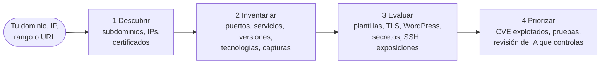

<p align="center">
  
</p>

<h3 align="center">La plataforma de evaluación de superficie de ataque externa más avanzada.</h3>

<p align="center">Descubre los activos que expones y mapéalos en un inventario estilo Shodan.</p>

<p align="center">Evalúa cada host con escáneres estándar del sector y arregla primero lo que importa.</p>

<p align="center">
  <a href="CHANGELOG.md"></a>
  <a href="LICENSE"></a>
  
</p>

<p align="center">
  
</p>

<p align="center"><sub>cvENGINE 1.4.1 con datos de demostración.</sub></p>

---

**cvENGINE vigila los feeds de CVE las 24 horas y te muestra, con pruebas, qué nuevos CVE llegan realmente a tus hosts.**

### Cada CVE nuevo, comprobado contra tus hosts

1. **Vigila los feeds.** Los nuevos CVE y las noticias frescas de explotación llegan todo el día desde las fuentes que importan.
2. **Encuentra quién está expuesto.** Cada CVE se empareja con los hosts que ejecutan el producto y la versión afectados.
3. **Escribe la comprobación.** Cuando no existe una comprobación validada, tu IA redacta una de solo lectura que cvENGINE valida primero.
4. **Demuéstralo en tus hosts.** Un Sentinel reproduce cada coincidencia con una comprobación de solo lectura y conserva la evidencia.
5. **Reduce el ruido.** La IA revisa la evidencia: lo real sube y los probables falsos positivos bajan.

**Trae tu propia IA:** Anthropic, OpenAI u OpenRouter con tu propia clave, o totalmente local con Ollama, LM Studio o vLLM. Está apagada hasta que la enciendes, y nunca cierra un hallazgo que una comprobación demostró. Sin modelo, cvENGINE sigue descubriendo, escaneando, emparejando y validando.

<details>
<summary><b>Cómo funciona, exactamente</b></summary>

- **Feeds.** El feed de [cve.now](https://cve.now) se lee cada 30 minutos. CISA KEV, ENISA EUVD, FIRST EPSS, Exploit-DB, Metasploit y, con clave, VulnCheck KEV se leen cada hora, de modo que un CVE que pasa a ser explotado se vuelve hot en el plazo de una hora.
- **Emparejamiento.** Un CVE solo se convierte en coincidencia cuando un host ejecuta el mismo producto en una versión dentro de un rango afectado acotado. Un producto visto sin versión nunca genera una coincidencia.
- **Comprobaciones que escribe la IA.** Para CVE hot, dentro de un presupuesto diario, la IA lee el aviso y registra cómo detectarlo. Cuando no existe una plantilla Nuclei validada puede redactar una de solo lectura, que se ejecuta en un host solo después de que el sistema la haya validado: sintaxis y un control inofensivo de loopback en un Sentinel, una prueba sin conexión contra una respuesta afectada y una corregida, y una segunda pasada de IA. Esto se entrega apagado: un administrador activa **Validar automáticamente las comprobaciones escritas por IA**.
- **Prueba.** Cada cinco minutos, hasta 20 coincidencias, primero las fire, se reproducen en un Sentinel con una de seis comprobaciones de solo lectura: una plantilla Nuclei validada, `nmap -sV` en el puerto único, una petición de banner de versión, la comprobación de base de datos sin credenciales, una sonda de versión e identidad, o una lectura de biblioteca JavaScript. Se conservan el comando y el resultado exactos. Una comprobación que no reproduce un hallazgo nunca lo rebaja.
- **Triage.** Las coincidencias CVE, los hallazgos del escáner, las bases de datos abiertas, las rutas de administración abiertas, las rutas que exponen credenciales y los hallazgos de higiene de severidad media o peor se califican como confirmed, likely, needs validation, likely false positive o not applicable, dentro de límites diarios (por defecto 500 por proyecto y 2.000 en total).
- **Revisor de IA.** Lee cada hallazgo abierto una vez, hasta 300 al día por defecto, y registra si es real. Solo cierra un falso positivo cuando tú lo permites y solo cuando el hallazgo no tiene evidencia dura y ninguna persona lo ha trabajado.
- **Suelos.** La evidencia dura fija un suelo que el modelo no puede bajar: un acierto de plantilla, una base de datos que respondió o un acierto de validación es confirmed, y una versión dentro del rango afectado es al menos needs validation. El modelo por sí solo nunca puede confirmar un hallazgo.
- **Tu IA, tus controles.** Para el triage y la revisión, el modelo ve evidencia estructurada con nombres de host redactados, no tiene herramientas y el servidor comprueba cada respuesta antes de que cuente. Los trabajos de IA tienen límites diarios y la página de uso muestra llamadas, tokens y estimaciones de coste. El revisor de IA, las comprobaciones escritas por IA y el auto-fire (confirmación y pruebas de IA en cuanto aterriza un CVE hot nuevo) se entregan apagados.

Más en [Pipeline](docs/PIPELINE.md#triage-and-validation), [Inteligencia CVE](docs/PIPELINE.md#cve-intelligence) y [Revisor de IA](docs/AI-REVIEWER.md).

</details>

### Conoce todo lo que expones

cvENGINE es una plataforma autoalojada de evaluación de superficie de ataque externa y vulnerabilidades. Dale tus dominios y seguirá descubriendo los subdominios, direcciones y certificados que expones, en un inventario buscable estilo Shodan de cada host, puerto, servicio, tecnología y certificado. Los activos olvidados y en sombra salen a la luz, y los hosts nuevos, los puertos abiertos y los cambios de versión aterrizan en una línea de tiempo en cuanto un escaneo los ve. Cada host se evalúa con escáneres de código abierto estándar del sector, y [Situations](docs/SITUATIONS.md) ordena qué arreglar primero: la prueba antes que la probabilidad, lo explotado conocido antes que la severidad por sí sola.

## cvENGINE 1.4.0 está aquí

| | |
| --- | --- |
| **Escanea desde donde lo necesites** | Tú eliges dónde ocurre el escaneo: en tu servidor, con el escáner integrado que acompaña a cada instalación en su propio contenedor; en [Sentinels](docs/SENTINELS.md) remotos que colocas en cualquier lugar, en otras nubes o regiones o dentro de redes privadas para alcanzar activos internos; o ambos. Añade Sentinels para escalar. |
| **IA que reduce falsos positivos** | El nuevo revisor de IA, en su propio contenedor aislado, lee cada hallazgo abierto una vez (hasta un límite diario) y registra si es real, y las comprobaciones escritas por IA son validadas por el sistema antes de ejecutarse, también en tus propios Sentinels. Ambos permanecen apagados hasta que los enciendes. |
| **Configuración en el navegador** | `install.sh` es un arranque fino. Un [asistente de configuración](docs/DEPLOYMENT.md#setup-wizard) toma tu organización, proyecto y primer dominio, y el descubrimiento empieza de inmediato. |
| **Lo que te necesita, ordenado** | [Situations](docs/SITUATIONS.md) lista los hosts que necesitan a una persona, lo más urgente primero. Los hallazgos que una comprobación reprodujo muestran su prueba primero, y un hallazgo marcado como corregido se comprueba de nuevo. |
| **Secretos expuestos y SSH** | Un inventario de secretos del proyecto alimentado por Kingfisher, e inspección SSH con sshamble que comprueba las claves de host contra una lista de claves malas conocidas y nunca inicia sesión. |
| **Nada se enciende sin que lo veas** | Las comprobaciones de credenciales, el revisor de IA y cualquier otra cosa que cueste dinero o amplíe un escaneo permanecen apagadas hasta que un administrador dice sí. Los tokens de API y los agentes de IA no pueden encenderlas. |
| **Funciona solo** | Un [watchdog](docs/WATCHDOG.md) repara trabajadores atascados, el auto-tuning comprueba cada cambio que hace y deshace lo que dolió, y puedes publicar a través de un [Cloudflare Tunnel](docs/HOSTING-ONLINE.md) sin puerto entrante. |

¿Actualizas desde 1.3? Lee primero [actualizar a 1.4](docs/UPGRADE.md#upgrading-to-14) y las [notas del operador](docs/1.4-OPERATOR-NOTES.md): haz copia de seguridad, comprueba el disco libre y actualiza tus Sentinels. Todos los cambios están en el [changelog](CHANGELOG.md).

## Del dominio al veredicto



1. **Descubrir.** Apunta cvENGINE a un dominio y encontrará los subdominios, direcciones y certificados que te pertenecen, seguirá vigilando la transparencia de certificados y repetirá un barrido profundo cada semana.
2. **Inventariar.** Cada host, puerto abierto, servicio, versión de producto, tecnología, certificado y página de inicio entra en un inventario que puedes [buscar como Shodan](docs/SEARCH.md): `port:3389 -host:vpn`, `tech:"apache tomcat" sev:high`. Los hosts nuevos, los puertos abiertos y los cambios de versión aterrizan en una línea de tiempo.
3. **Evaluar.** Cada host se prueba con escáneres estándar del sector y las comprobaciones de solo lectura propias de cvENGINE, y un CVE se empareja con un host solo cuando el producto es el mismo y su versión cae dentro del rango afectado.
4. **Priorizar.** Cada CVE se califica [fire, smoke o ice](docs/FIRE-SMOKE-ICE.md) a partir de datos reales de explotación, cada host recibe una puntuación de 0 a 100, y el triage de IA, cuando lo enciendes, ordena los hallazgos en confirmed, likely o needs validation. La IA nunca cierra un hallazgo que una comprobación demostró.

El escaneo se ejecuta donde elijas: en el escáner integrado de tu servidor, en [Sentinels](docs/SENTINELS.md) que colocas en otro lugar, o ambos. El [pipeline](docs/PIPELINE.md) describe cada etapa.

## Las herramientas que hay detrás

cvENGINE ejecuta las mejores herramientas de seguridad de código abierto. La imagen del escáner fija cada herramienta que instala a una versión exacta, y las fijaciones se comprueban antes de cada lanzamiento. La página About de tu instalación las lista con sus versiones, y [THIRD-PARTY.md](THIRD-PARTY.md) da cada licencia.

| Etapa | Herramienta | Para qué la usa cvENGINE |
| --- | --- | --- |
| **Descubrimiento** | [bbot](https://github.com/blacklanternsecurity/bbot) | Descubrimiento de subdominios, direcciones y activos, transmitido al inventario mientras se ejecuta |
| | [baddns](https://github.com/blacklanternsecurity/baddns) | Candidatos de DNS colgante y toma de subdominios, ejecutado dentro de bbot |
| | [crt.sh](https://crt.sh) | Consultas de transparencia de certificados que captan nombres nuevos entre escaneos |
| **Inventario y huella digital** | [naabu](https://github.com/projectdiscovery/naabu) | Un barrido de los 65.535 puertos TCP de cada dirección |
| | [Nmap](https://nmap.org) | Huellas de servicio, versión y SO, scripts revisados y un escaneo lento de exposición UDP |
| | [Nuclei](https://github.com/projectdiscovery/nuclei) | Un pase de tecnología que nombra lo que ejecuta cada host web |
| | [wafw00f](https://github.com/EnableSecurity/wafw00f) | Nombra el cortafuegos de aplicaciones web delante de un sitio |
| | [Playwright](https://playwright.dev) con Chromium sin cabeza | Capturas de cada página web que sirve un host |
| | [gowitness](https://github.com/sensepost/gowitness) | Capturas de la portada durante el descubrimiento, instalado por bbot |
| | [aardwolf](https://github.com/skelsec/aardwolf) | La captura de la pantalla de inicio de sesión de un servidor RDP que la permite sin credenciales |
| **Evaluación** | [Nuclei](https://github.com/projectdiscovery/nuclei) y [nuclei-templates](https://github.com/projectdiscovery/nuclei-templates) | La biblioteca de plantillas de la comunidad, pases dirigidos por IA y comprobaciones por CVE; las plantillas de denegación de servicio y de credenciales se excluyen por defecto |
| | [testssl.sh](https://github.com/testssl/testssl.sh) | Protocolos, cifrados y las vulnerabilidades TLS nombradas en cada puerto TLS |
| | [WPScan](https://github.com/wpscanteam/wpscan) | Vulnerabilidades de núcleo, plugins y temas de WordPress (añade un token de [wpscan.com](https://wpscan.com/) para sus datos de vulnerabilidades) |
| | [Kingfisher](https://github.com/mongodb/kingfisher) | Claves de API, tokens y claves privadas que sirven tus páginas y scripts, guardados en un inventario de Secretos |
| | [sshamble](https://github.com/runZeroInc/sshamble) | Handshake SSH y claves de host, comprobadas contra la lista de bloqueo [badkeys](https://badkeys.info); nunca inicia sesión |
| | [detector node2shell](https://github.com/assetnote/node2shell-scanner) | La comprobación de solo lectura de Assetnote para CVE-2026-111497; apagada por defecto |
| | Comprobaciones propias de cvENGINE | Bases de datos expuestas, almacenamiento en la nube público y colgante (S3, Google Cloud Storage, Azure Blob), rutas web y su estado de inicio de sesión, sondas de versión, e higiene de DNS y correo basada en [MailFail](https://github.com/ACK-J/MailFail) |
| **Inteligencia de explotación** | [cve.now](https://cve.now), [CISA KEV](https://www.cisa.gov/known-exploited-vulnerabilities-catalog), [ENISA EUVD](https://euvd.enisa.europa.eu/), [VulnCheck KEV](https://vulncheck.com), [FIRST EPSS](https://www.first.org/epss/), [Exploit-DB](https://gitlab.com/exploit-database/exploitdb), [Metasploit](https://github.com/rapid7/metasploit-framework), [CVE List V5](https://github.com/CVEProject/cvelistV5), [OSV](https://osv.dev), [rastreador de seguridad de Debian](https://security-tracker.debian.org) | Qué CVE se explotan hoy y qué arreglos ha backporteado una distribución |
| **Complementos opcionales** | [OpenVAS](https://greenbone.github.io/docs/latest/) (Greenbone Community Edition) | Un segundo escáner de vulnerabilidades de red en un Sentinel, para tus hosts más calientes. Apagado por defecto ([OpenVAS](docs/OPENVAS.md)) |
| | [Tailscale](https://github.com/tailscale/tailscale) | Opcional: únete a una tailnet, importa y escanea sus dispositivos y comprueba su configuración ([Tailscale](docs/TAILSCALE.md)) |
| | [runZero](https://www.runzero.com) | Opcional: una sincronización programada de los datos de activos de runZero con tu propio token ([Configuración](docs/CONFIGURATION.md#runzero)) |
| | Fuentes con clave de bbot | Opcional: Shodan, Censys, VirusTotal, SecurityTrails, GitHub, Chaos y más, con tus propias claves de API ([Configuración](docs/CONFIGURATION.md#api-keys)) |
| **IA (trae la tuya, apagada hasta que elijas)** | [Anthropic](https://www.anthropic.com), [OpenAI](https://openai.com), [OpenRouter](https://openrouter.ai), [Ollama](https://github.com/ollama/ollama), [LM Studio](https://lmstudio.ai), [vLLM](https://github.com/vllm-project/vllm) | Triage de hallazgos, orientación de Nuclei y el [revisor de IA](docs/AI-REVIEWER.md) en su propio contenedor. Sin modelo, cvENGINE sigue descubriendo, escaneando y emparejando |
| | [Model Context Protocol](https://modelcontextprotocol.io) | Un servidor MCP y una API REST para tus propios agentes ([Agent API](docs/AGENT-API.md)) |

## Instala en minutos

Necesitas un servidor Linux (Debian o Ubuntu es lo más fácil) con al menos 4 GB de RAM (8 GB para ir cómodo) y 20 GB de disco libre.

```bash
git clone https://github.com/hevnsnt/CVEngine.git
cd CVEngine
sudo ./install.sh
```

El instalador añade lo que falta, genera todos los secretos, crea el certificado HTTPS, inicia cvENGINE con su escáner integrado e imprime la dirección y dónde está tu contraseña de administrador generada. Inicia sesión y el asistente de configuración hace el resto. La automatización puede pasar `--sentinels=internal|both|external` y `-n`. Nunca instala OpenVAS. Tu navegador avisará del certificado privado hasta que confíes en `secrets/certs/ca.crt`.

Un nombre público con un certificado de confianza, un Cloudflare Tunnel, Mac y Windows: consulta [Deployment](docs/DEPLOYMENT.md) y [Hosting online](docs/HOSTING-ONLINE.md).

## Seguro por diseño

- **Solo lectura por defecto.** Sin listas de contraseñas. Las comprobaciones que envían credenciales (plantillas de login por defecto y fuerza bruta de Nuclei) están apagadas hasta que un App Admin las permite, y las plantillas de denegación de servicio se excluyen.
- **Tú trazas las líneas.** Las direcciones de loopback, link-local y de metadatos de nube nunca se escanean, y cada organización mantiene una lista de [direcciones que nunca debemos escanear](docs/1.4-OPERATOR-NOTES.md#addresses-we-must-never-scan) que recoge cualquier nombre que lleve allí.
- **Tú sujetas los interruptores.** La validación de IA, el revisor de IA, OpenVAS y cualquier otra cosa que cueste dinero empiezan apagados, y una actualización pregunta antes de cambiarlos.
- **Bloqueado.** Los datos de la organización están aislados, los secretos almacenados están cifrados y el acceso está protegido por inicio de sesión en dos pasos, una lista de IP permitidas y un registro de auditoría.

Escanea solo sistemas que poseas o que estés autorizado a probar.

## Documentación

| Doc | Qué cubre |
| --- | --- |
| [Deployment](docs/DEPLOYMENT.md) y [Hosting online](docs/HOSTING-ONLINE.md) | Instalación, HTTPS, Cloudflare, copias de seguridad, hosts pequeños |
| [Updates](docs/UPDATES.md), [Upgrade](docs/UPGRADE.md) y [notas del operador de 1.4](docs/1.4-OPERATOR-NOTES.md) | Mantenerse al día y qué cambia 1.4 para un operador |
| [Sentinels](docs/SENTINELS.md) y [escáner integrado](docs/BUILTIN-SCANNER.md) | Dónde se ejecuta cada escaneo, escalado y escaneo de redes privadas |
| [Pipeline](docs/PIPELINE.md) y [Architecture](docs/ARCHITECTURE.md) | Cómo funciona, etapa por etapa |
| [Search](docs/SEARCH.md), [Situations](docs/SITUATIONS.md) y [Fire, smoke, and ice](docs/FIRE-SMOKE-ICE.md) | Encontrar lo que importa y cómo se califican los CVE |
| [Configuration](docs/CONFIGURATION.md) | Cada ajuste |
| [AI reviewer](docs/AI-REVIEWER.md), [AI usage](docs/AI-USAGE.md) y [Secrets](docs/SECRETS-PLAN.md) | El revisor aislado, el coste de la IA y el inventario de secretos expuestos |
| [OpenVAS](docs/OPENVAS.md) y [Tailscale](docs/TAILSCALE.md) | Los complementos opcionales |
| [Tenancy](docs/TENANCY.md), [Agent API](docs/AGENT-API.md) y [Host inventory](docs/HOST-INVENTORY.md) | Equipos y roles, la API REST y MCP, y hosts que informan de sus propios paquetes |
| [Bug bounty](docs/BUG-BOUNTY.md), [Watchdog](docs/WATCHDOG.md) y [Front end](docs/FRONTEND.md) | El banco de trabajo de recompensas, la autorreparación y la interfaz |

## Contribuir y seguridad

Los issues y pull requests son bienvenidos: consulta [CONTRIBUTING](.github/CONTRIBUTING.md). Informa de las vulnerabilidades de forma privada a través de la pestaña **Security** del repositorio, como explica la [política de seguridad](.github/SECURITY.md).

## Créditos y licencia

cvENGINE es un fork de [reNgine](https://github.com/yogeshojha/rengine) 2.x de Yogesh Ojha y sus contribuyentes, y se construye sobre los proyectos anteriores. El cliente Sentinel vive en [hevnsnt/cvENGINE-sentinel](https://github.com/hevnsnt/cvENGINE-sentinel). Gracias a nuestros beta testers, sobre todo a [camstork](https://github.com/camstork), cuyos cuidadosos informes dieron forma a la 1.3. Consulta el [changelog](CHANGELOG.md), los [contribuyentes](CONTRIBUTORS.md) y el [software de terceros](THIRD-PARTY.md).

"Estilo Shodan" describe el tipo de búsqueda; cvENGINE no está afiliado con Shodan.

Publicado bajo GPL-3.0. Consulta [LICENSE](LICENSE).

[](https://m8ven.ai/mcp/hevnsnt-cvengine-s24yvi?s=readme)
