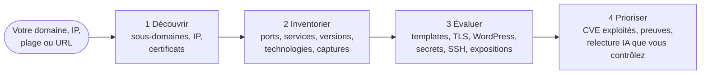

<p align="center">
  
</p>

<h3 align="center">La plateforme d'évaluation de surface d'attaque externe la plus avancée.</h3>

<p align="center">Découvrez les actifs que vous exposez et cartographiez-les dans un inventaire façon Shodan.</p>

<p align="center">Évaluez chaque hôte avec des scanners standard de l'industrie et corrigez d'abord ce qui compte.</p>

<p align="center">
  <a href="CHANGELOG.md"></a>
  <a href="LICENSE"></a>
  
</p>

<p align="center">
  
</p>

<p align="center"><sub>cvENGINE 1.4.1 sur des données de démonstration.</sub></p>

---

**cvENGINE surveille les flux CVE 24 h/24 et vous montre, preuves à l'appui, quels nouveaux CVE atteignent réellement vos hôtes.**

### Chaque nouveau CVE, vérifié contre vos hôtes

1. **Surveillez les flux.** De nouveaux CVE et de fraîches nouvelles d'exploitation arrivent toute la journée depuis les sources qui comptent.
2. **Trouvez qui est exposé.** Chaque CVE est mis en correspondance avec les hôtes qui exécutent le produit et la version affectés.
3. **Écrivez la vérification.** Quand aucune vérification validée n'existe, votre IA en rédige une en lecture seule que cvENGINE valide d'abord.
4. **Prouvez-le sur vos hôtes.** Un Sentinel reproduit chaque correspondance avec une vérification en lecture seule et conserve la preuve.
5. **Réduisez le bruit.** L'IA examine la preuve : ce qui est réel remonte et les faux positifs probables descendent.

**Apportez votre propre IA :** Anthropic, OpenAI ou OpenRouter avec votre propre clé, ou entièrement local avec Ollama, LM Studio ou vLLM. Elle est éteinte jusqu'à ce que vous l'allumiez, et elle ne ferme jamais un résultat qu'une vérification a prouvé. Sans modèle, cvENGINE découvre, scanne, met en correspondance et valide toujours.

<details>
<summary><b>Comment ça marche, exactement</b></summary>

- **Flux.** Le flux [cve.now](https://cve.now) est lu toutes les 30 minutes. CISA KEV, ENISA EUVD, FIRST EPSS, Exploit-DB, Metasploit et, avec une clé, VulnCheck KEV sont lus toutes les heures : un CVE qui devient exploité passe hot dans l'heure.
- **Correspondance.** Un CVE ne devient une correspondance que lorsqu'un hôte exécute le même produit dans une version située dans une plage affectée bornée. Un produit vu sans version ne produit jamais de correspondance.
- **Vérifications écrites par l'IA.** Pour les CVE hot, dans un budget quotidien, l'IA lit l'avis et note comment le détecter. Quand aucun template Nuclei validé n'existe, elle peut rédiger un template en lecture seule, qui ne s'exécute sur un hôte qu'après validation par le système : syntaxe et un contrôle de bouclage inoffensif sur un Sentinel, un test hors ligne contre une réponse affectée et une corrigée, puis une seconde passe d'IA. Cette fonctionnalité est livrée éteinte : un administrateur active **Valider automatiquement les vérifications écrites par l'IA**.
- **Preuve.** Toutes les cinq minutes, jusqu'à 20 correspondances, les fire d'abord, sont reproduites sur un Sentinel avec l'une des six vérifications en lecture seule : un template Nuclei validé, `nmap -sV` sur le port unique, une requête de bannière de version, la vérification de base de données sans identifiants, une sonde de version et d'identité, ou une lecture de bibliothèque JavaScript. La commande et le résultat exacts sont conservés. Une vérification qui ne reproduit pas un résultat ne le rétrograde jamais.
- **Triage.** Les correspondances CVE, les résultats des scanners, les bases de données ouvertes, les routes d'administration ouvertes, les routes exposant des identifiants et les résultats d'hygiène de sévérité moyenne ou pire sont classés confirmed, likely, needs validation, likely false positive ou not applicable, dans des plafonds quotidiens (500 par projet et 2 000 au total par défaut).
- **Relecteur IA.** Lit chaque résultat ouvert une fois, jusqu'à 300 par jour par défaut, et note s'il est réel. Il ne ferme un faux positif que si vous l'y autorisez, et seulement si le résultat n'a aucune preuve solide et qu'aucune personne ne l'a traité.
- **Planchers.** La preuve solide fixe un plancher sous lequel le modèle ne peut pas descendre : un hit de template, une base de données qui a répondu ou un hit de validation est confirmed, et une version dans la plage affectée est au moins needs validation. Le modèle seul ne peut jamais confirmer un résultat.
- **Votre IA, vos contrôles.** Pour le triage et la relecture, le modèle voit des preuves structurées avec des noms d'hôtes masqués, il n'a aucun outil et le serveur vérifie chaque réponse avant qu'elle ne compte. Les tâches IA ont des plafonds quotidiens et la page d'utilisation montre les appels, les tokens et les estimations de coût. Le relecteur IA, les vérifications écrites par l'IA et l'auto-fire (confirmation et tests IA dès qu'un nouveau CVE hot atterrit) sont livrés éteints.

Plus de détails dans [Pipeline](docs/PIPELINE.md#triage-and-validation), [Intelligence CVE](docs/PIPELINE.md#cve-intelligence) et [Relecteur IA](docs/AI-REVIEWER.md).

</details>

### Sachez tout ce que vous exposez

cvENGINE est une plateforme auto-hébergée d'évaluation de surface d'attaque externe et de vulnérabilités. Donnez-lui vos domaines et elle découvre en continu les sous-domaines, adresses et certificats que vous exposez, dans un inventaire interrogeable façon Shodan de chaque hôte, port, service, technologie et certificat. Les actifs oubliés et fantômes remontent à la surface, et les nouveaux hôtes, les ports ouverts et les changements de version atterrissent sur une chronologie dès qu'un scan les voit. Chaque hôte est évalué avec des scanners open source standard de l'industrie, et [Situations](docs/SITUATIONS.md) classe ce qu'il faut corriger en premier : la preuve avant la probabilité, l'exploitation connue avant la sévérité seule.

## cvENGINE 1.4.0 est là

| | |
| --- | --- |
| **Scannez d'où vous avez besoin** | Vous choisissez où le scan a lieu : sur votre serveur, avec le scanner intégré livré avec chaque installation dans son propre conteneur ; sur des [Sentinels](docs/SENTINELS.md) distants placés n'importe où, dans d'autres clouds ou régions ou à l'intérieur de réseaux privés pour atteindre les actifs internes ; ou les deux. Ajoutez des Sentinels pour passer à l'échelle. |
| **Une IA qui réduit les faux positifs** | Le nouveau relecteur IA, dans son propre conteneur cloisonné, lit chaque résultat ouvert une fois (jusqu'à un plafond quotidien) et note s'il est réel, et les vérifications écrites par l'IA sont validées par le système avant de s'exécuter, y compris sur vos propres Sentinels. Les deux restent éteints jusqu'à ce que vous les allumiez. |
| **Configuration dans le navigateur** | `install.sh` est un amorçage léger. Un [assistant de configuration](docs/DEPLOYMENT.md#setup-wizard) prend votre organisation, votre projet et votre premier domaine, et la découverte démarre aussitôt. |
| **Ce qui a besoin de vous, classé** | [Situations](docs/SITUATIONS.md) liste les hôtes qui ont besoin d'une personne, les plus urgents d'abord. Les résultats qu'une vérification a reproduits montrent leur preuve en premier, et un résultat marqué corrigé est revérifié. |
| **Secrets exposés et SSH** | Un inventaire des secrets du projet alimenté par Kingfisher, et une inspection SSH avec sshamble qui compare les clés d'hôte à une liste de mauvaises clés connues et ne se connecte jamais. |
| **Rien ne s'allume sans être vu** | Les vérifications d'identifiants, le relecteur IA et tout ce qui coûte de l'argent ou élargit un scan restent éteints jusqu'à ce qu'un administrateur dise oui. Les tokens d'API et les agents IA ne peuvent pas les allumer. |
| **Fonctionne tout seul** | Un [watchdog](docs/WATCHDOG.md) répare les workers bloqués, l'auto-tuning vérifie chaque changement qu'il fait et annule ce qui a fait mal, et vous pouvez publier via un [Cloudflare Tunnel](docs/HOSTING-ONLINE.md) sans port entrant. |

Vous passez de la 1.3 ? Lisez d'abord [mettre à niveau vers 1.4](docs/UPGRADE.md#upgrading-to-14) et les [notes opérateur](docs/1.4-OPERATOR-NOTES.md) : sauvegardez, vérifiez l'espace disque libre et mettez à jour vos Sentinels. Tous les changements sont dans le [changelog](CHANGELOG.md).

## Du domaine au verdict



1. **Découvrir.** Pointez cvENGINE vers un domaine et elle trouve les sous-domaines, adresses et certificats qui vous appartiennent, continue de surveiller la transparence des certificats et répète un balayage profond chaque semaine.
2. **Inventorier.** Chaque hôte, port ouvert, service, version de produit, technologie, certificat et page d'accueil entre dans un seul inventaire que vous pouvez [interroger comme Shodan](docs/SEARCH.md) : `port:3389 -host:vpn`, `tech:"apache tomcat" sev:high`. Les nouveaux hôtes, les ports ouverts et les changements de version atterrissent sur une chronologie.
3. **Évaluer.** Chaque hôte est testé avec des scanners standard de l'industrie et les vérifications en lecture seule propres à cvENGINE, et un CVE n'est mis en correspondance avec un hôte que lorsque le produit est le même et que sa version tombe dans la plage affectée.
4. **Prioriser.** Chaque CVE est classé [fire, smoke ou ice](docs/FIRE-SMOKE-ICE.md) à partir de données d'exploitation réelles, chaque hôte reçoit un score de 0 à 100, et le triage IA, quand vous l'allumez, range les résultats en confirmed, likely ou needs validation. L'IA ne ferme jamais un résultat qu'une vérification a prouvé.

Le scan s'exécute où vous choisissez : dans le scanner intégré de votre serveur, sur des [Sentinels](docs/SENTINELS.md) placés ailleurs, ou les deux. Le [pipeline](docs/PIPELINE.md) décrit chaque étape.

## Les outils derrière tout ça

cvENGINE exécute les meilleurs outils de sécurité open source. L'image du scanner épingle chaque outil qu'elle installe à une version exacte, et les épingles sont vérifiées avant chaque version. La page About de votre installation les liste avec leurs versions, et [THIRD-PARTY.md](THIRD-PARTY.md) donne chaque licence.

| Étape | Outil | Ce que cvENGINE en fait |
| --- | --- | --- |
| **Découverte** | [bbot](https://github.com/blacklanternsecurity/bbot) | Découverte de sous-domaines, adresses et actifs, diffusée dans l'inventaire au fil de l'exécution |
| | [baddns](https://github.com/blacklanternsecurity/baddns) | Candidats de DNS pendant et de prise de sous-domaines, exécuté dans bbot |
| | [crt.sh](https://crt.sh) | Recherches de transparence des certificats qui attrapent les nouveaux noms entre deux scans |
| **Inventaire et empreintes** | [naabu](https://github.com/projectdiscovery/naabu) | Un balayage des 65 535 ports TCP de chaque adresse |
| | [Nmap](https://nmap.org) | Empreintes de service, version et OS, scripts relus, et un scan lent d'exposition UDP |
| | [Nuclei](https://github.com/projectdiscovery/nuclei) | Une passe technologique qui nomme ce que chaque hôte web exécute |
| | [wafw00f](https://github.com/EnableSecurity/wafw00f) | Nomme le pare-feu applicatif web devant un site |
| | [Playwright](https://playwright.dev) avec Chromium headless | Captures de chaque page web servie par un hôte |
| | [gowitness](https://github.com/sensepost/gowitness) | Captures de la page d'accueil pendant la découverte, installé par bbot |
| | [aardwolf](https://github.com/skelsec/aardwolf) | La capture de l'écran de connexion d'un serveur RDP qui l'autorise sans identifiants |
| **Évaluation** | [Nuclei](https://github.com/projectdiscovery/nuclei) et [nuclei-templates](https://github.com/projectdiscovery/nuclei-templates) | La bibliothèque de templates communautaire, les passes ciblées par l'IA et les vérifications par CVE ; les templates de déni de service et d'identifiants sont exclus par défaut |
| | [testssl.sh](https://github.com/testssl/testssl.sh) | Protocoles, chiffrements et les vulnérabilités TLS nommées sur chaque port TLS |
| | [WPScan](https://github.com/wpscanteam/wpscan) | Vulnérabilités du cœur, des extensions et des thèmes WordPress (ajoutez un token [wpscan.com](https://wpscan.com/) pour ses données de vulnérabilités) |
| | [Kingfisher](https://github.com/mongodb/kingfisher) | Les clés d'API, tokens et clés privées que servent vos pages et scripts, conservés dans un inventaire des Secrets |
| | [sshamble](https://github.com/runZeroInc/sshamble) | Poignée de main SSH et clés d'hôte, comparées à la liste de blocage [badkeys](https://badkeys.info) ; ne se connecte jamais |
| | [détecteur node2shell](https://github.com/assetnote/node2shell-scanner) | La vérification en lecture seule d'Assetnote pour CVE-2026-111497 ; éteinte par défaut |
| | Vérifications propres à cvENGINE | Bases de données exposées, stockage cloud public et pendant (S3, Google Cloud Storage, Azure Blob), routes web et leur état de connexion, sondes de version, et hygiène DNS et e-mail basée sur [MailFail](https://github.com/ACK-J/MailFail) |
| **Intelligence d'exploitation** | [cve.now](https://cve.now), [CISA KEV](https://www.cisa.gov/known-exploited-vulnerabilities-catalog), [ENISA EUVD](https://euvd.enisa.europa.eu/), [VulnCheck KEV](https://vulncheck.com), [FIRST EPSS](https://www.first.org/epss/), [Exploit-DB](https://gitlab.com/exploit-database/exploitdb), [Metasploit](https://github.com/rapid7/metasploit-framework), [CVE List V5](https://github.com/CVEProject/cvelistV5), [OSV](https://osv.dev), [suivi de sécurité Debian](https://security-tracker.debian.org) | Quels CVE sont exploités aujourd'hui, et quels correctifs une distribution a backportés |
| **Modules optionnels** | [OpenVAS](https://greenbone.github.io/docs/latest/) (Greenbone Community Edition) | Un second scanner de vulnérabilités réseau sur un Sentinel, pour vos hôtes les plus chauds. Éteint par défaut ([OpenVAS](docs/OPENVAS.md)) |
| | [Tailscale](https://github.com/tailscale/tailscale) | Optionnel : rejoignez un tailnet, importez et scannez ses appareils, et vérifiez sa configuration ([Tailscale](docs/TAILSCALE.md)) |
| | [runZero](https://www.runzero.com) | Optionnel : une synchronisation programmée des données d'actifs runZero avec votre propre token ([Configuration](docs/CONFIGURATION.md#runzero)) |
| | Sources à clé de bbot | Optionnel : Shodan, Censys, VirusTotal, SecurityTrails, GitHub, Chaos et plus, avec vos propres clés d'API ([Configuration](docs/CONFIGURATION.md#api-keys)) |
| **IA (apportez la vôtre, éteinte jusqu'à votre choix)** | [Anthropic](https://www.anthropic.com), [OpenAI](https://openai.com), [OpenRouter](https://openrouter.ai), [Ollama](https://github.com/ollama/ollama), [LM Studio](https://lmstudio.ai), [vLLM](https://github.com/vllm-project/vllm) | Triage des résultats, ciblage Nuclei et le [relecteur IA](docs/AI-REVIEWER.md) dans son propre conteneur. Sans modèle, cvENGINE découvre, scanne et met toujours en correspondance |
| | [Model Context Protocol](https://modelcontextprotocol.io) | Un serveur MCP et une API REST pour vos propres agents ([Agent API](docs/AGENT-API.md)) |

## Installez en quelques minutes

Il vous faut un serveur Linux (Debian ou Ubuntu, c'est le plus simple) avec au moins 4 Go de RAM (8 Go pour être à l'aise) et 20 Go de disque libre.

```bash
git clone https://github.com/hevnsnt/CVEngine.git
cd CVEngine
sudo ./install.sh
```

L'installateur ajoute ce qui manque, génère tous les secrets, crée le certificat HTTPS, démarre cvENGINE avec son scanner intégré, et affiche l'adresse ainsi que l'emplacement de votre mot de passe administrateur généré. Connectez-vous et l'assistant de configuration fait le reste. L'automatisation peut passer `--sentinels=internal|both|external` et `-n`. OpenVAS n'est jamais installé par lui. Votre navigateur avertit à propos du certificat privé jusqu'à ce que vous fassiez confiance à `secrets/certs/ca.crt`.

Un nom public avec un certificat de confiance, un Cloudflare Tunnel, Mac et Windows : voir [Deployment](docs/DEPLOYMENT.md) et [Hosting online](docs/HOSTING-ONLINE.md).

## Sûr par conception

- **Lecture seule par défaut.** Pas de listes de mots de passe. Les vérifications qui envoient des identifiants (templates de login par défaut et de force brute de Nuclei) sont éteintes jusqu'à ce qu'un App Admin les autorise, et les templates de déni de service sont exclus.
- **Vous tracez les lignes.** Les adresses de bouclage, link-local et de métadonnées cloud ne sont jamais scannées, et chaque organisation tient une liste d'[adresses que nous ne devons jamais scanner](docs/1.4-OPERATOR-NOTES.md#addresses-we-must-never-scan) qui contient tout nom y menant.
- **Vous tenez les interrupteurs.** La validation IA, le relecteur IA, OpenVAS et tout ce qui coûte de l'argent démarrent éteints, et une mise à jour demande avant de les changer.
- **Verrouillé.** Les données de l'organisation sont isolées, les secrets stockés sont chiffrés, et l'accès est gardé par une connexion en deux étapes, une liste d'IP autorisées et un journal d'audit.

Ne scannez que les systèmes que vous possédez ou que vous êtes autorisé à tester.

## Documentation

| Doc | Ce qu'elle couvre |
| --- | --- |
| [Deployment](docs/DEPLOYMENT.md) et [Hosting online](docs/HOSTING-ONLINE.md) | Installation, HTTPS, Cloudflare, sauvegardes, petits hôtes |
| [Updates](docs/UPDATES.md), [Upgrade](docs/UPGRADE.md) et [notes opérateur 1.4](docs/1.4-OPERATOR-NOTES.md) | Rester à jour, et ce que 1.4 change pour un opérateur |
| [Sentinels](docs/SENTINELS.md) et [scanner intégré](docs/BUILTIN-SCANNER.md) | Où chaque scan s'exécute, passer à l'échelle et scanner les réseaux privés |
| [Pipeline](docs/PIPELINE.md) et [Architecture](docs/ARCHITECTURE.md) | Comment ça marche, étape par étape |
| [Search](docs/SEARCH.md), [Situations](docs/SITUATIONS.md) et [Fire, smoke, and ice](docs/FIRE-SMOKE-ICE.md) | Trouver ce qui compte, et comment les CVE sont classés |
| [Configuration](docs/CONFIGURATION.md) | Chaque réglage |
| [AI reviewer](docs/AI-REVIEWER.md), [AI usage](docs/AI-USAGE.md) et [Secrets](docs/SECRETS-PLAN.md) | Le relecteur cloisonné, le coût de l'IA, et l'inventaire des secrets exposés |
| [OpenVAS](docs/OPENVAS.md) et [Tailscale](docs/TAILSCALE.md) | Les modules optionnels |
| [Tenancy](docs/TENANCY.md), [Agent API](docs/AGENT-API.md) et [Host inventory](docs/HOST-INVENTORY.md) | Équipes et rôles, l'API REST et MCP, et les hôtes qui déclarent leurs propres paquets |
| [Bug bounty](docs/BUG-BOUNTY.md), [Watchdog](docs/WATCHDOG.md) et [Front end](docs/FRONTEND.md) | L'établi de primes, l'auto-réparation et l'interface |

## Contribuer et sécurité

Les issues et pull requests sont bienvenues : voir [CONTRIBUTING](.github/CONTRIBUTING.md). Signalez les vulnérabilités en privé via l'onglet **Security** du dépôt, comme l'explique la [politique de sécurité](.github/SECURITY.md).

## Crédits et licence

cvENGINE est un fork de [reNgine](https://github.com/yogeshojha/rengine) 2.x par Yogesh Ojha et ses contributeurs, et s'appuie sur les projets ci-dessus. Le client Sentinel vit dans [hevnsnt/cvENGINE-sentinel](https://github.com/hevnsnt/cvENGINE-sentinel). Merci à nos bêta-testeurs, surtout à [camstork](https://github.com/camstork), dont les rapports soignés ont façonné la 1.3. Voir le [changelog](CHANGELOG.md), les [contributeurs](CONTRIBUTORS.md) et les [logiciels tiers](THIRD-PARTY.md).

« Façon Shodan » décrit le type de recherche ; cvENGINE n'est pas affilié à Shodan.

Publié sous GPL-3.0. Voir [LICENSE](LICENSE).

[](https://m8ven.ai/mcp/hevnsnt-cvengine-s24yvi?s=readme)
