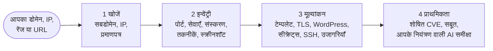

<p align="center">
  
</p>

<h3 align="center">सबसे उन्नत बाहरी अटैक सरफेस मूल्यांकन प्लेटफ़ॉर्म।</h3>

<p align="center">आप जिन एसेट्स को उजागर करते हैं उन्हें खोजें और Shodan-शैली की इन्वेंट्री में मैप करें।</p>

<p align="center">इंडस्ट्री-स्टैंडर्ड स्कैनर से हर होस्ट का मूल्यांकन करें और जो मायने रखता है उसे पहले ठीक करें।</p>

<p align="center">
  <a href="CHANGELOG.md"></a>
  <a href="LICENSE"></a>
  
</p>

<p align="center">
  
</p>

<p align="center"><sub>cvENGINE 1.4.1 डेमो डेटा पर।</sub></p>

---

**cvENGINE चौबीसों घंटे CVE फ़ीड पर नज़र रखता है और आपको सबूत के साथ दिखाता है कि कौन-से नए CVE वाकई आपके होस्ट तक पहुँचते हैं।**

### हर नया CVE, आपके होस्ट के विरुद्ध जाँचा गया

1. **फ़ीड पर नज़र रखें।** नए CVE और ताज़ा शोषण समाचार पूरे दिन उन स्रोतों से आते हैं जो मायने रखते हैं।
2. **कौन उजागर है, खोजें।** हर CVE का मिलान उन होस्ट से होता है जो प्रभावित उत्पाद और संस्करण चलाते हैं।
3. **जाँच लिखें।** जब कोई सत्यापित जाँच मौजूद नहीं होती, आपका AI एक रीड-ओनली जाँच का मसौदा तैयार करता है जिसे cvENGINE पहले मान्य करता है।
4. **अपने होस्ट पर साबित करें।** एक Sentinel हर मिलान को रीड-ओनली जाँच से दोहराता है और सबूत रखता है।
5. **शोर काटें।** AI सबूत की समीक्षा करता है — जो असली है ऊपर उठता है, संभावित झूठे अलार्म नीचे बैठते हैं।

**अपना AI लाएँ:** अपनी कुंजी से Anthropic, OpenAI या OpenRouter, या Ollama, LM Studio या vLLM से पूरी तरह लोकल। यह तब तक बंद है जब तक आप इसे चालू नहीं करते, और यह कभी ऐसी फ़ाइंडिंग बंद नहीं करता जिसे किसी जाँच ने साबित किया हो। मॉडल के बिना भी cvENGINE खोजता, स्कैन करता, मिलान करता और मान्य करता है।

<details>
<summary><b>यह कैसे काम करता है, ठीक-ठीक</b></summary>

- **फ़ीड।** [cve.now](https://cve.now) फ़ीड हर 30 मिनट में पढ़ा जाता है। CISA KEV, ENISA EUVD, FIRST EPSS, Exploit-DB, Metasploit और, कुंजी के साथ, VulnCheck KEV हर घंटे पढ़े जाते हैं — इसलिए जिस CVE का शोषण शुरू होता है वह एक घंटे के भीतर hot हो जाता है।
- **मिलान।** CVE तभी मिलान बनता है जब कोई होस्ट वही उत्पाद किसी सीमित प्रभावित रेंज के अंदर के संस्करण पर चलाता है। बिना संस्करण दिखा उत्पाद कभी मिलान नहीं बनाता।
- **AI द्वारा लिखी जाँचें।** hot CVE के लिए, दैनिक बजट के भीतर, AI एडवाइज़री पढ़ता है और लिखता है कि उसे कैसे पहचाना जाए। जब कोई सत्यापित Nuclei टेम्पलेट नहीं होता, वह रीड-ओनली टेम्पलेट का मसौदा बना सकता है, जो होस्ट पर तभी चलता है जब सिस्टम ने उसे मान्य किया हो: Sentinel पर सिंटैक्स और एक हानिरहित लूपबैक नियंत्रण, एक प्रभावित और एक ठीक किए गए रिस्पॉन्स के विरुद्ध ऑफ़लाइन परीक्षण, और दूसरा AI पास। यह बंद अवस्था में शिप होता है: एक एडमिन **AI-लिखित जाँचों को स्वतः मान्य करें** चालू करता है।
- **सबूत।** हर पाँच मिनट में 20 मिलान तक, fire पहले, एक Sentinel पर छह रीड-ओनली जाँचों में से एक से दोहराए जाते हैं: एक सत्यापित Nuclei टेम्पलेट, एक ही पोर्ट पर `nmap -sV`, एक संस्करण-बैनर अनुरोध, बिना-क्रेडेंशियल डेटाबेस जाँच, एक संस्करण व पहचान प्रोब, या एक JavaScript लाइब्रेरी रीड। सटीक कमांड और परिणाम रखे जाते हैं। जो जाँच किसी फ़ाइंडिंग को दोहरा नहीं पाती वह उसे कभी नीचे नहीं गिराती।
- **ट्राइएज।** CVE मिलान, स्कैनर फ़ाइंडिंग्स, खुले डेटाबेस, खुले एडमिन रूट, क्रेडेंशियल उजागर करने वाले रूट और मध्यम या उससे बुरी गंभीरता की हाइजीन फ़ाइंडिंग्स को दैनिक सीमाओं के भीतर (डिफ़ॉल्ट रूप से प्रति प्रोजेक्ट 500 और कुल 2,000) confirmed, likely, needs validation, likely false positive या not applicable में आँका जाता है।
- **AI समीक्षक।** हर खुली फ़ाइंडिंग को एक बार पढ़ता है (डिफ़ॉल्ट रूप से दिन में 300 तक) और दर्ज करता है कि वह असली है या नहीं। वह झूठा अलार्म तभी बंद करता है जब आप अनुमति दें, और तभी जब फ़ाइंडिंग के पास कोई पुख्ता सबूत न हो और किसी व्यक्ति ने उस पर काम न किया हो।
- **निचली सीमाएँ।** पुख्ता सबूत एक निचली सीमा तय करता है जिसके नीचे मॉडल नहीं जा सकता: टेम्पलेट हिट, उत्तर देने वाला डेटाबेस या मान्यता हिट confirmed है, और प्रभावित रेंज के अंदर का संस्करण कम-से-कम needs validation है। मॉडल अकेले कभी किसी फ़ाइंडिंग की पुष्टि नहीं कर सकता।
- **आपका AI, आपके नियंत्रण।** ट्राइएज और समीक्षा में मॉडल को होस्ट नाम छिपाकर संरचित सबूत दिखते हैं, उसके पास कोई टूल नहीं होता, और सर्वर हर उत्तर को गिनने से पहले जाँचता है। AI कार्यों की दैनिक सीमाएँ हैं, और उपयोग पृष्ठ कॉल, टोकन और लागत अनुमान दिखाता है। AI समीक्षक, AI-लिखित जाँचें और ऑटो-फ़ायर (नया hot CVE उतरते ही AI पुष्टि और परीक्षण) सभी बंद अवस्था में शिप होते हैं।

अधिक जानकारी [Pipeline](docs/PIPELINE.md#triage-and-validation), [CVE इंटेलिजेंस](docs/PIPELINE.md#cve-intelligence) और [AI समीक्षक](docs/AI-REVIEWER.md) में।

</details>

### जो कुछ आप उजागर करते हैं, सब जानें

cvENGINE एक सेल्फ़-होस्टेड बाहरी अटैक सरफेस और भेद्यता मूल्यांकन प्लेटफ़ॉर्म है। इसे अपने डोमेन दें और यह आपके द्वारा उजागर किए गए सबडोमेन, पते और प्रमाणपत्र खोजता रहेगा — हर होस्ट, पोर्ट, सेवा, तकनीक और प्रमाणपत्र की खोज-योग्य Shodan-शैली इन्वेंट्री में। भूली हुई और छाया एसेट्स सामने आती हैं, और नए होस्ट, खुले पोर्ट और संस्करण बदलाव किसी स्कैन के देखते ही टाइमलाइन पर उतरते हैं। हर होस्ट का मूल्यांकन इंडस्ट्री-स्टैंडर्ड ओपन-सोर्स स्कैनर से होता है, और [Situations](docs/SITUATIONS.md) तय करता है कि पहले क्या ठीक करना है: संभावना से पहले सबूत, केवल गंभीरता से पहले ज्ञात शोषण।

## cvENGINE 1.4.0 आ गया है

| | |
| --- | --- |
| **जहाँ ज़रूरत हो वहाँ से स्कैन करें** | आप चुनते हैं कि स्कैन कहाँ हो: अपने सर्वर पर, हर इंस्टॉल के साथ अपने कंटेनर में आने वाले बिल्ट-इन स्कैनर से; दूरस्थ [Sentinels](docs/SENTINELS.md) पर जिन्हें आप कहीं भी रखें — दूसरे क्लाउड या क्षेत्रों में या आंतरिक एसेट्स तक पहुँचने के लिए निजी नेटवर्क के अंदर; या दोनों। स्केल आउट के लिए Sentinel जोड़ें। |
| **AI जो झूठे अलार्म कम करता है** | नया AI समीक्षक, अपने अलग बंद कंटेनर में, हर खुली फ़ाइंडिंग को एक बार पढ़ता है (दैनिक सीमा तक) और दर्ज करता है कि वह असली है या नहीं, और AI-लिखित जाँचें चलने से पहले सिस्टम द्वारा मान्य होती हैं — आपके अपने Sentinels पर भी। दोनों तब तक बंद रहते हैं जब तक आप चालू नहीं करते। |
| **ब्राउज़र में सेटअप** | `install.sh` केवल एक पतला बूटस्ट्रैप है। एक [सेटअप विज़ार्ड](docs/DEPLOYMENT.md#setup-wizard) आपका संगठन, प्रोजेक्ट और पहला डोमेन लेता है, और खोज तुरंत शुरू होती है। |
| **जिसे आपकी ज़रूरत है, क्रमबद्ध** | [Situations](docs/SITUATIONS.md) उन होस्ट को सूचीबद्ध करता है जिन्हें किसी व्यक्ति की ज़रूरत है, सबसे ज़रूरी पहले। जिन फ़ाइंडिंग्स को किसी जाँच ने दोहराया वे अपना सबूत पहले दिखाती हैं, और ठीक चिह्नित फ़ाइंडिंग की फिर जाँच होती है। |
| **उजागर सीक्रेट्स और SSH** | Kingfisher द्वारा संचालित प्रोजेक्ट सीक्रेट्स इन्वेंट्री, और sshamble से SSH निरीक्षण जो होस्ट कीज़ की जाँच ज्ञात-ख़राब कीज़ की सूची से करता है और कभी लॉगिन नहीं करता। |
| **कुछ भी बिना दिखे चालू नहीं होता** | क्रेडेंशियल जाँचें, AI समीक्षक और जो कुछ भी पैसा खर्च करता है या स्कैन बढ़ाता है, तब तक बंद रहता है जब तक कोई एडमिन हाँ न कहे। API टोकन और AI एजेंट उन्हें चालू नहीं कर सकते। |
| **खुद चलता है** | एक [वॉचडॉग](docs/WATCHDOG.md) अटके वर्कर्स ठीक करता है, ऑटो-ट्यूनिंग अपने हर बदलाव की जाँच करती है और जो नुकसान पहुँचाए उसे वापस लेती है, और आप बिना इनबाउंड पोर्ट के [Cloudflare Tunnel](docs/HOSTING-ONLINE.md) से प्रकाशित कर सकते हैं। |

1.3 से अपग्रेड कर रहे हैं? पहले [1.4 में अपग्रेड](docs/UPGRADE.md#upgrading-to-14) और [ऑपरेटर नोट्स](docs/1.4-OPERATOR-NOTES.md) पढ़ें: बैकअप लें, खाली डिस्क जाँचें और अपने Sentinels अपडेट करें। सारे बदलाव [चेंजलॉग](CHANGELOG.md) में हैं।

## डोमेन से फ़ैसले तक



1. **खोजें।** cvENGINE को किसी डोमेन पर लगाएँ और यह आपके सबडोमेन, पते और प्रमाणपत्र ढूँढ लेगा, प्रमाणपत्र पारदर्शिता पर नज़र रखता रहेगा और हर सप्ताह गहरी सफ़ाई दोहराता है।
2. **इन्वेंट्री।** हर होस्ट, खुला पोर्ट, सेवा, उत्पाद संस्करण, तकनीक, प्रमाणपत्र और फ्रंट पेज एक इन्वेंट्री में आता है जिसे आप [Shodan की तरह खोज](docs/SEARCH.md) सकते हैं: `port:3389 -host:vpn`, `tech:"apache tomcat" sev:high`। नए होस्ट, खुले पोर्ट और संस्करण बदलाव टाइमलाइन पर उतरते हैं।
3. **मूल्यांकन।** हर होस्ट की जाँच इंडस्ट्री-स्टैंडर्ड स्कैनर और cvENGINE की अपनी रीड-ओनली जाँचों से होती है, और CVE का होस्ट से मिलान तभी होता है जब उत्पाद वही हो और उसका संस्करण प्रभावित रेंज में आता हो।
4. **प्राथमिकता।** हर CVE को वास्तविक शोषण डेटा से [fire, smoke या ice](docs/FIRE-SMOKE-ICE.md) आँका जाता है, हर होस्ट को 0 से 100 का स्कोर मिलता है, और AI ट्राइएज, जब आप चालू करते हैं, फ़ाइंडिंग्स को confirmed, likely या needs validation में बाँटती है। AI कभी ऐसी फ़ाइंडिंग बंद नहीं करता जिसे किसी जाँच ने साबित किया हो।

स्कैनिंग वहीं चलती है जहाँ आप चुनें: आपके सर्वर के बिल्ट-इन स्कैनर में, कहीं और रखे [Sentinels](docs/SENTINELS.md) पर, या दोनों। [पाइपलाइन](docs/PIPELINE.md) हर चरण का वर्णन करती है।

## इसके पीछे के टूल

cvENGINE सबसे अच्छे ओपन-सोर्स सुरक्षा टूल चलाता है। स्कैनर इमेज अपने हर टूल को एक सटीक संस्करण पर पिन करती है, और हर रिलीज़ से पहले पिन की जाँच होती है। आपकी इंस्टॉल का About पेज उन्हें संस्करणों सहित सूचीबद्ध करता है, और [THIRD-PARTY.md](THIRD-PARTY.md) हर लाइसेंस देता है।

| चरण | टूल | cvENGINE इसे किसलिए इस्तेमाल करता है |
| --- | --- | --- |
| **खोज** | [bbot](https://github.com/blacklanternsecurity/bbot) | सबडोमेन, पते और एसेट खोज, चलते समय इन्वेंट्री में स्ट्रीम |
| | [baddns](https://github.com/blacklanternsecurity/baddns) | लटकते DNS और सबडोमेन अधिग्रहण उम्मीदवार, bbot के अंदर चलता है |
| | [crt.sh](https://crt.sh) | प्रमाणपत्र पारदर्शिता क्वेरीज़ जो स्कैन के बीच नए नाम पकड़ती हैं |
| **इन्वेंट्री और फ़िंगरप्रिंटिंग** | [naabu](https://github.com/projectdiscovery/naabu) | हर पते के सभी 65,535 TCP पोर्ट की सफ़ाई |
| | [Nmap](https://nmap.org) | सेवा, संस्करण और OS फ़िंगरप्रिंट, समीक्षित स्क्रिप्ट, और धीमा UDP उजागर स्कैन |
| | [Nuclei](https://github.com/projectdiscovery/nuclei) | तकनीक पास जो बताता है कि हर वेब होस्ट क्या चलाता है |
| | [wafw00f](https://github.com/EnableSecurity/wafw00f) | साइट के सामने के वेब एप्लिकेशन फ़ायरवॉल का नाम बताता है |
| | [Playwright](https://playwright.dev) + हेडलेस Chromium | होस्ट द्वारा दिए गए हर वेब पेज के स्क्रीनशॉट |
| | [gowitness](https://github.com/sensepost/gowitness) | खोज के दौरान फ्रंट-पेज स्क्रीनशॉट, bbot द्वारा इंस्टॉल |
| | [aardwolf](https://github.com/skelsec/aardwolf) | ऐसे RDP सर्वर का लॉगिन-स्क्रीन स्क्रीनशॉट जो बिना क्रेडेंशियल की अनुमति देता है |
| **मूल्यांकन** | [Nuclei](https://github.com/projectdiscovery/nuclei) और [nuclei-templates](https://github.com/projectdiscovery/nuclei-templates) | सामुदायिक टेम्पलेट लाइब्रेरी, AI-लक्षित पास और प्रति-CVE जाँचें; डिनायल-ऑफ़-सर्विस और क्रेडेंशियल टेम्पलेट डिफ़ॉल्ट रूप से बाहर |
| | [testssl.sh](https://github.com/testssl/testssl.sh) | हर TLS पोर्ट पर प्रोटोकॉल, सिफ़र और ज्ञात TLS भेद्यताएँ |
| | [WPScan](https://github.com/wpscanteam/wpscan) | WordPress कोर, प्लगइन और थीम भेद्यताएँ (इसके भेद्यता डेटा के लिए [wpscan.com](https://wpscan.com/) टोकन जोड़ें) |
| | [Kingfisher](https://github.com/mongodb/kingfisher) | आपके पेज और स्क्रिप्ट द्वारा दी गई API कीज़, टोकन और निजी कीज़, सीक्रेट्स इन्वेंट्री में रखी जाती हैं |
| | [sshamble](https://github.com/runZeroInc/sshamble) | SSH हैंडशेक और होस्ट कीज़, [badkeys](https://badkeys.info) ब्लॉकलिस्ट से जाँची जाती हैं; कभी लॉगिन नहीं करता |
| | [node2shell डिटेक्टर](https://github.com/assetnote/node2shell-scanner) | CVE-2026-111497 के लिए Assetnote की रीड-ओनली जाँच; डिफ़ॉल्ट रूप से बंद |
| | cvENGINE की अपनी जाँचें | उजागर डेटाबेस, सार्वजनिक और लटकता क्लाउड स्टोरेज (S3, Google Cloud Storage, Azure Blob), वेब रूट और उनकी साइन-इन स्थिति, संस्करण प्रोब, और [MailFail](https://github.com/ACK-J/MailFail) पर आधारित DNS व ईमेल हाइजीन |
| **शोषण इंटेलिजेंस** | [cve.now](https://cve.now), [CISA KEV](https://www.cisa.gov/known-exploited-vulnerabilities-catalog), [ENISA EUVD](https://euvd.enisa.europa.eu/), [VulnCheck KEV](https://vulncheck.com), [FIRST EPSS](https://www.first.org/epss/), [Exploit-DB](https://gitlab.com/exploit-database/exploitdb), [Metasploit](https://github.com/rapid7/metasploit-framework), [CVE List V5](https://github.com/CVEProject/cvelistV5), [OSV](https://osv.dev), [Debian सुरक्षा ट्रैकर](https://security-tracker.debian.org) | आज कौन-से CVE शोषित हो रहे हैं, और कौन-से फ़िक्स किसी वितरण ने बैकपोर्ट किए |
| **वैकल्पिक ऐड-ऑन** | [OpenVAS](https://greenbone.github.io/docs/latest/) (Greenbone Community Edition) | Sentinel पर दूसरा नेटवर्क भेद्यता स्कैनर, आपके सबसे हॉट होस्ट के लिए। डिफ़ॉल्ट रूप से बंद ([OpenVAS](docs/OPENVAS.md)) |
| | [Tailscale](https://github.com/tailscale/tailscale) | वैकल्पिक: tailnet में शामिल हों, उसके डिवाइस इम्पोर्ट व स्कैन करें और कॉन्फ़िगरेशन जाँचें ([Tailscale](docs/TAILSCALE.md)) |
| | [runZero](https://www.runzero.com) | वैकल्पिक: अपने टोकन से runZero के एसेट डेटा की निर्धारित सिंक ([कॉन्फ़िगरेशन](docs/CONFIGURATION.md#runzero)) |
| | bbot के की-स्रोत | वैकल्पिक: Shodan, Censys, VirusTotal, SecurityTrails, GitHub, Chaos और अधिक, अपनी API कीज़ के साथ ([कॉन्फ़िगरेशन](docs/CONFIGURATION.md#api-keys)) |
| **AI (अपना लाएँ, चुनने तक बंद)** | [Anthropic](https://www.anthropic.com), [OpenAI](https://openai.com), [OpenRouter](https://openrouter.ai), [Ollama](https://github.com/ollama/ollama), [LM Studio](https://lmstudio.ai), [vLLM](https://github.com/vllm-project/vllm) | फ़ाइंडिंग ट्राइएज, Nuclei लक्ष्यीकरण और अपने कंटेनर में [AI समीक्षक](docs/AI-REVIEWER.md)। मॉडल के बिना भी cvENGINE खोजता, स्कैन करता और मिलान करता है |
| | [Model Context Protocol](https://modelcontextprotocol.io) | आपके अपने एजेंटों के लिए MCP सर्वर और REST API ([Agent API](docs/AGENT-API.md)) |

## मिनटों में इंस्टॉल करें

आपको एक Linux सर्वर चाहिए (Debian या Ubuntu सबसे आसान) जिसमें कम-से-कम 4 GB RAM (आराम के लिए 8 GB) और 20 GB खाली डिस्क हो।

```bash
git clone https://github.com/hevnsnt/CVEngine.git
cd CVEngine
sudo ./install.sh
```

इंस्टॉलर जो कमी है उसे जोड़ता है, सारे सीक्रेट बनाता है, HTTPS प्रमाणपत्र बनाता है, बिल्ट-इन स्कैनर के साथ cvENGINE शुरू करता है, और पता तथा आपके जनरेट किए गए एडमिन पासवर्ड का स्थान छापता है। साइन इन करें और सेटअप विज़ार्ड बाकी कर लेगा। ऑटोमेशन `--sentinels=internal|both|external` और `-n` पास कर सकता है। OpenVAS कभी इसके द्वारा इंस्टॉल नहीं होता। जब तक आप `secrets/certs/ca.crt` पर भरोसा नहीं करते, आपका ब्राउज़र निजी प्रमाणपत्र की चेतावनी देता है।

भरोसेमंद प्रमाणपत्र वाला सार्वजनिक नाम, Cloudflare Tunnel, Mac और Windows: देखें [डिप्लॉयमेंट](docs/DEPLOYMENT.md) और [ऑनलाइन होस्टिंग](docs/HOSTING-ONLINE.md)।

## डिज़ाइन से सुरक्षित

- **डिफ़ॉल्ट रूप से रीड-ओनली।** कोई पासवर्ड सूची नहीं। क्रेडेंशियल भेजने वाली जाँचें (Nuclei के डिफ़ॉल्ट-लॉगिन और ब्रूट-फ़ोर्स टेम्पलेट) तब तक बंद हैं जब तक कोई ऐप एडमिन अनुमति न दे, और डिनायल-ऑफ़-सर्विस टेम्पलेट बाहर रखे गए हैं।
- **रेखाएँ आप खींचते हैं।** लूपबैक, लिंक-लोकल और क्लाउड मेटाडेटा पते कभी स्कैन नहीं होते, और हर संगठन [उन पतों की सूची रखता है जिन्हें हमें कभी स्कैन नहीं करना चाहिए](docs/1.4-OPERATOR-NOTES.md#addresses-we-must-never-scan) — उसमें वहाँ ले जाने वाला हर नाम होता है।
- **स्विच आपके हाथ में।** AI मान्यता, AI समीक्षक, OpenVAS और जो कुछ भी पैसा खर्च करता है बंद शुरू होता है, और अपडेट उन्हें बदलने से पहले पूछता है।
- **तालाबंद।** संगठन का डेटा अलग रहता है, संग्रहीत सीक्रेट एन्क्रिप्टेड हैं, और पहुँच दो-चरणीय साइन-इन, IP अनुमति-सूची और ऑडिट लॉग से सुरक्षित है।

केवल वही सिस्टम स्कैन करें जिनके आप मालिक हैं या जिनके परीक्षण के लिए आप अधिकृत हैं।

## दस्तावेज़ीकरण

| दस्तावेज़ | क्या कवर करता है |
| --- | --- |
| [डिप्लॉयमेंट](docs/DEPLOYMENT.md) और [ऑनलाइन होस्टिंग](docs/HOSTING-ONLINE.md) | इंस्टॉल, HTTPS, Cloudflare, बैकअप, छोटे होस्ट |
| [अपडेट](docs/UPDATES.md), [अपग्रेड](docs/UPGRADE.md) और [1.4 ऑपरेटर नोट्स](docs/1.4-OPERATOR-NOTES.md) | वर्तमान बने रहना, और 1.4 ऑपरेटर के लिए क्या बदलता है |
| [Sentinels](docs/SENTINELS.md) और [बिल्ट-इन स्कैनर](docs/BUILTIN-SCANNER.md) | हर स्कैन कहाँ चलता है, स्केल आउट और निजी नेटवर्क स्कैनिंग |
| [पाइपलाइन](docs/PIPELINE.md) और [आर्किटेक्चर](docs/ARCHITECTURE.md) | यह कैसे काम करता है, चरण दर चरण |
| [खोज](docs/SEARCH.md), [Situations](docs/SITUATIONS.md) और [Fire, smoke और ice](docs/FIRE-SMOKE-ICE.md) | जो मायने रखता है उसे खोजना, और CVE कैसे आँके जाते हैं |
| [कॉन्फ़िगरेशन](docs/CONFIGURATION.md) | हर सेटिंग |
| [AI समीक्षक](docs/AI-REVIEWER.md), [AI उपयोग](docs/AI-USAGE.md) और [सीक्रेट्स](docs/SECRETS-PLAN.md) | बंद समीक्षक, AI लागत और उजागर-सीक्रेट इन्वेंट्री |
| [OpenVAS](docs/OPENVAS.md) और [Tailscale](docs/TAILSCALE.md) | वैकल्पिक ऐड-ऑन |
| [टेनेंसी](docs/TENANCY.md), [Agent API](docs/AGENT-API.md) और [होस्ट इन्वेंट्री](docs/HOST-INVENTORY.md) | टीमें और भूमिकाएँ, REST API और MCP, और अपने पैकेज खुद रिपोर्ट करने वाले होस्ट |
| [बग बाउंटी](docs/BUG-BOUNTY.md), [वॉचडॉग](docs/WATCHDOG.md) और [फ्रंट एंड](docs/FRONTEND.md) | बाउंटी कार्यक्षेत्र, स्व-मरम्मत और इंटरफ़ेस |

## योगदान और सुरक्षा

इश्यू और पुल रिक्वेस्ट का स्वागत है: देखें [CONTRIBUTING](.github/CONTRIBUTING.md)। कृपया भेद्यताओं की रिपोर्ट निजी तौर पर रिपॉज़िटरी के **Security** टैब से करें, जैसा [सुरक्षा नीति](.github/SECURITY.md) बताती है।

## श्रेय और लाइसेंस

cvENGINE Yogesh Ojha और उनके योगदानकर्ताओं के [reNgine](https://github.com/yogeshojha/rengine) 2.x का फ़ोर्क है, और ऊपर के प्रोजेक्ट्स पर बना है। Sentinel क्लाइंट [hevnsnt/cvENGINE-sentinel](https://github.com/hevnsnt/cvENGINE-sentinel) में रहता है। हमारे बीटा टेस्टरों का धन्यवाद, सबसे बढ़कर [camstork](https://github.com/camstork) का, जिनकी सावधान रिपोर्टों ने 1.3 को आकार दिया। देखें [चेंजलॉग](CHANGELOG.md), [योगदानकर्ता](CONTRIBUTORS.md) और [तृतीय-पक्ष सॉफ़्टवेयर](THIRD-PARTY.md)।

"Shodan-शैली" खोज के प्रकार का वर्णन है; cvENGINE Shodan से संबद्ध नहीं है।

GPL-3.0 के अंतर्गत जारी। देखें [LICENSE](LICENSE)।

[](https://m8ven.ai/mcp/hevnsnt-cvengine-s24yvi?s=readme)
