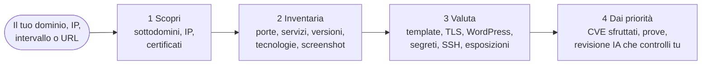

<p align="center">
  
</p>

<h3 align="center">La piattaforma di valutazione della superficie d'attacco esterna più avanzata.</h3>

<p align="center">Scopri gli asset che esponi e mappali in un inventario in stile Shodan.</p>

<p align="center">Valuta ogni host con scanner standard del settore e correggi prima ciò che conta.</p>

<p align="center">
  <a href="CHANGELOG.md"></a>
  <a href="LICENSE"></a>
  
</p>

<p align="center">
  
</p>

<p align="center"><sub>cvENGINE 1.4.1 su dati dimostrativi.</sub></p>

---

**cvENGINE osserva i feed CVE 24 ore su 24 e ti mostra, con le prove, quali nuovi CVE raggiungono davvero i tuoi host.**

### Ogni nuovo CVE, verificato contro i tuoi host

1. **Osserva i feed.** Nuovi CVE e notizie fresche di sfruttamento arrivano tutto il giorno dalle fonti che contano.
2. **Trova chi è esposto.** Ogni CVE viene abbinato agli host che eseguono il prodotto e la versione interessati.
3. **Scrivi la verifica.** Quando non esiste una verifica vagliata, la tua IA ne redige una in sola lettura che cvENGINE valida per prima.
4. **Dimostralo sui tuoi host.** Un Sentinel riproduce ogni corrispondenza con una verifica in sola lettura e conserva la prova.
5. **Taglia il rumore.** L'IA esamina la prova: ciò che è reale sale e i probabili falsi positivi scendono.

**Porta la tua IA:** Anthropic, OpenAI o OpenRouter con la tua chiave, o del tutto locale con Ollama, LM Studio o vLLM. È spenta finché non la accendi, e non chiude mai un reperto che una verifica ha dimostrato. Senza modello, cvENGINE scopre, scansiona, abbina e valida comunque.

<details>
<summary><b>Come funziona, esattamente</b></summary>

- **Feed.** Il feed di [cve.now](https://cve.now) viene letto ogni 30 minuti. CISA KEV, ENISA EUVD, FIRST EPSS, Exploit-DB, Metasploit e, con una chiave, VulnCheck KEV vengono letti ogni ora: un CVE che diventa sfruttato passa a hot entro un'ora.
- **Abbinamento.** Un CVE diventa una corrispondenza solo quando un host esegue lo stesso prodotto in una versione dentro un intervallo interessato delimitato. Un prodotto visto senza versione non genera mai una corrispondenza.
- **Verifiche scritte dall'IA.** Per i CVE hot, entro un budget giornaliero, l'IA legge l'advisory e registra come rilevarlo. Quando non esiste un template Nuclei vagliato può redigerne uno in sola lettura, che gira su un host solo dopo che il sistema l'ha validato: sintassi e un innocuo controllo di loopback su un Sentinel, un test offline contro una risposta interessata e una corretta, e un secondo passaggio dell'IA. Questo viene consegnato spento: un amministratore attiva **Valida automaticamente le verifiche scritte dall'IA**.
- **Prova.** Ogni cinque minuti, fino a 20 corrispondenze, prima le fire, vengono riprodotte su un Sentinel con una di sei verifiche in sola lettura: un template Nuclei vagliato, `nmap -sV` sulla singola porta, una richiesta di banner di versione, la verifica del database senza credenziali, una sonda di versione e identità, o una lettura di libreria JavaScript. Il comando e il risultato esatti vengono conservati. Una verifica che non riproduce un reperto non lo declassa mai.
- **Triage.** Le corrispondenze CVE, i reperti degli scanner, i database aperti, le rotte di amministrazione aperte, le rotte che espongono credenziali e i reperti di igiene di gravità media o peggiore vengono classificati come confirmed, likely, needs validation, likely false positive o not applicable, entro limiti giornalieri (per impostazione predefinita 500 per progetto e 2.000 in totale).
- **Revisore IA.** Legge ogni reperto aperto una volta, fino a 300 al giorno per impostazione predefinita, e registra se è reale. Chiude un falso positivo solo quando glielo permetti, e solo quando il reperto non ha prove solide e nessuna persona ci ha lavorato.
- **Pavimenti.** La prova solida fissa un pavimento sotto il quale il modello non può scendere: un colpo di template, un database che ha risposto o un colpo di validazione è confirmed, e una versione nell'intervallo interessato è almeno needs validation. Il modello da solo non può mai confermare un reperto.
- **La tua IA, i tuoi controlli.** Per il triage e la revisione il modello vede prove strutturate con i nomi host oscurati, non ha strumenti e il server controlla ogni risposta prima che conti. I lavori IA hanno limiti giornalieri e la pagina di utilizzo mostra chiamate, token e stime di costo. Il revisore IA, le verifiche scritte dall'IA e l'auto-fire (conferma e test IA appena atterra un nuovo CVE hot) vengono consegnati spenti.

Di più in [Pipeline](docs/PIPELINE.md#triage-and-validation), [Intelligence CVE](docs/PIPELINE.md#cve-intelligence) e [Revisore IA](docs/AI-REVIEWER.md).

</details>

### Sappi tutto ciò che esponi

cvENGINE è una piattaforma self-hosted di valutazione della superficie d'attacco esterna e delle vulnerabilità. Dalle i tuoi domini e continua a scoprire i sottodomini, gli indirizzi e i certificati che esponi, in un inventario ricercabile in stile Shodan di ogni host, porta, servizio, tecnologia e certificato. Gli asset dimenticati e ombra vengono alla luce, e i nuovi host, le porte aperte e i cambi di versione atterrano su una timeline appena una scansione li vede. Ogni host viene valutato con scanner open source standard del settore, e [Situations](docs/SITUATIONS.md) classifica cosa correggere prima: la prova prima della probabilità, lo sfruttamento noto prima della sola gravità.

## cvENGINE 1.4.0 è qui

| | |
| --- | --- |
| **Scansiona da dove ti serve** | Scegli tu dove avviene la scansione: sul tuo server, con lo scanner integrato che accompagna ogni installazione nel proprio contenitore; su [Sentinels](docs/SENTINELS.md) remoti che collochi ovunque, in altri cloud o regioni o dentro reti private per raggiungere gli asset interni; o entrambi. Aggiungi Sentinels per scalare. |
| **IA che riduce i falsi positivi** | Il nuovo revisore IA, nel proprio contenitore isolato, legge ogni reperto aperto una volta (fino a un limite giornaliero) e registra se è reale, e le verifiche scritte dall'IA vengono validate dal sistema prima di girare, anche sui tuoi Sentinels. Entrambi restano spenti finché non li accendi. |
| **Configurazione nel browser** | `install.sh` è solo un bootstrap leggero. Una [procedura guidata di configurazione](docs/DEPLOYMENT.md#setup-wizard) prende la tua organizzazione, il progetto e il primo dominio, e la scoperta parte subito. |
| **Ciò che ha bisogno di te, classificato** | [Situations](docs/SITUATIONS.md) elenca gli host che hanno bisogno di una persona, i più urgenti prima. I reperti che una verifica ha riprodotto mostrano la loro prova per primi, e un reperto segnato come corretto viene ricontrollato. |
| **Segreti esposti e SSH** | Un inventario dei segreti di progetto alimentato da Kingfisher, e un'ispezione SSH con sshamble che confronta le chiavi host con un elenco di chiavi note cattive e non effettua mai il login. |
| **Niente si accende senza essere visto** | Le verifiche di credenziali, il revisore IA e qualsiasi altra cosa che costa denaro o amplia una scansione restano spenti finché un amministratore non dice sì. I token API e gli agenti IA non possono accenderli. |
| **Funziona da solo** | Un [watchdog](docs/WATCHDOG.md) ripara i worker bloccati, l'auto-tuning controlla ogni modifica che fa e annulla ciò che ha fatto male, e puoi pubblicare tramite un [Cloudflare Tunnel](docs/HOSTING-ONLINE.md) senza porta in ingresso. |

Aggiorni dalla 1.3? Leggi prima [aggiornare alla 1.4](docs/UPGRADE.md#upgrading-to-14) e le [note per l'operatore](docs/1.4-OPERATOR-NOTES.md): fai il backup, controlla lo spazio libero e aggiorna i tuoi Sentinels. Ogni modifica è nel [changelog](CHANGELOG.md).

## Dal dominio al verdetto



1. **Scopri.** Punta cvENGINE su un dominio e troverà i sottodomini, gli indirizzi e i certificati che ti appartengono, continuerà a osservare la trasparenza dei certificati e ripeterà una scansione profonda ogni settimana.
2. **Inventaria.** Ogni host, porta aperta, servizio, versione di prodotto, tecnologia, certificato e pagina iniziale entra in un inventario che puoi [cercare come Shodan](docs/SEARCH.md): `port:3389 -host:vpn`, `tech:"apache tomcat" sev:high`. Nuovi host, porte aperte e cambi di versione atterrano su una timeline.
3. **Valuta.** Ogni host viene testato con scanner standard del settore e le verifiche in sola lettura proprie di cvENGINE, e un CVE viene abbinato a un host solo quando il prodotto è lo stesso e la sua versione cade nell'intervallo interessato.
4. **Dai priorità.** Ogni CVE viene classificato [fire, smoke o ice](docs/FIRE-SMOKE-ICE.md) da dati di sfruttamento reali, ogni host riceve un punteggio da 0 a 100, e il triage IA, quando lo accendi, ordina i reperti in confirmed, likely o needs validation. L'IA non chiude mai un reperto che una verifica ha dimostrato.

La scansione gira dove scegli tu: nello scanner integrato sul tuo server, su [Sentinels](docs/SENTINELS.md) collocati altrove, o entrambi. La [pipeline](docs/PIPELINE.md) descrive ogni fase.

## Gli strumenti dietro tutto questo

cvENGINE esegue i migliori strumenti di sicurezza open source. L'immagine dello scanner blocca ogni strumento che installa a una versione esatta, e i blocchi vengono verificati prima di ogni release. La pagina About della tua installazione li elenca con le versioni, e [THIRD-PARTY.md](THIRD-PARTY.md) riporta ogni licenza.

| Fase | Strumento | Per cosa lo usa cvENGINE |
| --- | --- | --- |
| **Scoperta** | [bbot](https://github.com/blacklanternsecurity/bbot) | Scoperta di sottodomini, indirizzi e asset, trasmessa all'inventario mentre gira |
| | [baddns](https://github.com/blacklanternsecurity/baddns) | Candidati di DNS pendente e di presa di sottodomini, eseguito dentro bbot |
| | [crt.sh](https://crt.sh) | Ricerche di trasparenza dei certificati che catturano nuovi nomi tra una scansione e l'altra |
| **Inventario e impronte digitali** | [naabu](https://github.com/projectdiscovery/naabu) | Una spazzata di tutte le 65.535 porte TCP di ogni indirizzo |
| | [Nmap](https://nmap.org) | Impronte di servizio, versione e SO, script revisionati e una lenta scansione di esposizione UDP |
| | [Nuclei](https://github.com/projectdiscovery/nuclei) | Un passaggio tecnologico che nomina cosa esegue ogni host web |
| | [wafw00f](https://github.com/EnableSecurity/wafw00f) | Nomina il web application firewall davanti a un sito |
| | [Playwright](https://playwright.dev) con Chromium headless | Screenshot di ogni pagina web servita da un host |
| | [gowitness](https://github.com/sensepost/gowitness) | Screenshot della pagina iniziale durante la scoperta, installato da bbot |
| | [aardwolf](https://github.com/skelsec/aardwolf) | Lo screenshot della schermata di login di un server RDP che la consente senza credenziali |
| **Valutazione** | [Nuclei](https://github.com/projectdiscovery/nuclei) e [nuclei-templates](https://github.com/projectdiscovery/nuclei-templates) | La libreria di template della comunità, passaggi mirati dall'IA e verifiche per CVE; i template di negazione del servizio e di credenziali sono esclusi per impostazione predefinita |
| | [testssl.sh](https://github.com/testssl/testssl.sh) | Protocolli, cifrari e le vulnerabilità TLS note su ogni porta TLS |
| | [WPScan](https://github.com/wpscanteam/wpscan) | Vulnerabilità di core, plugin e temi WordPress (aggiungi un token [wpscan.com](https://wpscan.com/) per i suoi dati sulle vulnerabilità) |
| | [Kingfisher](https://github.com/mongodb/kingfisher) | Chiavi API, token e chiavi private servite dalle tue pagine e dai tuoi script, conservati in un inventario dei Segreti |
| | [sshamble](https://github.com/runZeroInc/sshamble) | Handshake SSH e chiavi host, confrontate con la lista di blocco [badkeys](https://badkeys.info); non effettua mai il login |
| | [rilevatore node2shell](https://github.com/assetnote/node2shell-scanner) | La verifica in sola lettura di Assetnote per CVE-2026-111497; spenta per impostazione predefinita |
| | Verifiche proprie di cvENGINE | Database esposti, storage cloud pubblico e pendente (S3, Google Cloud Storage, Azure Blob), rotte web e il loro stato di accesso, sonde di versione, e igiene di DNS ed e-mail basata su [MailFail](https://github.com/ACK-J/MailFail) |
| **Intelligence sullo sfruttamento** | [cve.now](https://cve.now), [CISA KEV](https://www.cisa.gov/known-exploited-vulnerabilities-catalog), [ENISA EUVD](https://euvd.enisa.europa.eu/), [VulnCheck KEV](https://vulncheck.com), [FIRST EPSS](https://www.first.org/epss/), [Exploit-DB](https://gitlab.com/exploit-database/exploitdb), [Metasploit](https://github.com/rapid7/metasploit-framework), [CVE List V5](https://github.com/CVEProject/cvelistV5), [OSV](https://osv.dev), [tracker di sicurezza Debian](https://security-tracker.debian.org) | Quali CVE vengono sfruttati oggi e quali correzioni una distribuzione ha backportato |
| **Componenti opzionali** | [OpenVAS](https://greenbone.github.io/docs/latest/) (Greenbone Community Edition) | Un secondo scanner di vulnerabilità di rete su un Sentinel, per i tuoi host più caldi. Spento per impostazione predefinita ([OpenVAS](docs/OPENVAS.md)) |
| | [Tailscale](https://github.com/tailscale/tailscale) | Opzionale: entra in una tailnet, importa e scansiona i suoi dispositivi e controllane la configurazione ([Tailscale](docs/TAILSCALE.md)) |
| | [runZero](https://www.runzero.com) | Opzionale: una sincronizzazione programmata dei dati degli asset di runZero con il tuo token ([Configurazione](docs/CONFIGURATION.md#runzero)) |
| | Sorgenti con chiave di bbot | Opzionale: Shodan, Censys, VirusTotal, SecurityTrails, GitHub, Chaos e altro, con le tue chiavi API ([Configurazione](docs/CONFIGURATION.md#api-keys)) |
| **IA (porta la tua, spenta finché non scegli)** | [Anthropic](https://www.anthropic.com), [OpenAI](https://openai.com), [OpenRouter](https://openrouter.ai), [Ollama](https://github.com/ollama/ollama), [LM Studio](https://lmstudio.ai), [vLLM](https://github.com/vllm-project/vllm) | Triage dei reperti, targeting Nuclei e il [revisore IA](docs/AI-REVIEWER.md) nel proprio contenitore. Senza modello, cvENGINE scopre, scansiona e abbina comunque |
| | [Model Context Protocol](https://modelcontextprotocol.io) | Un server MCP e un'API REST per i tuoi agenti ([Agent API](docs/AGENT-API.md)) |

## Installa in pochi minuti

Ti serve un server Linux (Debian o Ubuntu è la scelta più semplice) con almeno 4 GB di RAM (8 GB per stare comodi) e 20 GB di disco libero.

```bash
git clone https://github.com/hevnsnt/CVEngine.git
cd CVEngine
sudo ./install.sh
```

Il programma di installazione aggiunge ciò che manca, genera tutti i segreti, crea il certificato HTTPS, avvia cvENGINE con lo scanner integrato e stampa l'indirizzo e dove si trova la password amministratore generata. Accedi e la procedura guidata fa il resto. L'automazione può passare `--sentinels=internal|both|external` e `-n`. OpenVAS non viene mai installato da lui. Il browser avvisa del certificato privato finché non ti fidi di `secrets/certs/ca.crt`.

Un nome pubblico con un certificato attendibile, un Cloudflare Tunnel, Mac e Windows: vedi [Deployment](docs/DEPLOYMENT.md) e [Hosting online](docs/HOSTING-ONLINE.md).

## Sicuro per progettazione

- **Sola lettura per impostazione predefinita.** Nessun elenco di password. Le verifiche che inviano credenziali (template di login predefinito e forza bruta di Nuclei) sono spente finché un App Admin non le consente, e i template di negazione del servizio sono esclusi.
- **Le linee le tracci tu.** Gli indirizzi di loopback, link-local e dei metadati cloud non vengono mai scansionati, e ogni organizzazione tiene un elenco di [indirizzi che non dobbiamo mai scansionare](docs/1.4-OPERATOR-NOTES.md#addresses-we-must-never-scan) che contiene qualsiasi nome porti lì.
- **Gli interruttori li tieni tu.** La validazione IA, il revisore IA, OpenVAS e qualsiasi altra cosa costi denaro partono spenti, e un aggiornamento chiede prima di cambiarli.
- **Bloccato.** I dati dell'organizzazione sono isolati, i segreti memorizzati sono cifrati e l'accesso è protetto da accesso in due passaggi, un elenco di IP consentiti e un registro di controllo.

Scansiona solo sistemi che possiedi o che sei autorizzato a testare.

## Documentazione

| Doc | Cosa copre |
| --- | --- |
| [Deployment](docs/DEPLOYMENT.md) e [Hosting online](docs/HOSTING-ONLINE.md) | Installazione, HTTPS, Cloudflare, backup, host piccoli |
| [Updates](docs/UPDATES.md), [Upgrade](docs/UPGRADE.md) e [note operatore 1.4](docs/1.4-OPERATOR-NOTES.md) | Rimanere aggiornati e cosa cambia la 1.4 per un operatore |
| [Sentinels](docs/SENTINELS.md) e [scanner integrato](docs/BUILTIN-SCANNER.md) | Dove gira ogni scansione, scalare e scansionare reti private |
| [Pipeline](docs/PIPELINE.md) e [Architecture](docs/ARCHITECTURE.md) | Come funziona, fase per fase |
| [Search](docs/SEARCH.md), [Situations](docs/SITUATIONS.md) e [Fire, smoke e ice](docs/FIRE-SMOKE-ICE.md) | Trovare ciò che conta e come vengono classificati i CVE |
| [Configuration](docs/CONFIGURATION.md) | Ogni impostazione |
| [AI reviewer](docs/AI-REVIEWER.md), [AI usage](docs/AI-USAGE.md) e [Secrets](docs/SECRETS-PLAN.md) | Il revisore isolato, il costo dell'IA e l'inventario dei segreti esposti |
| [OpenVAS](docs/OPENVAS.md) e [Tailscale](docs/TAILSCALE.md) | I componenti opzionali |
| [Tenancy](docs/TENANCY.md), [Agent API](docs/AGENT-API.md) e [Host inventory](docs/HOST-INVENTORY.md) | Team e ruoli, l'API REST e MCP, e gli host che segnalano i propri pacchetti |
| [Bug bounty](docs/BUG-BOUNTY.md), [Watchdog](docs/WATCHDOG.md) e [Front end](docs/FRONTEND.md) | Il banco di lavoro delle taglie, l'auto-riparazione e l'interfaccia |

## Contribuire e sicurezza

Issue e pull request sono benvenuti: vedi [CONTRIBUTING](.github/CONTRIBUTING.md). Segnala le vulnerabilità in privato tramite la scheda **Security** del repository, come spiega la [politica di sicurezza](.github/SECURITY.md).

## Crediti e licenza

cvENGINE è un fork di [reNgine](https://github.com/yogeshojha/rengine) 2.x di Yogesh Ojha e dei suoi contributori, e si basa sui progetti sopra. Il client Sentinel vive in [hevnsnt/cvENGINE-sentinel](https://github.com/hevnsnt/cvENGINE-sentinel). Grazie ai nostri beta tester, soprattutto a [camstork](https://github.com/camstork), i cui accurati rapporti hanno plasmato la 1.3. Vedi il [changelog](CHANGELOG.md), i [contributori](CONTRIBUTORS.md) e il [software di terze parti](THIRD-PARTY.md).

"Stile Shodan" descrive il tipo di ricerca; cvENGINE non è affiliato a Shodan.

Rilasciato sotto GPL-3.0. Vedi [LICENSE](LICENSE).

[](https://m8ven.ai/mcp/hevnsnt-cvengine-s24yvi?s=readme)
