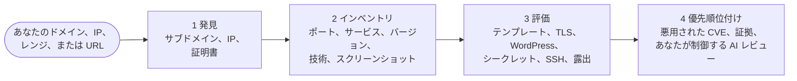

<p align="center">
  
</p>

<h3 align="center">最先端の外部攻撃面評価プラットフォーム。</h3>

<p align="center">公開している資産を発見し、Shodan スタイルのインベントリにマッピングします。</p>

<p align="center">業界標準のスキャナーで各ホストを評価し、本当に重要なものから修正します。</p>

<p align="center">
  <a href="CHANGELOG.md"></a>
  <a href="LICENSE"></a>
  
</p>

<p align="center">
  
</p>

<p align="center"><sub>cvENGINE 1.4.1、デモデータによる表示。</sub></p>

---

**cvENGINE は CVE フィードを 24 時間監視し、どの新しい CVE が実際にあなたのホストへ到達するかを証拠付きで示します。**

### すべての新しい CVE を、あなたのホストと照合

1. **フィードを監視。** 新しい CVE と最新の悪用ニュースが、重要な情報源から一日中届きます。
2. **露出しているホストを特定。** 各 CVE は、影響を受ける製品とバージョンを実行しているホストと照合されます。
3. **チェックを作成。** 審査済みチェックが存在しない場合、あなたの AI が読み取り専用チェックを起草し、cvENGINE が最初に検証します。
4. **あなたのホストで証明。** Sentinel が各マッチを読み取り専用チェックで再現し、証拠を保持します。
5. **ノイズを削減。** AI が証拠をレビューし、本物が浮上し、誤検知の可能性が高いものが沈みます。

**AI は持ち込み（BYO）：** 自分のキーで Anthropic、OpenAI、OpenRouter を使用するか、Ollama、LM Studio、vLLM で完全ローカル実行。あなたがオンにするまでオフであり、チェックが証明した検出事項を閉じることは決してありません。モデルがなくても、cvENGINE は発見・スキャン・照合・検証を行います。

<details>
<summary><b>正確な仕組み</b></summary>

- **フィード。** [cve.now](https://cve.now) フィードは 30 分ごとに読み取られます。CISA KEV、ENISA EUVD、FIRST EPSS、Exploit-DB、Metasploit、そして（キーがあれば）VulnCheck KEV は毎時読み取られるため、悪用が始まった CVE は 1 時間以内に hot になります。
- **照合。** CVE がマッチになるのは、ホストが同じ製品を、影響を受ける範囲内のバージョンで実行している場合のみです。バージョンなしで見つかった製品がマッチになることはありません。
- **AI が書くチェック。** hot な CVE について、日次予算内で AI がアドバイザリを読み、検出方法を記録します。審査済み Nuclei テンプレートが存在しない場合は読み取り専用テンプレートを起草できますが、システムが検証した後でのみホストで実行されます：Sentinel 上での構文チェックと無害なループバック制御、影響を受ける応答と修正済み応答に対するオフラインテスト、そして 2 回目の AI パス。これは初期状態ではオフです：管理者が**AI 作成チェックの自動検証**をオンにします。
- **証明。** 5 分ごとに最大 20 件のマッチ（先着順）が、6 種類の読み取り専用チェックのいずれかで Sentinel 上で再現されます：審査済み Nuclei テンプレート、単一ポートへの `nmap -sV`、バージョンバナーリクエスト、認証情報不要のデータベースチェック、バージョン・アイデンティティプローブ、JavaScript ライブラリ読み取り。正確なコマンドと結果が保持されます。検出事項を再現できないチェックがその評価を下げることは決してありません。
- **トリアージ。** CVE マッチ、スキャナー検出、公開データベース、公開管理ルート、認証情報を露出するルート、中程度以上の重大度の衛生上の問題は、日次上限内（デフォルトでプロジェクトあたり 500 件、全体で 2,000 件）で confirmed、likely、needs validation、likely false positive、not applicable に分類されます。
- **AI レビュアー。** 未解決の検出事項を 1 件ずつ読み（デフォルトで 1 日最大 300 件）、それが本物かを記録します。誤検知を閉じるのは、あなたが許可した場合のみ、かつハードな証拠がなく誰も作業していない場合のみです。
- **下限。** ハードな証拠はモデルが下回れない下限を設定します：テンプレートヒット、応答したデータベース、検証ヒットは confirmed、影響範囲内のバージョンは最低でも needs validation です。モデル単独で検出事項を confirmed にすることは決してできません。
- **あなたの AI、あなたのコントロール。** トリアージとレビューでは、モデルが見るのはホスト名をマスキングした構造化証拠のみで、ツールは持たず、サーバーが各回答を採用前にチェックします。AI ジョブには日次上限があり、使用量ページでコール数・トークン・コスト見積もりを確認できます。AI レビュアー、AI 作成チェック、自動発火（新しい hot CVE の着地と同時に AI が確認・テスト）は、いずれも初期状態ではオフです。

詳細は [Pipeline](docs/PIPELINE.md#triage-and-validation)、[CVE インテリジェンス](docs/PIPELINE.md#cve-intelligence)、[AI レビュアー](docs/AI-REVIEWER.md) をご覧ください。

</details>

### 公開しているすべてを把握

cvENGINE はセルフホスト型の外部攻撃面・脆弱性評価プラットフォームです。ドメインを渡すと、公開しているサブドメイン・アドレス・証明書を発見し続け、全ホスト・ポート・サービス・技術・証明書を検索可能な Shodan スタイルのインベントリにまとめます。忘れられた資産やシャドー資産が明るみに出て、新しいホスト・開いたポート・バージョン変更はスキャンが見つけ次第タイムラインに記録されます。各ホストは業界標準のオープンソーススキャナーで評価され、[Situations](docs/SITUATIONS.md) が何から直すべきかをランク付けします：可能性より証拠、重大度だけより既知の悪用を優先。

## cvENGINE 1.4.0 が登場

| | |
| --- | --- |
| **必要な場所からスキャン** | スキャンをどこで実行するかはあなた次第：すべてのインストールに同梱され専用コンテナで動く内蔵スキャナーで自サーバー上、どこにでも置けるリモート [Sentinels](docs/SENTINELS.md)（別のクラウド、別リージョン、内部資産へ到達するためのプライベートネットワーク内）で、または両方。Sentinel を追加してスケールアウトできます。 |
| **誤検知を減らす AI** | 新しい AI レビュアーは専用の隔離コンテナで動き、未解決の検出事項を 1 件ずつ読み（日次上限まで）本物かを記録します。AI 作成チェックは実行前にシステムが検証します（あなたの Sentinel 上でも）。どちらもオンにするまでオフです。 |
| **ブラウザでセットアップ** | `install.sh` は薄いブートストラップに過ぎません。[セットアップウィザード](docs/DEPLOYMENT.md#setup-wizard)が組織・プロジェクト・最初のドメインを受け取り、発見がすぐに始まります。 |
| **人を必要とするもののランキング** | [Situations](docs/SITUATIONS.md) が人の対応が必要なホストを緊急度順にリストします。チェックが再現した検出事項は証拠が先に表示され、修正済みとマークされたものは再チェックされます。 |
| **露出したシークレットと SSH** | Kingfisher が支えるプロジェクトのシークレットインベントリと、sshamble による SSH 検査：ホストキーを既知の悪質リストと照合し、決してログインしません。 |
| **黙ってオンになるものはない** | 認証情報チェック、AI レビュアー、その他コストがかかる・スキャンを広げる機能は、管理者が許可するまでオフです。API トークンや AI エージェントがオンにすることはできません。 |
| **自動で動く** | [ウォッチドッグ](docs/WATCHDOG.md)がスタックしたワーカーを修復し、自動チューニングが自分の各変更をチェックして害を及ぼしたものを元に戻します。[Cloudflare Tunnel](docs/HOSTING-ONLINE.md) 経由なら受信ポートなしで公開できます。 |

1.3 からアップグレードする場合は、まず[1.4 へのアップグレード](docs/UPGRADE.md#upgrading-to-14)と[運用者向けノート](docs/1.4-OPERATOR-NOTES.md)を読んでください：バックアップ、空きディスクの確認、Sentinels の更新。すべての変更は[チェンジログ](CHANGELOG.md)にあります。

## ドメインから結論まで



1. **発見。** cvENGINE をドメインに向けると、あなたのサブドメイン・アドレス・証明書を見つけ出し、証明書の透明性ログを監視し続け、週に一度ディープスイープを繰り返します。
2. **インベントリ。** すべてのホスト、開いたポート、サービス、製品バージョン、技術、証明書、フロントページが 1 つのインベントリに入り、[Shodan のように検索](docs/SEARCH.md)できます：`port:3389 -host:vpn`、`tech:"apache tomcat" sev:high`。新しいホスト、開いたポート、バージョン変更はタイムラインに記録されます。
3. **評価。** 各ホストは業界標準のスキャナーと cvENGINE 独自の読み取り専用チェックでテストされ、CVE がホストにマッチするのは製品が同一でバージョンが影響範囲内の場合のみです。
4. **優先順位付け。** 各 CVE は実際の悪用データから [fire、smoke、ice](docs/FIRE-SMOKE-ICE.md) に格付けされ、各ホストは 0〜100 のスコアを獲得します。AI トリアージをオンにすると、検出事項は confirmed、likely、needs validation に分類されます。AI がチェックで証明された検出事項を閉じることは決してありません。

スキャンはあなたが選んだ場所で実行されます：自サーバーの内蔵スキャナー、他所に置いた [Sentinels](docs/SENTINELS.md)、または両方。[Pipeline](docs/PIPELINE.md) が各段階を説明します。

## 背後にあるツール

cvENGINE は最高のオープンソースセキュリティツールを実行します。スキャナーイメージはインストールする各ツールを正確なバージョンに固定し、リリース前に固定がチェックされます。インストールの About ページにツールとバージョンが一覧され、[THIRD-PARTY.md](THIRD-PARTY.md) に各ライセンスが記載されています。

| 段階 | ツール | cvENGINE での用途 |
| --- | --- | --- |
| **発見** | [bbot](https://github.com/blacklanternsecurity/bbot) | サブドメイン・アドレス・資産の発見。実行中にインベントリへストリーミング |
| | [baddns](https://github.com/blacklanternsecurity/baddns) | ダングリング DNS とサブドメイン乗っ取り候補。bbot 内で実行 |
| | [crt.sh](https://crt.sh) | スキャンとスキャンの間に現れる新しい名前を捕捉する証明書透明性ルックアップ |
| **インベントリとフィンガープリント** | [naabu](https://github.com/projectdiscovery/naabu) | 各アドレスの全 65,535 TCP ポートのスイープ |
| | [Nmap](https://nmap.org) | サービス・バージョン・OS フィンガープリント、レビュー済みスクリプト、低速 UDP 露出スキャン |
| | [Nuclei](https://github.com/projectdiscovery/nuclei) | 各 Web ホストが何を実行しているかを特定する技術パス |
| | [wafw00f](https://github.com/EnableSecurity/wafw00f) | サイトの前面にある Web アプリケーションファイアウォールの特定 |
| | [Playwright](https://playwright.dev) + ヘッドレス Chromium | ホストが配信する全 Web ページのスクリーンショット |
| | [gowitness](https://github.com/sensepost/gowitness) | 発見中のフロントページのスクリーンショット。bbot がインストール |
| | [aardwolf](https://github.com/skelsec/aardwolf) | 認証情報なしでのログイン画面を許可する RDP サーバーのスクリーンショット |
| **評価** | [Nuclei](https://github.com/projectdiscovery/nuclei) と [nuclei-templates](https://github.com/projectdiscovery/nuclei-templates) | コミュニティテンプレートライブラリ、AI による対象指定パス、CVE ごとのチェック。DoS と認証情報テンプレートはデフォルトで除外 |
| | [testssl.sh](https://github.com/testssl/testssl.sh) | 全 TLS ポートのプロトコル、暗号スイート、既知の TLS 脆弱性 |
| | [WPScan](https://github.com/wpscanteam/wpscan) | WordPress コア・プラグイン・テーマの脆弱性（[wpscan.com](https://wpscan.com/) トークンで脆弱性データを取得） |
| | [Kingfisher](https://github.com/mongodb/kingfisher) | ページやスクリプトが露出する API キー・トークン・秘密鍵。シークレットインベントリに保管 |
| | [sshamble](https://github.com/runZeroInc/sshamble) | SSH ハンドシェイクとホストキーを [badkeys](https://badkeys.info) ブロックリストと照合。決してログインしない |
| | [node2shell 検出器](https://github.com/assetnote/node2shell-scanner) | Assetnote による CVE-2026-111497 の読み取り専用チェック。デフォルトでオフ |
| | cvENGINE 独自チェック | 露出したデータベース、公開・ダングリングクラウドストレージ（S3、Google Cloud Storage、Azure Blob）、Web ルートとサインイン状態、バージョンプローブ、[MailFail](https://github.com/ACK-J/MailFail) ベースの DNS・メール衛生 |
| **悪用インテリジェンス** | [cve.now](https://cve.now)、[CISA KEV](https://www.cisa.gov/known-exploited-vulnerabilities-catalog)、[ENISA EUVD](https://euvd.enisa.europa.eu/)、[VulnCheck KEV](https://vulncheck.com)、[FIRST EPSS](https://www.first.org/epss/)、[Exploit-DB](https://gitlab.com/exploit-database/exploitdb)、[Metasploit](https://github.com/rapid7/metasploit-framework)、[CVE List V5](https://github.com/CVEProject/cvelistV5)、[OSV](https://osv.dev)、[Debian セキュリティトラッカー](https://security-tracker.debian.org) | 今日どの CVE が悪用されているか、ディストリビューションがどの修正をバックポートしたか |
| **オプションのアドオン** | [OpenVAS](https://greenbone.github.io/docs/latest/)（Greenbone Community Edition） | Sentinel 上で動く 2 つ目のネットワーク脆弱性スキャナー。最もホットなホスト向け。デフォルトでオフ（[OpenVAS](docs/OPENVAS.md)） |
| | [Tailscale](https://github.com/tailscale/tailscale) | オプション：tailnet に参加し、そのデバイスをインポート・スキャンし、設定を確認（[Tailscale](docs/TAILSCALE.md)） |
| | [runZero](https://www.runzero.com) | オプション：自分のトークンで runZero の資産データを定期同期（[設定](docs/CONFIGURATION.md#runzero)） |
| | bbot のキー付きソース | オプション：Shodan、Censys、VirusTotal、SecurityTrails、GitHub、Chaos など。自分の API キーで（[設定](docs/CONFIGURATION.md#api-keys)） |
| **AI（持ち込み。選ぶまでオフ）** | [Anthropic](https://www.anthropic.com)、[OpenAI](https://openai.com)、[OpenRouter](https://openrouter.ai)、[Ollama](https://github.com/ollama/ollama)、[LM Studio](https://lmstudio.ai)、[vLLM](https://github.com/vllm-project/vllm) | 検出事項のトリアージ、Nuclei の対象指定、専用コンテナ内の [AI レビュアー](docs/AI-REVIEWER.md)。モデルがなくても cvENGINE は発見・スキャン・照合する |
| | [Model Context Protocol](https://modelcontextprotocol.io) | あなたのエージェントのための MCP サーバーと REST API（[Agent API](docs/AGENT-API.md)） |

## 数分でインストール

Linux サーバー（Debian か Ubuntu が最も簡単）で、少なくとも 4 GB の RAM（快適には 8 GB）と 20 GB の空きディスクが必要です。

```bash
git clone https://github.com/hevnsnt/CVEngine.git
cd CVEngine
sudo ./install.sh
```

インストーラーは不足分を追加し、すべてのシークレットを生成し、HTTPS 証明書を作成し、内蔵スキャナー付きで cvENGINE を起動し、アドレスと生成された管理者パスワードの場所を表示します。サインインすればセットアップウィザードが残りを完了します。自動化では `--sentinels=internal|both|external` と `-n` を渡せます。インストーラーが OpenVAS をインストールすることはありません。`secrets/certs/ca.crt` を信頼するまで、ブラウザはプライベート証明書について警告します。

公開名と信頼できる証明書、Cloudflare Tunnel、Mac と Windows については [デプロイ](docs/DEPLOYMENT.md) と [オンラインホスティング](docs/HOSTING-ONLINE.md) をご覧ください。

## 設計上安全

- **デフォルトで読み取り専用。** パスワードリストはありません。認証情報を送るチェック（Nuclei のデフォルトログイン・ブルートフォーステンプレート）は App Admin が許可するまでオフ、DoS テンプレートは除外されます。
- **線を引くのはあなた。** ループバック、リンクローカル、クラウドメタデータのアドレスは決してスキャンされず、各組織は[絶対にスキャンしないアドレス](docs/1.4-OPERATOR-NOTES.md#addresses-we-must-never-scan)のリストを保持し、そこに導くあらゆる名前を収めます。
- **スイッチはあなたの手に。** AI 検証、AI レビュアー、OpenVAS、その他コストがかかるものは初期状態でオフで、アップデートは変更前に確認を求めます。
- **ロックダウン。** 組織データは分離され、保存されたシークレットは暗号化され、アクセスは 2 段階サインイン、IP 許可リスト、監査ログで守られます。

自分が所有するか、テストを許可されたシステムだけをスキャンしてください。

## ドキュメント

| ドキュメント | 内容 |
| --- | --- |
| [デプロイ](docs/DEPLOYMENT.md) と [オンラインホスティング](docs/HOSTING-ONLINE.md) | インストール、HTTPS、Cloudflare、バックアップ、小規模ホスト |
| [更新](docs/UPDATES.md)、[アップグレード](docs/UPGRADE.md)、[1.4 運用者向けノート](docs/1.4-OPERATOR-NOTES.md) | 最新の維持と、1.4 が運用者にとって変えるもの |
| [Sentinels](docs/SENTINELS.md) と [内蔵スキャナー](docs/BUILTIN-SCANNER.md) | 各スキャンの実行場所、スケールアウト、プライベートネットワークのスキャン |
| [Pipeline](docs/PIPELINE.md) と [アーキテクチャ](docs/ARCHITECTURE.md) | 段階ごとの仕組み |
| [検索](docs/SEARCH.md)、[Situations](docs/SITUATIONS.md)、[Fire、smoke、ice](docs/FIRE-SMOKE-ICE.md) | 重要なものを見つける方法と CVE の格付け |
| [設定](docs/CONFIGURATION.md) | すべての設定 |
| [AI レビュアー](docs/AI-REVIEWER.md)、[AI 使用量](docs/AI-USAGE.md)、[シークレット](docs/SECRETS-PLAN.md) | 隔離されたレビュアー、AI のコスト、露出シークレットのインベントリ |
| [OpenVAS](docs/OPENVAS.md) と [Tailscale](docs/TAILSCALE.md) | オプションのアドオン |
| [テナンシー](docs/TENANCY.md)、[Agent API](docs/AGENT-API.md)、[ホストインベントリ](docs/HOST-INVENTORY.md) | チームとロール、REST API と MCP、ホストによる自己パッケージ報告 |
| [バグ報奨金](docs/BUG-BOUNTY.md)、[ウォッチドッグ](docs/WATCHDOG.md)、[フロントエンド](docs/FRONTEND.md) | 報奨金ワークベンチ、自己修復、インターフェース |

## コントリビューションとセキュリティ

Issue とプルリクエストを歓迎します：[CONTRIBUTING](.github/CONTRIBUTING.md) をご覧ください。脆弱性は[セキュリティポリシー](.github/SECURITY.md)の説明に従い、リポジトリの **Security** タブから非公開で報告してください。

## クレジットとライセンス

cvENGINE は Yogesh Ojha とそのコントリビューターによる [reNgine](https://github.com/yogeshojha/rengine) 2.x のフォークであり、上記のプロジェクトの上に構築されています。Sentinel クライアントは [hevnsnt/cvENGINE-sentinel](https://github.com/hevnsnt/cvENGINE-sentinel) にあります。ベータテスターの皆さん、とりわけ 1.3 を形作った細やかな報告をくださった [camstork](https://github.com/camstork) に感謝します。[チェンジログ](CHANGELOG.md)、[コントリビューター](CONTRIBUTORS.md)、[サードパーティソフトウェア](THIRD-PARTY.md) をご覧ください。

"Shodan スタイル"は検索の種類を表す表現であり、cvENGINE は Shodan とは関係ありません。

GPL-3.0 で公開されています。[LICENSE](LICENSE) をご覧ください。

[](https://m8ven.ai/mcp/hevnsnt-cvengine-s24yvi?s=readme)
