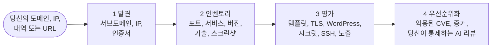

<p align="center">
  
</p>

<h3 align="center">가장 진보된 외부 공격면 평가 플랫폼.</h3>

<p align="center">노출한 자산을 발견하고 Shodan 스타일 인벤토리로 매핑하세요.</p>

<p align="center">업계 표준 스캐너로 각 호스트를 평가하고, 정말 중요한 것부터 고치세요.</p>

<p align="center">
  <a href="CHANGELOG.md"></a>
  <a href="LICENSE"></a>
  
</p>

<p align="center">
  
</p>

<p align="center"><sub>cvENGINE 1.4.1, 데모 데이터 기준.</sub></p>

---

**cvENGINE은 CVE 피드를 24시간 감시하며, 어떤 새 CVE가 실제로 당신의 호스트에 도달하는지 증거와 함께 보여줍니다.**

### 모든 새 CVE를 당신의 호스트와 대조

1. **피드 감시.** 새로운 CVE와 최신 익스플로잇 소식이 하루 종일 중요한 소스에서 도착합니다.
2. **노출된 호스트 파악.** 각 CVE는 영향을 받는 제품과 버전을 실행하는 호스트와 매칭됩니다.
3. **체크 작성.** 검증된 체크가 없으면 당신의 AI가 읽기 전용 체크 초안을 작성하고, cvENGINE이 먼저 검증합니다.
4. **당신의 호스트에서 증명.** Sentinel이 읽기 전용 체크로 각 매치를 재현하고 증거를 보관합니다.
5. **노이즈 제거.** AI가 증거를 검토하여 진짜는 떠오르고 오탐 가능성은 가라앉습니다.

**AI는 직접 가져오기(BYO):** 자신의 키로 Anthropic, OpenAI, OpenRouter를 사용하거나 Ollama, LM Studio, vLLM으로 완전 로컬 실행. 켜기 전까지는 꺼져 있으며, 체크로 증명된 발견 항목을 닫는 일은 절대 없습니다. 모델이 없어도 cvENGINE은 발견·스캔·매칭·검증을 수행합니다.

<details>
<summary><b>정확한 작동 방식</b></summary>

- **피드.** [cve.now](https://cve.now) 피드는 30분마다 읽힙니다. CISA KEV, ENISA EUVD, FIRST EPSS, Exploit-DB, Metasploit 그리고 (키가 있으면) VulnCheck KEV는 매시간 읽히므로, 악용이 시작된 CVE는 1시간 안에 hot(불)이 됩니다.
- **매칭.** CVE가 매치가 되는 것은 호스트가 동일한 제품을 영향 범위 내 버전으로 실행할 때뿐입니다. 버전 없이 발견된 제품은 절대 매치가 되지 않습니다.
- **AI가 작성하는 체크.** hot CVE에 대해 일일 예산 내에서 AI가 어드바이저리를 읽고 탐지 방법을 기록합니다. 검증된 Nuclei 템플릿이 없으면 읽기 전용 템플릿 초안을 작성할 수 있으며, 시스템이 검증한 후에만 호스트에서 실행됩니다: Sentinel에서의 구문 검사와 무해한 루프백 제어, 영향받는 응답과 수정된 응답에 대한 오프라인 테스트, 그리고 2차 AI 패스. 이 기능은 기본적으로 꺼져 있습니다: 관리자가 **AI 작성 체크 자동 검증**을 켭니다.
- **증거.** 5분마다 최대 20개의 매치(선착순)가 Sentinel에서 6가지 읽기 전용 체크 중 하나로 재현됩니다: 검증된 Nuclei 템플릿, 단일 포트 `nmap -sV`, 버전 배너 요청, 자격 증명 없는 데이터베이스 체크, 버전·신원 프로브, JavaScript 라이브러리 읽기. 정확한 명령과 결과가 보관됩니다. 발견 항목을 재현하지 못한 체크가 등급을 내리는 일은 절대 없습니다.
- **트리아지.** CVE 매치, 스캐너 발견, 노출된 데이터베이스, 노출된 관리 라우트, 자격 증명을 노출하는 라우트, 중간 이상 심각도의 위생 문제는 일일 상한 내(기본값 프로젝트당 500건, 전체 2,000건)에서 confirmed, likely, needs validation, likely false positive, not applicable로 분류됩니다.
- **AI 리뷰어.** 열린 발견 항목을 하나씩 읽고(기본값 하루 최대 300건) 실제인지 기록합니다. 오탐을 닫는 것은 당신이 허용한 경우에만, 그리고 하드 증거가 없고 아무도 작업하지 않은 경우에만 가능합니다.
- **하한선.** 하드 증거는 모델이 내려갈 수 없는 하한선을 정합니다: 템플릿 히트, 응답한 데이터베이스, 검증 히트는 confirmed, 영향 범위 내 버전은 최소 needs validation입니다. 모델 단독으로 발견 항목을 confirmed로 만들 수는 없습니다.
- **당신의 AI, 당신의 통제.** 트리아지와 리뷰에서 모델이 보는 것은 호스트명이 마스킹된 구조화된 증거뿐이며, 도구는 없고, 서버가 채택 전에 모든 답변을 검사합니다. AI 작업에는 일일 상한이 있고, 사용량 페이지에서 호출 수·토큰·비용 추정을 볼 수 있습니다. AI 리뷰어, AI 작성 체크, 자동 발사(새 hot CVE 착지 즉시 AI 확인·테스트)는 모두 기본적으로 꺼져 있습니다.

자세한 내용은 [Pipeline](docs/PIPELINE.md#triage-and-validation), [CVE 인텔리전스](docs/PIPELINE.md#cve-intelligence), [AI 리뷰어](docs/AI-REVIEWER.md)를 참조하세요.

</details>

### 노출한 모든 것을 파악

cvENGINE은 셀프 호스팅 외부 공격면·취약점 평가 플랫폼입니다. 도메인을 주면 노출한 서브도메인·주소·인증서를 계속 발견하여, 모든 호스트·포트·서비스·기술·인증서를 검색 가능한 Shodan 스타일 인벤토리로 정리합니다. 잊힌 자산과 섀도 자산이 드러나고, 새 호스트·열린 포트·버전 변경은 스캔이 발견하는 즉시 타임라인에 기록됩니다. 모든 호스트는 업계 표준 오픈소스 스캐너로 평가되며, [Situations](docs/SITUATIONS.md)이 무엇부터 고칠지 순위를 매깁니다: 가능성보다 증거를, 심각도만 보기보다 알려진 악용을 우선.

## cvENGINE 1.4.0 출시

| | |
| --- | --- |
| **필요한 곳에서 스캔** | 스캔을 어디서 실행할지는 당신이 정합니다: 모든 설치에 포함되어 전용 컨테이너로 실행되는 내장 스캐너로 자신의 서버에서, 어디든 배치할 수 있는 원격 [Sentinels](docs/SENTINELS.md)(다른 클라우드·리전, 내부 자산에 도달하기 위한 사설 네트워크 내)에서, 또는 둘 다. Sentinel을 추가해 규모를 늘리세요. |
| **오탐을 줄이는 AI** | 새로운 AI 리뷰어는 자체 격리 컨테이너에서 실행되며, 열린 발견 항목을 하나씩 읽고(일일 상한까지) 실제인지 기록합니다. AI 작성 체크는 실행 전에 시스템이 검증합니다(당신의 Sentinel에서도). 둘 다 켜기 전까지는 꺼져 있습니다. |
| **브라우저에서 설정** | `install.sh`는 얇은 부트스트랩일 뿐입니다. [설정 마법사](docs/DEPLOYMENT.md#setup-wizard)가 조직·프로젝트·첫 도메인을 받고, 발견이 즉시 시작됩니다. |
| **사람이 필요한 것의 순위** | [Situations](docs/SITUATIONS.md)이 사람의 대응이 필요한 호스트를 가장 긴급한 순으로 나열합니다. 체크로 재현된 발견 항목은 증거가 먼저 표시되고, 수정됨으로 표시된 항목은 다시 검사됩니다. |
| **노출된 시크릿과 SSH** | Kingfisher 기반 프로젝트 시크릿 인벤토리, 그리고 sshamble을 이용한 SSH 검사: 호스트 키를 알려진 악성 목록과 대조하며 절대 로그인하지 않습니다. |
| **조용히 켜지는 것은 없다** | 자격 증명 체크, AI 리뷰어, 그 밖에 비용이 들거나 스캔을 넓히는 기능은 관리자가 허용하기 전까지 꺼져 있습니다. API 토큰과 AI 에이전트는 이를 켤 수 없습니다. |
| **스스로 운영** | [워치독](docs/WATCHDOG.md)이 멈춘 워커를 복구하고, 자동 튜닝이 자신의 모든 변경을 점검하여 해가 된 것을 되돌립니다. [Cloudflare Tunnel](docs/HOSTING-ONLINE.md)로 인바운드 포트 없이 공개할 수도 있습니다. |

1.3에서 업그레이드하나요? 먼저 [1.4로 업그레이드](docs/UPGRADE.md#upgrading-to-14)와 [운영자 노트](docs/1.4-OPERATOR-NOTES.md)를 읽으세요: 백업, 여유 디스크 확인, Sentinels 업데이트. 모든 변경 사항은 [체인지로그](CHANGELOG.md)에 있습니다.

## 도메인에서 판정까지



1. **발견.** cvENGINE을 도메인에 지정하면 당신 소유의 서브도메인·주소·인증서를 찾아내고, 인증서 투명성을 계속 감시하며, 매주 딥 스윕을 반복합니다.
2. **인벤토리.** 모든 호스트, 열린 포트, 서비스, 제품 버전, 기술, 인증서, 첫 페이지가 하나의 인벤토리에 들어가며 [Shodan처럼 검색](docs/SEARCH.md)할 수 있습니다: `port:3389 -host:vpn`, `tech:"apache tomcat" sev:high`. 새 호스트, 열린 포트, 버전 변경이 타임라인에 기록됩니다.
3. **평가.** 각 호스트는 업계 표준 스캐너와 cvENGINE 자체 읽기 전용 체크로 테스트되며, CVE가 호스트에 매칭되는 것은 제품이 동일하고 버전이 영향 범위 내일 때뿐입니다.
4. **우선순위화.** 모든 CVE는 실제 악용 데이터로 [fire, smoke, ice](docs/FIRE-SMOKE-ICE.md) 등급이 매겨지고, 각 호스트는 0~100점을 받습니다. AI 트리아지를 켜면 발견 항목을 confirmed, likely, needs validation으로 분류합니다. AI가 체크로 증명된 발견 항목을 닫는 일은 절대 없습니다.

스캔은 당신이 선택한 곳에서 실행됩니다: 서버의 내장 스캐너, 다른 곳에 둔 [Sentinels](docs/SENTINELS.md), 또는 둘 다. [Pipeline](docs/PIPELINE.md)이 각 단계를 설명합니다.

## 그 뒤의 도구들

cvENGINE은 최고의 오픈소스 보안 도구를 실행합니다. 스캐너 이미지는 설치하는 각 도구를 정확한 버전으로 고정하며, 릴리스 전마다 고정 여부를 점검합니다. 설치본의 About 페이지에 도구와 버전이 나열되고, [THIRD-PARTY.md](THIRD-PARTY.md)에 각 라이선스가 명시됩니다.

| 단계 | 도구 | cvENGINE의 용도 |
| --- | --- | --- |
| **발견** | [bbot](https://github.com/blacklanternsecurity/bbot) | 서브도메인·주소·자산 발견. 실행 중 인벤토리로 스트리밍 |
| | [baddns](https://github.com/blacklanternsecurity/baddns) | 댕글링 DNS와 서브도메인 탈취 후보. bbot 내에서 실행 |
| | [crt.sh](https://crt.sh) | 스캔 사이에 나타나는 새 이름을 잡아내는 인증서 투명성 조회 |
| **인벤토리·핑거프린팅** | [naabu](https://github.com/projectdiscovery/naabu) | 각 주소의 전체 65,535개 TCP 포트 스윕 |
| | [Nmap](https://nmap.org) | 서비스·버전·OS 핑거프린트, 검토된 스크립트, 느린 UDP 노출 스캔 |
| | [Nuclei](https://github.com/projectdiscovery/nuclei) | 각 웹 호스트가 무엇을 실행하는지 식별하는 기술 패스 |
| | [wafw00f](https://github.com/EnableSecurity/wafw00f) | 사이트 앞의 웹 애플리케이션 방화벽 식별 |
| | [Playwright](https://playwright.dev) + 헤드리스 Chromium | 호스트가 제공하는 모든 웹 페이지 스크린샷 |
| | [gowitness](https://github.com/sensepost/gowitness) | 발견 중 첫 페이지 스크린샷. bbot이 설치 |
| | [aardwolf](https://github.com/skelsec/aardwolf) | 자격 증명 없이 로그인 화면을 허용하는 RDP 서버의 스크린샷 |
| **평가** | [Nuclei](https://github.com/projectdiscovery/nuclei)와 [nuclei-templates](https://github.com/projectdiscovery/nuclei-templates) | 커뮤니티 템플릿 라이브러리, AI 표적 패스, CVE별 체크. DoS 및 자격 증명 템플릿은 기본 제외 |
| | [testssl.sh](https://github.com/testssl/testssl.sh) | 모든 TLS 포트의 프로토콜, 암호 스위트, 알려진 TLS 취약점 |
| | [WPScan](https://github.com/wpscanteam/wpscan) | WordPress 코어·플러그인·테마 취약점([wpscan.com](https://wpscan.com/) 토큰으로 취약점 데이터 획득) |
| | [Kingfisher](https://github.com/mongodb/kingfisher) | 페이지와 스크립트가 노출하는 API 키·토큰·개인 키. 시크릿 인벤토리에 보관 |
| | [sshamble](https://github.com/runZeroInc/sshamble) | SSH 핸드셰이크와 호스트 키를 [badkeys](https://badkeys.info) 차단 목록과 대조. 절대 로그인하지 않음 |
| | [node2shell 탐지기](https://github.com/assetnote/node2shell-scanner) | Assetnote의 CVE-2026-111497 읽기 전용 체크. 기본 꺼짐 |
| | cvENGINE 자체 체크 | 노출된 데이터베이스, 공개·댕글링 클라우드 스토리지(S3, Google Cloud Storage, Azure Blob), 웹 라우트와 로그인 상태, 버전 프로브, [MailFail](https://github.com/ACK-J/MailFail) 기반 DNS·이메일 위생 |
| **악용 인텔리전스** | [cve.now](https://cve.now), [CISA KEV](https://www.cisa.gov/known-exploited-vulnerabilities-catalog), [ENISA EUVD](https://euvd.enisa.europa.eu/), [VulnCheck KEV](https://vulncheck.com), [FIRST EPSS](https://www.first.org/epss/), [Exploit-DB](https://gitlab.com/exploit-database/exploitdb), [Metasploit](https://github.com/rapid7/metasploit-framework), [CVE List V5](https://github.com/CVEProject/cvelistV5), [OSV](https://osv.dev), [Debian 보안 트래커](https://security-tracker.debian.org) | 오늘 어떤 CVE가 악용되는지, 배포판이 어떤 수정을 백포트했는지 |
| **옵션 애드온** | [OpenVAS](https://greenbone.github.io/docs/latest/)(Greenbone Community Edition) | Sentinel에서 실행되는 두 번째 네트워크 취약점 스캐너. 가장 핫한 호스트용. 기본 꺼짐([OpenVAS](docs/OPENVAS.md)) |
| | [Tailscale](https://github.com/tailscale/tailscale) | 옵션: tailnet에 참여하고 해당 디바이스를 가져와 스캔하고 설정 점검([Tailscale](docs/TAILSCALE.md)) |
| | [runZero](https://www.runzero.com) | 옵션: 자신의 토큰으로 runZero 자산 데이터 정기 동기화([설정](docs/CONFIGURATION.md#runzero)) |
| | bbot의 키 소스 | 옵션: Shodan, Censys, VirusTotal, SecurityTrails, GitHub, Chaos 등. 자신의 API 키 사용([설정](docs/CONFIGURATION.md#api-keys)) |
| **AI(직접 가져오기. 선택 전까지 꺼짐)** | [Anthropic](https://www.anthropic.com), [OpenAI](https://openai.com), [OpenRouter](https://openrouter.ai), [Ollama](https://github.com/ollama/ollama), [LM Studio](https://lmstudio.ai), [vLLM](https://github.com/vllm-project/vllm) | 발견 항목 트리아지, Nuclei 표적 지정, 전용 컨테이너의 [AI 리뷰어](docs/AI-REVIEWER.md). 모델이 없어도 cvENGINE은 발견·스캔·매칭 |
| | [Model Context Protocol](https://modelcontextprotocol.io) | 당신의 에이전트를 위한 MCP 서버와 REST API([Agent API](docs/AGENT-API.md)) |

## 몇 분 만에 설치

Linux 서버(Debian 또는 Ubuntu가 가장 간편)에 최소 4GB RAM(권장 8GB)과 20GB의 여유 디스크가 필요합니다.

```bash
git clone https://github.com/hevnsnt/CVEngine.git
cd CVEngine
sudo ./install.sh
```

설치 프로그램은 부족한 것을 추가하고, 모든 시크릿을 생성하고, HTTPS 인증서를 만들고, 내장 스캐너와 함께 cvENGINE을 시작하고, 주소와 생성된 관리자 비밀번호 위치를 출력합니다. 로그인하면 설정 마법사가 나머지를 완료합니다. 자동화에서는 `--sentinels=internal|both|external`과 `-n`을 전달할 수 있습니다. 설치 프로그램이 OpenVAS를 설치하는 일은 절대 없습니다. `secrets/certs/ca.crt`를 신뢰하기 전까지 브라우저는 사설 인증서에 대해 경고합니다.

공개 이름과 신뢰할 수 있는 인증서, Cloudflare Tunnel, Mac과 Windows: [배포](docs/DEPLOYMENT.md)와 [온라인 호스팅](docs/HOSTING-ONLINE.md)을 참조하세요.

## 설계상 안전

- **기본적으로 읽기 전용.** 비밀번호 목록이 없습니다. 자격 증명을 보내는 체크(Nuclei의 기본 로그인·무차별 대입 템플릿)는 App Admin이 허용하기 전까지 꺼져 있고, DoS 템플릿은 제외됩니다.
- **경계는 당신이 긋습니다.** 루프백, 링크 로컬, 클라우드 메타데이터 주소는 절대 스캔되지 않으며, 각 조직은 [절대 스캔하지 않을 주소](docs/1.4-OPERATOR-NOTES.md#addresses-we-must-never-scan) 목록을 유지하고 그곳으로 이어지는 모든 이름을 담습니다.
- **스위치는 당신 손에.** AI 검증, AI 리뷰어, OpenVAS, 그 밖에 비용이 드는 것은 기본적으로 꺼져 있고, 업데이트가 이를 바꾸기 전에 확인을 요청합니다.
- **잠금.** 조직 데이터는 격리되고, 저장된 시크릿은 암호화되며, 접근은 2단계 로그인, IP 허용 목록, 감사 로그로 보호됩니다.

소유하거나 테스트 권한이 있는 시스템만 스캔하세요.

## 문서

| 문서 | 내용 |
| --- | --- |
| [배포](docs/DEPLOYMENT.md)와 [온라인 호스팅](docs/HOSTING-ONLINE.md) | 설치, HTTPS, Cloudflare, 백업, 소형 호스트 |
| [업데이트](docs/UPDATES.md), [업그레이드](docs/UPGRADE.md), [1.4 운영자 노트](docs/1.4-OPERATOR-NOTES.md) | 최신 유지와 1.4가 운영자에게 바꾸는 것 |
| [Sentinels](docs/SENTINELS.md)와 [내장 스캐너](docs/BUILTIN-SCANNER.md) | 각 스캔의 실행 위치, 스케일 아웃, 사설 네트워크 스캔 |
| [Pipeline](docs/PIPELINE.md)과 [아키텍처](docs/ARCHITECTURE.md) | 단계별 작동 방식 |
| [검색](docs/SEARCH.md), [Situations](docs/SITUATIONS.md), [Fire, smoke, ice](docs/FIRE-SMOKE-ICE.md) | 중요한 것 찾기와 CVE 등급 |
| [설정](docs/CONFIGURATION.md) | 모든 설정 |
| [AI 리뷰어](docs/AI-REVIEWER.md), [AI 사용량](docs/AI-USAGE.md), [시크릿](docs/SECRETS-PLAN.md) | 격리된 리뷰어, AI 비용, 노출 시크릿 인벤토리 |
| [OpenVAS](docs/OPENVAS.md)와 [Tailscale](docs/TAILSCALE.md) | 옵션 애드온 |
| [테넌시](docs/TENANCY.md), [Agent API](docs/AGENT-API.md), [호스트 인벤토리](docs/HOST-INVENTORY.md) | 팀과 역할, REST API와 MCP, 호스트의 자체 패키지 보고 |
| [버그 바운티](docs/BUG-BOUNTY.md), [워치독](docs/WATCHDOG.md), [프론트엔드](docs/FRONTEND.md) | 바운티 워크벤치, 자가 복구, 인터페이스 |

## 기여와 보안

이슈와 풀 리퀘스트를 환영합니다: [CONTRIBUTING](.github/CONTRIBUTING.md)을 참조하세요. 취약점은 [보안 정책](.github/SECURITY.md)의 설명에 따라 저장소의 **Security** 탭을 통해 비공개로 보고해 주세요.

## 크레딧과 라이선스

cvENGINE은 Yogesh Ojha와 기여자들의 [reNgine](https://github.com/yogeshojha/rengine) 2.x 포크이며 위 프로젝트들을 기반으로 합니다. Sentinel 클라이언트는 [hevnsnt/cvENGINE-sentinel](https://github.com/hevnsnt/cvENGINE-sentinel)에 있습니다. 베타 테스터 여러분, 특히 1.3을 다듬은 세심한 보고를 보내주신 [camstork](https://github.com/camstork)께 감사드립니다. [체인지로그](CHANGELOG.md), [기여자](CONTRIBUTORS.md), [서드파티 소프트웨어](THIRD-PARTY.md)를 참조하세요.

"Shodan 스타일"은 검색 방식을 설명하는 표현이며, cvENGINE은 Shodan과 무관합니다.

GPL-3.0으로 공개됩니다. [LICENSE](LICENSE) 참조.

[](https://m8ven.ai/mcp/hevnsnt-cvengine-s24yvi?s=readme)
