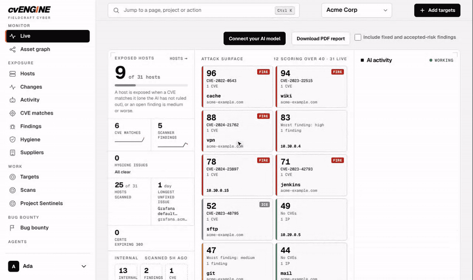
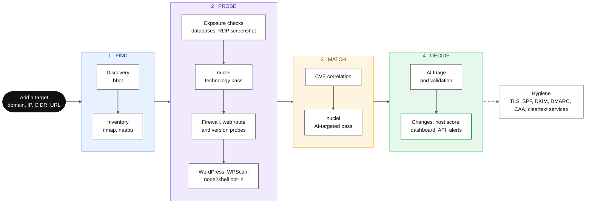

<p align="center">
  
</p>

<h3 align="center">The most advanced external attack surface assessment you can get for free.</h3>

<p align="center">
  Type in your domain. cvENGINE finds everything you expose, then tells you which of today's exploited CVEs can actually hit you, with proof.<br>
  No license fee. No per-asset pricing. No black box. 100% open source and self-hosted.
</p>

<p align="center">
  
  
  
  
  
</p>

---

<p align="center">
  
</p>

## Know what you expose. Fix what's exploitable first.

Attack surface tools find assets. Vulnerability scanners find flaws. Threat feeds find CVEs. **cvENGINE runs all three as one continuous loop** and hands you a verdict instead of a pile of alerts. It answers the question that matters: *of everything exploited today, what do I have exposed?*

- **Total visibility.** Domains, subdomains, IPs, ports, products, versions, TLS, and technologies, discovered for you and kept current in one Shodan-style inventory.
- **Exploitation-ranked.** Every CVE is rated [fire, smoke, or ice](docs/FIRE-SMOKE-ICE.md) from the real exploitation sources, then matched to what you actually run.
- **Proof, not noise.** AI triage plus read-only checks that reproduce the finding, with the exact command recorded.
- **Nothing changes unseen.** New hosts, opened ports, version bumps, and changed front pages land on a timeline.
- **Yours completely.** One Docker Compose stack on your own server. Bring your own AI keys, or run a local model.

## Everything in the box

| | |
| --- | --- |
| **Discover** | Subdomains, certificates, IPs, and ports with [bbot](https://github.com/blacklanternsecurity/bbot) and [naabu](https://github.com/projectdiscovery/naabu), a certificate transparency watch, weekly deep sweeps, and [Sentinels](docs/SENTINELS.md) that find hosts inside private networks |
| **Understand** | [nmap](https://nmap.org) service and OS fingerprints, UDP exposure, a TLS audit, web routes and their sign-in state, exposed databases and cloud storage, firewalls, WordPress, email and DNS hygiene, and an optional [OpenVAS](docs/OPENVAS.md) add-on |
| **Prioritize** | Fire, smoke, and ice ratings, a 0 to 100 score per host, and AI triage into confirmed, likely, or needs validation |
| **Verify** | Read-only validation with [Nuclei](https://github.com/projectdiscovery/nuclei), nmap, and banner probes. **Validate now** on any match |
| **Search** | [Shodan-style search](docs/SEARCH.md) over your own inventory: `port:3389 -host:vpn`, `tech:"apache tomcat" sev:high` |
| **Operate** | A live dashboard, a change timeline with screenshot diffs, PDF reports, organizations and roles, two-step sign-in, a REST API, an MCP server, and Slack, Discord, Telegram, and Lark alerts |
| **Hunt** | A [bug bounty workbench](docs/BUG-BOUNTY.md): program scope from HackerOne, Bugcrowd, Intigriti, and YesWeHack, and report drafts |
| **Bring your own AI** | Anthropic, OpenAI, OpenRouter, Ollama, LM Studio, or vLLM. Without a model it still discovers, scans, matches, and validates |

## New in 1.3

### Sentinels: scale out, and scan inside your network

Run a **Sentinel** on any machine and cvENGINE hands it scan work. Deploy one or a hundred to spread scanning across machines. Put one outside your network to see what the internet sees. Put one inside to reach what no outside scanner can: declare a private range, and the Sentinel finds the live hosts in it and runs the same nmap, naabu, Nuclei, TLS, UDP, WordPress, and OpenVAS checks on them, with the same CVE matching and the same dashboard. Provisioning is one copy-paste: press **Provision** on the Sentinels page, then `docker compose up -d` with the blob it gives you. Update and configure every Sentinel from cvENGINE. The client lives in [hevnsnt/cvengine-sentinel](https://github.com/hevnsnt/cvengine-sentinel). [Sentinels guide](docs/SENTINELS.md)

### OpenVAS, built in and off by default

Switch on Greenbone's [OpenVAS](docs/OPENVAS.md) from Settings and its network vulnerability tests run beside Nuclei and nmap, against the hosts you choose, on a slow, throttled, safe-checks-only schedule. Every result that names a CVE becomes a finding in the same list, the same fire, smoke, and ice ratings, and the same AI triage. Switched off, it costs nothing.

### And a ton more

- **Hard evidence only.** A CVE match now needs the same product and a version inside a bounded affected range. A product name alone no longer makes noise, and OS and kernel flaws stay host-only.
- **Asks the host what it is.** Safe version and identity probes fill in the version a fingerprint missed, so more of your inventory can be matched.
- **TLS audit.** [testssl.sh](https://github.com/testssl/testssl.sh) on every TLS port: protocols, ciphers, and the named TLS vulnerabilities, with hard CVE evidence.
- **UDP exposure scan.** DNS, NTP, SNMP, IKE, IPMI, SSDP, memcached and more, checked slowly in the background.
- **Cloud storage.** Public and dangling S3, Google Cloud Storage, and Azure Blob buckets.
- **More of every host.** Other sites on the same address, applications under subdirectories, and authenticated checks with stored headers or cookies.
- **Suppliers.** The vendors you depend on get a Shodan-style host card and a technology search.
- **One-click PDF reports** for a project or a host.
- **Tailscale.** Attach a tailnet, import its devices, scan them, and check its configuration.
- **Host inventory and runZero.** Hosts report their own OS, packages, and patches, and a runZero sync adds what it knows.
- **Saved searches with alerts,** per-host check coverage, internal-host flags, and a CVE match that opens on three clear cards.
- **Every Nuclei template by default,** LM Studio as an AI provider, one API keys page, and a friendly page while an update rebuilds.
- **Supply chain you can audit.** Pinned scanner versions checked before every release, and a CycloneDX bill of materials with every release.

Upgrading an existing install: [upgrading to 1.3](docs/UPGRADE.md#upgrading-to-13). Earlier releases are in the [changelog](CHANGELOG.md).

## How it works



Each scanner runs once per host inside a time window, so repeat scans stay fast. Any scanning stage can run on a [Sentinel](docs/SENTINELS.md) instead of the server. See the [pipeline](docs/PIPELINE.md) for every stage.

## Built on the best

cvENGINE stands on excellent open source work. Full credits and licenses are in [THIRD-PARTY.md](THIRD-PARTY.md).

| | |
| --- | --- |
| **Scanners** | [bbot](https://github.com/blacklanternsecurity/bbot), [Nuclei](https://github.com/projectdiscovery/nuclei) and its [templates](https://github.com/projectdiscovery/nuclei-templates), [naabu](https://github.com/projectdiscovery/naabu), [nmap](https://nmap.org), [testssl.sh](https://github.com/testssl/testssl.sh), [gowitness](https://github.com/sensepost/gowitness), [wafw00f](https://github.com/EnableSecurity/wafw00f), [WPScan](https://wpscan.com/), [aardwolf](https://github.com/skelsec/aardwolf), [node2shell](https://github.com/assetnote/node2shell-scanner), and optionally [OpenVAS](docs/OPENVAS.md) from [Greenbone](https://greenbone.github.io/docs/) |
| **Exploitation intelligence** | [cve.now](https://cve.now), [CISA KEV](https://www.cisa.gov/known-exploited-vulnerabilities-catalog), [ENISA EUVD](https://euvd.enisa.europa.eu/), [FIRST EPSS](https://www.first.org/epss/), [Exploit-DB](https://gitlab.com/exploit-database/exploitdb), [Metasploit](https://github.com/rapid7/metasploit-framework), [VulnCheck KEV](https://vulncheck.com), [CVE List V5](https://github.com/CVEProject/cvelistV5) |
| **Also** | [OSV](https://osv.dev), [Debian security tracker](https://security-tracker.debian.org), [crt.sh](https://crt.sh), [MailFail](https://github.com/ACK-J/MailFail), [bounty-targets-data](https://github.com/arkadiyt/bounty-targets-data), [Bugcrowd VRT](https://github.com/bugcrowd/vulnerability-rating-taxonomy), [Tailscale](https://github.com/tailscale/tailscale), [runZero](https://www.runzero.com), [Ollama](https://github.com/ollama/ollama), [LM Studio](https://lmstudio.ai), [vLLM](https://github.com/vllm-project/vllm), [Model Context Protocol](https://modelcontextprotocol.io) |

## Install in minutes

On a Linux server (Debian or Ubuntu is easiest, with 4 GB of RAM or more):

```bash
git clone https://github.com/hevnsnt/CVEngine.git
cd CVEngine
sudo ./install.sh
```

It asks nothing: it installs what is missing, generates every secret, creates the HTTPS certificate, starts cvENGINE, and prints the address and your admin password. Open the address, sign in, and add a domain. The setup wizard does the rest. Your browser will warn about the private certificate until you trust `secrets/certs/ca.crt`.

Step-by-step install, a public name with a trusted certificate, and Mac and Windows are in [Deployment](docs/DEPLOYMENT.md) and [Hosting online](docs/HOSTING-ONLINE.md).

## Safe by design

Read-only checks, no password lists, and no scanning of loopback, link-local, or cloud metadata addresses. Each organization's data is isolated, stored secrets are encrypted, and access is protected by two-step sign-in, an IP allowlist, and an audit log. Only scan systems you own or are authorized to test.

## Documentation

| Doc | What it covers |
| --- | --- |
| [Deployment](docs/DEPLOYMENT.md) and [Hosting online](docs/HOSTING-ONLINE.md) | Install, HTTPS, proxies, backups, dev stack |
| [Updates](docs/UPDATES.md) and [Upgrade](docs/UPGRADE.md) | Staying current |
| [Configuration](docs/CONFIGURATION.md) | Every setting |
| [Search](docs/SEARCH.md) | Shodan-style search, with examples |
| [Fire, smoke, and ice](docs/FIRE-SMOKE-ICE.md) | How CVEs are rated and why |
| [Pipeline](docs/PIPELINE.md) and [Architecture](docs/ARCHITECTURE.md) | How it works |
| [Compare](docs/COMPARISON.md) | cvENGINE and ProjectDiscovery, feature by feature |
| [Tenancy](docs/TENANCY.md), [Agent API](docs/AGENT-API.md), [AI usage](docs/AI-USAGE.md) | Teams, the REST API and MCP, and AI cost |
| [Bug bounty](docs/BUG-BOUNTY.md) and [Front end](docs/FRONTEND.md) | The bounty workbench and the interface |
| [Host inventory](docs/HOST-INVENTORY.md) | Hosts reporting their own OS, packages and patches with a script |
| [Sentinels](docs/SENTINELS.md) | Scaling scans across machines, and scanning private networks |
| [Tailscale](docs/TAILSCALE.md) | Scanning a tailnet and its Tailscale checks |
| [OpenVAS](docs/OPENVAS.md) | The optional Greenbone scanner: enabling it, its resource floor and what it imports |

## Credits and license

cvENGINE is a fork of [reNgine](https://github.com/yogeshojha/rengine) 2.x by Yogesh Ojha and its contributors, and builds on the projects above. See the [changelog](CHANGELOG.md), [contributors](CONTRIBUTORS.md), and [third-party software](THIRD-PARTY.md).

Released under the GPL-3.0. See [LICENSE](LICENSE).

[](https://m8ven.ai/mcp/hevnsnt-cvengine-s24yvi?s=readme)
