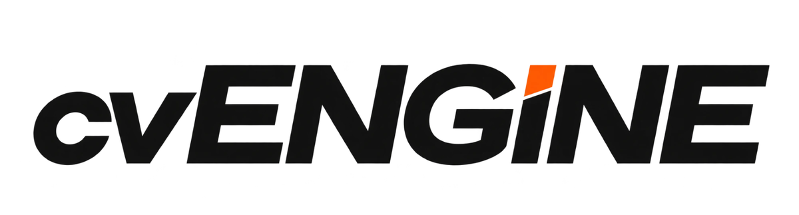
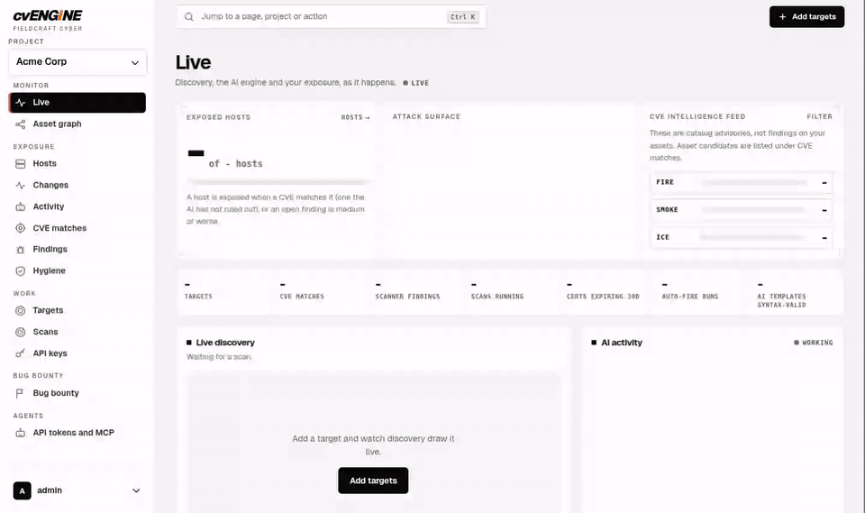
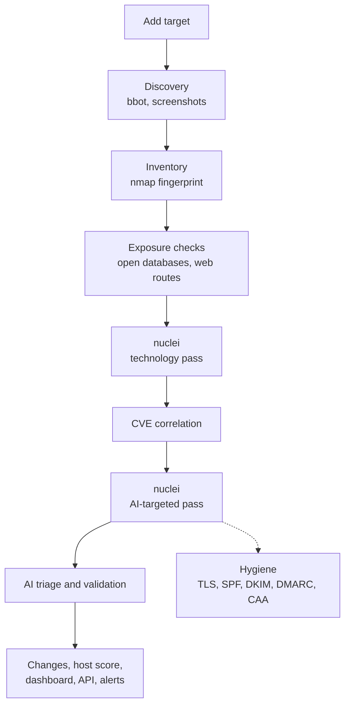
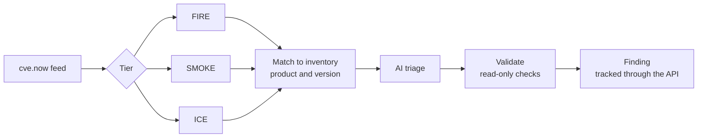

<p align="center">
  
</p>

<h3 align="center">The most advanced external attack surface assessment you can get for free.</h3>

<p align="center">
  Know what you expose. Know what is exploitable. Fix it first.<br>
  cvENGINE finds every asset you have on the internet, fingerprints every service and version, and tells you which of today's CVEs actually hit you, then proves it with safe, read-only checks. Enterprise-grade attack surface management with no license fee, no per-asset pricing, and no black box.
</p>

<p align="center">
  
  
  
  
  
</p>

---

<p align="center">
  
</p>

## Why cvENGINE

Attack surface tools find assets. Vulnerability scanners find flaws. Threat feeds find CVEs. cvENGINE runs all three as one continuous loop and hands you a verdict instead of a pile of alerts. It answers the only question that matters: **which of today's vulnerabilities are live on assets I own, and can I reproduce them?**

- **Total visibility.** Domains, subdomains, IPs, ports, products, versions, TLS, and technologies in one inventory that keeps itself current, from the first scan to the weekly deep dive.
- **Every CVE, matched to your internet facing environment.** The live [cve.now](https://cve.now) feed is rated [fire, smoke, or ice](docs/FIRE-SMOKE-ICE.md) and matched to what you actually run, by product and version, with distribution backports understood.
- **Verdicts, not noise.** AI triages every finding, read-only checks reproduce it, and fixed rules mean the model can never wave away hard evidence. Every check records exactly what it ran.
- **Changes to your environment are tracked** New hosts, opened ports, version bumps, new certificates, login pages that appear, and front pages that change all land on a timeline.
- **Start scanning in minutes.** One Docker Compose stack with every scanner built in. No agents to install, no cloud account to open.
- **Yours, completely.** Open source, self-hosted, GPL-3.0. Your inventory stays on your server, and you choose the AI model, including one that runs on your own hardware. No data goes back to me or Fieldcraft cyber. Deployed with your AI keys, so you control interaction with LLMs.

## Everything in the box

**Discover**
- Subdomain and asset discovery with [bbot](https://github.com/blacklanternsecurity/bbot) in passive, standard, and deep modes, plus screenshots.
- A certificate transparency watch that pulls newly issued hostnames into the full pipeline automatically.
- Targets as domains, IPs, CIDR ranges, or URLs, with bulk add by organization and project and scope control for shared provider domains.

**Understand**
- Host tracking: open ports, services, products, versions, OS, banners, TLS, and technologies, from nmap and nuclei fingerprinting. (shodan style)
- A slow background sweep of all 65,535 ports, one host at a time, so coverage grows without slowing your scans.
- Paced deep nuclei coverage that walks the whole inventory with the full template set every week.
- Web route checks that label each route open, login, session required, or SSO, and spot sensitive data in responses. Only the type, a count, and a masked sample are ever stored.
- Exposure checks for Redis, Memcached, PostgreSQL, Elasticsearch, and CouchDB servers that answer without a login.
- Hygiene checks for TLS certificates and SPF, DKIM, DMARC, and CAA records.

**Prioritize**
- Fire, smoke, and ice ratings from CISA KEV, EPSS, Exploit-DB, and CVSS.
- A 0 to 100 score for every host, with the reasons shown, used to sort hosts, search, and the attack-surface map.
- AI triage of CVE matches, scanner findings, open admin routes, and exposed credentials into confirmed, likely, needs validation, or likely false positive.
- An AI review every three hours that queues the triage, validation, and rescans that are due, and right-sizes scanner concurrency from real measurements.

**Verify**
- Automatic read-only validation: a vetted nuclei template, a single-port nmap check, a version banner probe, or the database check. Fire and smoke findings jump the queue, and each result records the exact command it ran.
- **Validate now** on any CVE match: the AI plans the checks, cvENGINE runs them, and the AI reviews the evidence.
- When no template exists for a CVE, the AI drafts one. It runs on your hosts only after it passes static, syntax, and fixture checks and a reviewed positive test proves it detects the flaw.
- Optional auto-fire tests matching CVEs on their hosts as soon as the feed delivers them.

**Operate**
- A live dashboard with a discovery graph, an AI activity log, and a Changes page with side-by-side screenshot diffs.
- **Rescan**, archive, pin, or exclude any host. Archived hosts are rechecked daily and come back on their own when they reappear.
- One switch to pause all scanning, which holds across restarts.
- For administrators: scheduler and worker health, an activity and error log, and AI model usage with cost estimates.
- Teams: organizations, projects, four roles, MFA, an audit log, and an IP allowlist.
- A REST API and an MCP server, so agents can add scoped targets, start and inspect scans, read findings, request validation, and drive remediation under the same project permissions.
- Notifications to Slack, Discord, Telegram, and Lark.
- Memory-aware scheduling that keeps small servers healthy, and updates that drain running work before they restart anything.

**Bring your own AI.** Anthropic, OpenAI, OpenRouter, Ollama, or vLLM, with keys stored encrypted. Without a model cvENGINE still discovers, scans, matches CVEs, and validates findings. The AI adds triage, targeted scans, and generated templates.

## How it works

Add a target and cvENGINE runs one pipeline for it. Each scanner runs once per host inside a time window, so repeat scans stay fast.



Meanwhile the CVE feed runs on its own schedule:



See [Pipeline](docs/PIPELINE.md) for each stage and [Architecture](docs/ARCHITECTURE.md) for the services.

## Quick start

You need Linux, [Docker Engine](https://docs.docker.com/engine/install/) with the Compose plugin, `git`, and `make`. 8 GB of RAM and 20 GB of disk are recommended.

```bash
git clone https://github.com/hevnsnt/cvENGINE.git
cd cvENGINE
cp .env.example .env     # set DOMAIN_NAME and replace every change-me
make certs               # HTTPS certificate for the built-in proxy
make up                  # build and start (the first build takes about 30 minutes)
make username            # create your admin account
```

Open `https://<your DOMAIN_NAME>/`. The setup wizard creates your organization, project, and first target. On a fresh Linux machine, `sudo ./install.sh` installs Docker and runs these steps for you.

Next: open **Settings, AI model** to add a key (optional), click **Add targets**, and watch discovery on the dashboard.

Updates are one command (`scripts/update.sh`), an approval in the app, or fully automatic on every new commit ([automatic deployment](docs/UPDATES.md#automatic-deployment)). Details, reverse proxy setup, and the development stack are in [Deployment](docs/DEPLOYMENT.md).

## Built for teams and agents

Paste targets grouped by organization and project, and cvENGINE creates the projects for you:

```text
##Acme Corp
#Website
example.com
203.0.113.0/28
#Staging
198.51.100.7
```

Create a token on **API tokens and MCP** and send `Authorization: Bearer <token>` to `/api/v1/`, or connect an MCP client to `/mcp/`. Tokens use the roles of their user, and read-only tokens are supported. See [Agent API](docs/AGENT-API.md).

## Safe by design

- nuclei runs only templates that pass read-only and destination checks, and credentials are never guessed.
- Loopback, link-local, and cloud metadata addresses are never scanned, and private ranges stay off until you allow them.
- Injection attempts are blocked, and repeat offenders are banned.
- Each project's data is isolated, and stored secrets are encrypted.
- Two-step sign-in, an IP allowlist, and an audit log protect access.

Only scan systems you own or are authorized to test.

## Documentation

| Doc | What it covers |
| --- | --- |
| [Fire, smoke, and ice](docs/FIRE-SMOKE-ICE.md) | How cvENGINE rates every CVE and why |
| [Pipeline](docs/PIPELINE.md) | How a target becomes findings |
| [Architecture](docs/ARCHITECTURE.md) | Services, data, and where AI is used |
| [Configuration](docs/CONFIGURATION.md) | Environment variables |
| [Deployment](docs/DEPLOYMENT.md) | HTTPS, proxies, AI models, backups, dev stack |
| [Tenancy](docs/TENANCY.md) | Organizations, roles, and two-step sign-in |
| [Agent API](docs/AGENT-API.md) | REST API and MCP tools |
| [AI usage](docs/AI-USAGE.md) | Tracking model calls, tokens, and cost |
| [Updates](docs/UPDATES.md) and [Upgrade](docs/UPGRADE.md) | Staying current |
| [Front end](docs/FRONTEND.md) | Design system and pages |

## Credits and license

cvENGINE is a fork of [reNgine](https://github.com/yogeshojha/rengine) 2.x and builds on [bbot](https://github.com/blacklanternsecurity/bbot), [nuclei](https://github.com/projectdiscovery/nuclei), [nmap](https://nmap.org), [gowitness](https://github.com/sensepost/gowitness), [VivaGraphJS](https://github.com/anvaka/VivaGraphJS), [naabu](https://github.com/projectdiscovery/naabu), and the [cve.now](https://cve.now) feed. See the [changelog](CHANGELOG.md), [contributors](CONTRIBUTORS.md), and [third-party software](THIRD-PARTY.md).

Released under the GPL-3.0. See [LICENSE](LICENSE).
