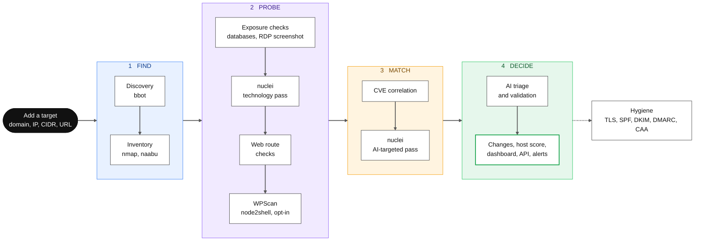
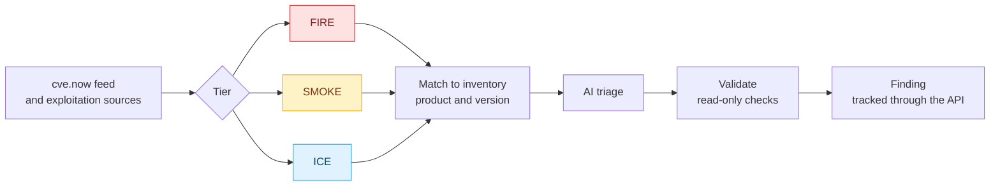

<p align="center">
  
</p>

<h3 align="center">The most advanced external attack surface assessment you can get for free.</h3>

<p align="center">cvENGINE automatically discovers and maps your internet-facing assets, fingerprints every service and version it finds, and tells you which of today's exploited CVEs actually hit you, then reproduces what it can with safe, read-only checks. Enterprise-grade attack surface management with no license fee, no per-asset pricing, and fully opensource.
</p>

<p align="center">
  
  
  
  
  
</p>

---

<p align="center">
  
</p>

## Why cvENGINE

Attack surface tools find assets. Vulnerability scanners find flaws. Threat feeds find CVEs. cvENGINE runs all three as one continuous loop and hands you a verdict instead of a pile of alerts. It answers the one question that matters: **which of today's vulnerabilities are live on assets I own, and can I reproduce them?**

- **Total visibility.** Domains, subdomains, IPs, ports, products, versions, TLS, and technologies are auto-discovered and stored in one Shodan-style inventory that keeps itself current. Just enter your domain name and cvENGINE does the rest.
- **Matched to your environment.** The live [cve.now](https://cve.now) feed and the major exploitation sources are rated [fire, smoke, or ice](docs/FIRE-SMOKE-ICE.md) and matched to what you actually run, by product and version, with distribution backports understood.
- **Verdicts, not noise.** AI triages your findings, read-only checks reproduce what they can, and fixed rules mean the model can never wave away hard evidence. Every check records exactly what it ran.
- **Nothing changes unseen.** New hosts, opened ports, version bumps, new certificates, login pages that appear, and front pages that change all land on a timeline.
- **Scanning in minutes.** One Docker Compose stack with every scanner built in. No agents to install, no cloud account to open.
- **Yours, completely.** Open source and self-hosted. Your inventory stays on your server, and you bring your own AI keys or run a model on your own hardware. Nothing is sent to the authors.

## Everything in the box

**Discover.** [bbot](https://github.com/blacklanternsecurity/bbot) subdomain and asset discovery in passive, standard, and deep modes (screenshots in deep). A certificate transparency watch that pulls new hostnames straight into assessment. Targets as domains, IPs, CIDR ranges, or URLs, bulk added by organization and project. Every apex domain gets a deep sweep each week.

**Understand.** One record per host: ports, services, products, versions, OS, banners, TLS, and technologies, from [nmap](https://nmap.org) and [nuclei](https://github.com/projectdiscovery/nuclei). [naabu](https://github.com/projectdiscovery/naabu) sweeps every port of each address before nmap fingerprints it, plus a background sweep of all 65,535 ports, one host at a time, for anything that changes in between. Web route checks that label each route open, login, session required, SSO, or redirect. Exposure checks for Redis, Memcached, PostgreSQL, Elasticsearch, and CouchDB that answer without a login. Email and domain hygiene: SPF, DKIM, DMARC, CAA, MTA-STS, DANE, DNSSEC, and TLS.

**Prioritize.** [Fire, smoke, and ice](docs/FIRE-SMOKE-ICE.md) ratings from [CISA KEV](https://www.cisa.gov/known-exploited-vulnerabilities-catalog), [ENISA EUVD](https://euvd.enisa.europa.eu/), [Metasploit](https://github.com/rapid7/metasploit-framework), [Exploit-DB](https://gitlab.com/exploit-database/exploitdb), [EPSS](https://www.first.org/epss/), [CVSS](https://www.first.org/cvss/), and optionally [VulnCheck KEV](https://vulncheck.com). A 0 to 100 score for every host, with the reasons shown. AI triage of every finding into confirmed, likely, needs validation, likely false positive, or not applicable. Connect your own AI, with your own API keys (Anthropic, OpenAI, OpenRouter) or a model on your own hardware (Ollama, vLLM), and a review every three hours queues the next triage, validation, or rescan per project and tunes scanner concurrency from real measurements.

**Verify.** Automatic read-only validation: a vetted nuclei template, a single-port nmap check, a banner probe, or the database check, each recording the exact command it ran. **Validate now** on any CVE match. When no template exists, the AI drafts one, and it never runs on your hosts until a person approves it. Optional auto-fire (off by default) tests new CVEs on matching hosts as the feed delivers them.

**Operate.** Search every host, port, banner, and finding the way you search Shodan: `port:3389 -host:vpn`, `tech:"apache tomcat" sev:high`, `ip:203.0.113.0/24 product:nginx` ([Search](docs/SEARCH.md)). A live dashboard, an AI activity log, and a Changes page with side-by-side screenshot diffs. Rescan, pin, exclude, or archive any host, and record its owner and criticality. Organizations, projects, roles (admin, user, audit), an All projects view, two-step sign-in, an IP allowlist, and an audit log. A REST API, an MCP server, and an OpenAPI spec so agents work under the same permissions. A [bug bounty workbench](docs/BUG-BOUNTY.md) for hunters: browse HackerOne, Bugcrowd, Intigriti, and YesWeHack programs and scope, point the scanner at what is in scope, and draft reports from its findings. Off until an admin enables it. Slack, Discord, Telegram, and Lark alerts if you don't want to monitor a dashboard. One switch pauses all scanning. Memory-aware scheduling keeps small servers healthy, and updates drain running work first or deploy automatically on every new commit.

**Bring your own AI.** Anthropic, OpenAI, OpenRouter, Ollama, or vLLM, with keys stored encrypted. Without a model, cvENGINE still discovers, scans, matches CVEs, and validates findings. The AI adds triage, targeted scans, and template drafts.

## Built on the best

cvENGINE stands on excellent open source work. Full credits and licenses are in [THIRD-PARTY.md](THIRD-PARTY.md).

| | |
| --- | --- |
| **Scanners** | [bbot](https://github.com/blacklanternsecurity/bbot) discovery, [nuclei](https://github.com/projectdiscovery/nuclei) and its [templates](https://github.com/projectdiscovery/nuclei-templates), [nmap](https://nmap.org), [naabu](https://github.com/projectdiscovery/naabu), [gowitness](https://github.com/sensepost/gowitness) screenshots, [WPScan](https://wpscan.com/) for WordPress, [aardwolf](https://github.com/skelsec/aardwolf) RDP screenshots, [node2shell](https://github.com/assetnote/node2shell-scanner) detection |
| **Exploitation intelligence** | [CVE feed cve.now](https://cve.now), [CISA KEV](https://www.cisa.gov/known-exploited-vulnerabilities-catalog), [ENISA EUVD](https://euvd.enisa.europa.eu/), [FIRST EPSS](https://www.first.org/epss/), [Exploit-DB](https://gitlab.com/exploit-database/exploitdb), [Metasploit](https://github.com/rapid7/metasploit-framework), [VulnCheck KEV](https://vulncheck.com), [CVE List V5](https://github.com/CVEProject/cvelistV5) |
| **Backport and certificate data** | [OSV](https://osv.dev), [Debian security tracker](https://security-tracker.debian.org), [crt.sh](https://crt.sh) |
| **Email security checks** | adapted from [MailFail](https://github.com/ACK-J/MailFail) |
| **Bug bounty data** | [bounty-targets-data](https://github.com/arkadiyt/bounty-targets-data), [Bugcrowd VRT](https://github.com/bugcrowd/vulnerability-rating-taxonomy) |
| **AI** | [Anthropic](https://www.anthropic.com), [OpenAI](https://openai.com), [OpenRouter](https://openrouter.ai), [Ollama](https://github.com/ollama/ollama), [vLLM](https://github.com/vllm-project/vllm), over the [Model Context Protocol](https://modelcontextprotocol.io) |
| **Platform** | [Django](https://github.com/django/django), [Celery](https://github.com/celery/celery), [PostgreSQL](https://www.postgresql.org), [Redis](https://github.com/redis/redis), [nginx](https://github.com/nginx/nginx), [Gunicorn](https://github.com/benoitc/gunicorn), [WeasyPrint](https://github.com/Kozea/WeasyPrint), [VivaGraphJS](https://github.com/anvaka/VivaGraphJS), [Geist](https://github.com/vercel/geist-font) |

## How it works

Add a target and cvENGINE runs one pipeline for it. Each scanner runs once per host inside a time window, so repeat scans stay fast.



Meanwhile the CVE feed runs on its own schedule:



See [Pipeline](docs/PIPELINE.md) for each stage and [Architecture](docs/ARCHITECTURE.md) for the services.

## Quick start

You need Linux with [Docker Engine](https://docs.docker.com/engine/install/) and the Compose plugin, plus `git`, `make`, and `python3`. 8 GB of RAM and 20 GB of disk are recommended.

```bash
git clone https://github.com/hevnsnt/CVEngine.git
cd CVEngine
./scripts/init-env.sh    # creates .env and generates its database and certificate passwords
nano .env                # set DOMAIN_NAME to the name people will type
make certs               # HTTPS certificate for the built-in proxy
make up                  # build and start (the first build takes about 30 minutes)
make admin               # create your admin account: its password is generated and printed once
```

`make admin` prints your username and a generated password once, so copy it from the terminal. You choose your own at your first sign-in. If you lose it before then, `make admin-password` prints a new one. (To pick the password yourself instead, put it in `DJANGO_SUPERUSER_PASSWORD` in `.env` first, or run `make username`.)

Open `https://<your DOMAIN_NAME>/`. Browsers warn about the private certificate authority until you trust `secrets/certs/ca.crt`. The setup wizard creates your organization and project, offers an optional AI model, adds your first target (discovery starts the moment you add it), and offers optional search-engine keys. On a fresh Debian or Ubuntu machine, `sudo ./install.sh` installs Docker and runs these steps for you, ending with the admin password.

Update with `scripts/update.sh`, or deploy every new commit automatically ([updates](docs/UPDATES.md)). Reverse proxies, backups, and the development stack are in [Deployment](docs/DEPLOYMENT.md).

## Built for teams and agents

Paste targets grouped by organization and project, and cvENGINE creates the projects for you (organization admins):

```text
##Acme Corp
#Website
example.com
203.0.113.0/28
#Staging
198.51.100.7
```

Create a token on **API tokens and MCP** and send `Authorization: Bearer <token>` to `/api/v1/`, or connect an MCP client to `/mcp/`. Tokens use the roles of their user, and read-only tokens are supported. See the [Agent API](docs/AGENT-API.md).

## Safe by design

- nuclei runs only templates that pass read-only and destination checks, and no password lists are ever tried: each database gets one attempt with no password (or none at all).
- Loopback, link-local, and cloud metadata addresses are never scanned, private ranges stay off until you allow them, and addresses on shared platforms such as CDNs are never port-scanned.
- Injection attempts are blocked, and at the strike threshold the account is disabled and the source IP is blocked for 24 hours.
- Each project's data is isolated, and stored secrets are encrypted.
- Two-step sign-in, an IP allowlist, and an audit log protect access.

Only scan systems you own or are authorized to test.

## Documentation

| Doc | What it covers |
| --- | --- |
| [Fire, smoke, and ice](docs/FIRE-SMOKE-ICE.md) | How cvENGINE rates every CVE and why |
| [Search](docs/SEARCH.md) | Shodan-style search over your inventory, with examples |
| [Pipeline](docs/PIPELINE.md) | How a target becomes findings |
| [Architecture](docs/ARCHITECTURE.md) | Services, data, and where AI is used |
| [Configuration](docs/CONFIGURATION.md) | Environment variables |
| [Deployment](docs/DEPLOYMENT.md) | HTTPS, proxies, AI models, backups, dev stack |
| [Updates](docs/UPDATES.md) and [Upgrade](docs/UPGRADE.md) | Staying current |
| [Tenancy](docs/TENANCY.md) | Organizations, roles, and two-step sign-in |
| [Agent API](docs/AGENT-API.md) | REST API and MCP tools |
| [Bug bounty](docs/BUG-BOUNTY.md) | Programs, scope, reports, and submission |
| [AI usage](docs/AI-USAGE.md) | Tracking model calls, tokens, and cost |
| [Front end](docs/FRONTEND.md) | Design system and pages |

## Credits and license

cvENGINE is a fork of [reNgine](https://github.com/yogeshojha/rengine) 2.x by Yogesh Ojha and its contributors, and builds on the projects above. See the [changelog](CHANGELOG.md), [contributors](CONTRIBUTORS.md), and [third-party software](THIRD-PARTY.md).

Released under the GPL-3.0. See [LICENSE](LICENSE).
