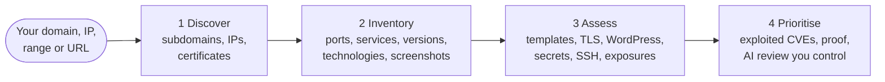

<p align="center">
  
</p>

<h3 align="center">The most advanced external assessment platform you can run yourself.</h3>

<p align="center">
  Give it your domain. cvENGINE discovers the assets you expose, builds a Shodan-style inventory of them with the best open-source tools,<br>
  then assesses every host with industry-standard scanners and shows you what to fix first, with the evidence.
</p>

<p align="center">
  <a href="CHANGELOG.md"></a>
  <a href="LICENSE"></a>
  
</p>

---

## cvENGINE 1.4.0 is here

| | |
| --- | --- |
| **Every scan runs on a Sentinel** | The server runs no scans. A built-in scanner ships with every install; add your own [Sentinels](docs/SENTINELS.md) to scale out or to scan inside a private network. |
| **Set up in the browser** | `install.sh` is a thin bootstrap. A [setup wizard](docs/DEPLOYMENT.md#setup-wizard) takes your organization, project and first domain, and discovery starts at once. |
| **What needs you, ranked** | [Situations](docs/SITUATIONS.md) lists the hosts that need a person, most urgent first. Findings a check reproduced show their proof first, and a finding marked fixed is checked again. |
| **Exposed secrets and SSH** | A project secrets inventory fed by Kingfisher, and SSH inspection with sshamble that checks host keys against a known-bad list and never logs in. |
| **Nothing switches on unseen** | Credential checks, the AI reviewer and anything else that costs money or widens a scan stay off until an administrator says yes. API tokens and AI agents cannot turn them on. |
| **Runs itself** | A [watchdog](docs/WATCHDOG.md) repairs stuck workers, auto-tuning checks every change it makes and undoes what hurt, and you can publish through a [Cloudflare Tunnel](docs/HOSTING-ONLINE.md) with no inbound port. |

Upgrading from 1.3? Read [upgrading to 1.4](docs/UPGRADE.md#upgrading-to-14) and the [operator notes](docs/1.4-OPERATOR-NOTES.md) first: back up, check free disk, and update your Sentinels. Every change is in the [changelog](CHANGELOG.md).

## From domain to verdict



1. **Discover.** Point cvENGINE at a domain and it finds the subdomains, addresses and certificates that belong to you, keeps watching certificate transparency, and repeats a deep sweep every week.
2. **Inventory.** Every host, open port, service, product version, technology, certificate and front page goes into one inventory you can [search like Shodan](docs/SEARCH.md): `port:3389 -host:vpn`, `tech:"apache tomcat" sev:high`. New hosts, opened ports and version changes land on a timeline.
3. **Assess.** Each host is tested with industry-standard scanners and cvENGINE's own read-only checks, and a CVE is matched to a host only when the product is the same and its version falls inside the affected range.
4. **Prioritise.** Every CVE is rated [fire, smoke or ice](docs/FIRE-SMOKE-ICE.md) from real exploitation data, each host gets a 0 to 100 score, and AI triage, when you switch it on, sorts findings into confirmed, likely or needs validation. The AI never closes a finding a check proved.

All scanning runs on [Sentinels](docs/SENTINELS.md), never on the server. The [pipeline](docs/PIPELINE.md) describes every stage.

## The tools behind it

cvENGINE runs the best open-source security tools. The scanner image pins each tool it installs to an exact version, and the pins are checked before every release. The About page of your install lists them with their versions, and [THIRD-PARTY.md](THIRD-PARTY.md) gives each license.

| Stage | Tool | What cvENGINE uses it for |
| --- | --- | --- |
| **Discovery** | [bbot](https://github.com/blacklanternsecurity/bbot) | Subdomain, address and asset discovery, streamed into the inventory as it runs |
| | [baddns](https://github.com/blacklanternsecurity/baddns) | Dangling DNS and subdomain takeover candidates, run inside bbot |
| | [crt.sh](https://crt.sh) | Certificate transparency lookups that catch new names between scans |
| **Inventory and fingerprinting** | [naabu](https://github.com/projectdiscovery/naabu) | A sweep of all 65,535 TCP ports of each address |
| | [Nmap](https://nmap.org) | Service, version and OS fingerprints, reviewed scripts, and a slow UDP exposure scan |
| | [Nuclei](https://github.com/projectdiscovery/nuclei) | A technology pass that names what each web host runs |
| | [wafw00f](https://github.com/EnableSecurity/wafw00f) | Names the web application firewall in front of a site |
| | [Playwright](https://playwright.dev) with headless Chromium | Screenshots of every web page a host serves |
| | [gowitness](https://github.com/sensepost/gowitness) | Front-page screenshots during discovery, installed by bbot |
| | [aardwolf](https://github.com/skelsec/aardwolf) | The login-screen screenshot of an RDP server that allows it without credentials |
| **Assessment** | [Nuclei](https://github.com/projectdiscovery/nuclei) and [nuclei-templates](https://github.com/projectdiscovery/nuclei-templates) | The community template library, AI-targeted passes and per-CVE checks; denial-of-service and credential templates are left out by default |
| | [testssl.sh](https://github.com/testssl/testssl.sh) | Protocols, ciphers and the named TLS vulnerabilities on every TLS port |
| | [WPScan](https://github.com/wpscanteam/wpscan) | WordPress core, plugin and theme vulnerabilities (add a [wpscan.com](https://wpscan.com/) token for its vulnerability data) |
| | [Kingfisher](https://github.com/mongodb/kingfisher) | API keys, tokens and private keys your pages and scripts serve, kept in a Secrets inventory |
| | [sshamble](https://github.com/runZeroInc/sshamble) | SSH handshake and host keys, checked against the [badkeys](https://badkeys.info) blocklist; it never logs in |
| | [node2shell detector](https://github.com/assetnote/node2shell-scanner) | Assetnote's read-only check for CVE-2026-111497; off by default |
| | cvENGINE's own checks | Exposed databases, public and dangling cloud storage (S3, Google Cloud Storage, Azure Blob), web routes and their sign-in state, version probes, and DNS and email hygiene based on [MailFail](https://github.com/ACK-J/MailFail) |
| **Exploitation intelligence** | [cve.now](https://cve.now), [CISA KEV](https://www.cisa.gov/known-exploited-vulnerabilities-catalog), [ENISA EUVD](https://euvd.enisa.europa.eu/), [VulnCheck KEV](https://vulncheck.com), [FIRST EPSS](https://www.first.org/epss/), [Exploit-DB](https://gitlab.com/exploit-database/exploitdb), [Metasploit](https://github.com/rapid7/metasploit-framework), [CVE List V5](https://github.com/CVEProject/cvelistV5), [OSV](https://osv.dev), [Debian security tracker](https://security-tracker.debian.org) | Which CVEs are exploited today, and which fixes a distribution backported |
| **Optional add-ons** | [OpenVAS](https://greenbone.github.io/docs/latest/) (Greenbone Community Edition) | A second network vulnerability scanner on a Sentinel, for your hottest hosts. Off by default ([OpenVAS](docs/OPENVAS.md)) |
| | [Tailscale](https://github.com/tailscale/tailscale) | Optional: join a tailnet, import and scan its devices, and check its configuration ([Tailscale](docs/TAILSCALE.md)) |
| | [runZero](https://www.runzero.com) | Optional: a scheduled sync of runZero's asset data with your own token ([Configuration](docs/CONFIGURATION.md#runzero)) |
| | bbot's keyed sources | Optional: Shodan, Censys, VirusTotal, SecurityTrails, GitHub, Chaos and more, with your own API keys ([Configuration](docs/CONFIGURATION.md#api-keys)) |
| **AI (bring your own, off until you choose)** | [Anthropic](https://www.anthropic.com), [OpenAI](https://openai.com), [OpenRouter](https://openrouter.ai), [Ollama](https://github.com/ollama/ollama), [LM Studio](https://lmstudio.ai), [vLLM](https://github.com/vllm-project/vllm) | Finding triage, Nuclei targeting and the [AI reviewer](docs/AI-REVIEWER.md) in its own container. Without a model cvENGINE still discovers, scans and matches |
| | [Model Context Protocol](https://modelcontextprotocol.io) | An MCP server and a REST API for your own agents ([Agent API](docs/AGENT-API.md)) |

<p align="center">
  <br>
  <sub>Tour recorded on 1.3 with demo data. 1.4 has a simpler left rail of eight entries.</sub>
</p>

## Install in minutes

You need a Linux server (Debian or Ubuntu is easiest) with at least 4 GB of RAM (8 GB for comfort) and 20 GB of free disk.

```bash
git clone https://github.com/hevnsnt/CVEngine.git
cd CVEngine
sudo ./install.sh
```

The installer adds what is missing, generates every secret, creates the HTTPS certificate, starts cvENGINE with its built-in scanner, and prints the address and where your generated admin password is. Sign in and the setup wizard does the rest. Automation can pass `--sentinels=internal|both|external` and `-n`. OpenVAS is never installed by it. Your browser warns about the private certificate until you trust `secrets/certs/ca.crt`.

A public name with a trusted certificate, a Cloudflare Tunnel, Mac and Windows: see [Deployment](docs/DEPLOYMENT.md) and [Hosting online](docs/HOSTING-ONLINE.md).

## Safe by design

- **Read-only by default.** No password lists. Checks that send credentials (Nuclei's default-login and brute-force templates) are off until an App Admin allows them, and denial-of-service templates are excluded.
- **You draw the lines.** Loopback, link-local and cloud metadata addresses are never scanned, and each organization keeps a list of [addresses we must never scan](docs/1.4-OPERATOR-NOTES.md#addresses-we-must-never-scan) that holds whatever name leads there.
- **You hold the switches.** AI validation, the AI reviewer, OpenVAS and anything else that costs money start off, and an update asks before it changes them.
- **Locked down.** Organization data is isolated, stored secrets are encrypted, and access is guarded by two-step sign-in, an IP allowlist and an audit log.

Only scan systems you own or are authorized to test.

## Documentation

| Doc | What it covers |
| --- | --- |
| [Deployment](docs/DEPLOYMENT.md) and [Hosting online](docs/HOSTING-ONLINE.md) | Install, HTTPS, Cloudflare, backups, small hosts |
| [Updates](docs/UPDATES.md), [Upgrade](docs/UPGRADE.md) and [1.4 operator notes](docs/1.4-OPERATOR-NOTES.md) | Staying current, and what 1.4 changes for an operator |
| [Sentinels](docs/SENTINELS.md) and [Built-in scanner](docs/BUILTIN-SCANNER.md) | Where every scan runs, scaling out and scanning private networks |
| [Pipeline](docs/PIPELINE.md) and [Architecture](docs/ARCHITECTURE.md) | How it works, stage by stage |
| [Search](docs/SEARCH.md), [Situations](docs/SITUATIONS.md) and [Fire, smoke, and ice](docs/FIRE-SMOKE-ICE.md) | Finding what matters, and how CVEs are rated |
| [Configuration](docs/CONFIGURATION.md) | Every setting |
| [AI reviewer](docs/AI-REVIEWER.md), [AI usage](docs/AI-USAGE.md) and [Secrets](docs/SECRETS-PLAN.md) | The boxed-in reviewer, AI cost, and the exposed-secrets inventory |
| [OpenVAS](docs/OPENVAS.md) and [Tailscale](docs/TAILSCALE.md) | The optional add-ons |
| [Tenancy](docs/TENANCY.md), [Agent API](docs/AGENT-API.md) and [Host inventory](docs/HOST-INVENTORY.md) | Teams and roles, the REST API and MCP, and hosts reporting their own packages |
| [Bug bounty](docs/BUG-BOUNTY.md), [Watchdog](docs/WATCHDOG.md) and [Front end](docs/FRONTEND.md) | The bounty workbench, self-repair, and the interface |

## Contributing and security

Issues and pull requests are welcome: see [CONTRIBUTING](.github/CONTRIBUTING.md). Please report vulnerabilities privately through the repository's **Security** tab, as the [security policy](.github/SECURITY.md) explains.

## Credits and license

cvENGINE is a fork of [reNgine](https://github.com/yogeshojha/rengine) 2.x by Yogesh Ojha and its contributors, and builds on the projects above. The Sentinel client lives in [hevnsnt/cvENGINE-sentinel](https://github.com/hevnsnt/cvENGINE-sentinel). Thanks to our beta testers, above all [camstork](https://github.com/camstork), whose careful reports shaped 1.3. See the [changelog](CHANGELOG.md), [contributors](CONTRIBUTORS.md), and [third-party software](THIRD-PARTY.md).

"Shodan-style" describes the kind of search; cvENGINE is not affiliated with Shodan.

Released under the GPL-3.0. See [LICENSE](LICENSE).

[](https://m8ven.ai/mcp/hevnsnt-cvengine-s24yvi?s=readme)
