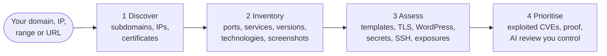

<p align="center">
  
</p>

<h3 align="center">The most advanced external assessment platform.</h3>

<p align="center">Discover the assets you expose and map them in a Shodan-style inventory.</p>

<p align="center">Assess each host with industry-standard scanners and fix what matters first.</p>

<p align="center">
  <a href="CHANGELOG.md"></a>
  <a href="LICENSE"></a>
  
</p>

<p align="center">
  
</p>

<p align="center"><sub>cvENGINE 1.4.1 on demo data.</sub></p>

---

**cvENGINE watches the CVE feeds around the clock and shows you, with proof, which new CVEs actually reach your hosts.**

### Every new CVE, checked against your hosts

1. **Watch the feeds.** New CVEs and fresh exploitation news arrive all day from the sources that matter.
2. **Find who is exposed.** Each CVE is matched to the hosts that run the affected product and version.
3. **Write the check.** When no vetted check exists, your AI drafts a read-only one that cvENGINE validates first.
4. **Prove it on your hosts.** A Sentinel reproduces each match with a read-only check and keeps the evidence.
5. **Cut the noise.** AI reviews the evidence, so what is real rises and likely false positives sink.

**Bring your own AI:** Anthropic, OpenAI or OpenRouter on your own key, or fully local with Ollama, LM Studio or vLLM. It is off until you switch it on, and it never closes a finding a check proved. Without a model, cvENGINE still discovers, scans, matches and validates.

<details>
<summary><b>How it works, exactly</b></summary>

- **Feeds.** The [cve.now](https://cve.now) feed is read every 30 minutes. CISA KEV, ENISA EUVD, FIRST EPSS, Exploit-DB, Metasploit and, with a key, VulnCheck KEV are read every hour, so a CVE that becomes exploited turns hot within the hour.
- **Matching.** A CVE becomes a match only when a host runs the same product at a version inside a bounded affected range. A product seen with no version never makes a match.
- **Checks the AI writes.** For hot CVEs, within a daily budget, the AI reads the advisory and records how to detect it. When no vetted Nuclei template exists it can draft a read-only one, which runs on a host only after the system validated it: syntax and a harmless loopback control on a Sentinel, an offline test against an affected and a fixed response, and a second AI pass. This ships off: an administrator switches on **Validate AI-written checks automatically**.
- **Proof.** Every five minutes up to 20 matches, fire first, are reproduced on a Sentinel with one of six read-only checks: a vetted Nuclei template, `nmap -sV` on the one port, a version banner request, the credential-less database check, a version and identity probe, or a JavaScript library read. The exact command and result are kept. A check that does not reproduce a finding never lowers it.
- **Triage.** CVE matches, scanner findings, open databases, open admin routes, routes exposing credentials and hygiene findings of medium severity or worse are rated confirmed, likely, needs validation, likely false positive or not applicable, within daily caps (by default 500 per project and 2,000 in all).
- **AI reviewer.** Reads each open finding once, up to 300 a day by default, and records whether it is real. It closes a false positive only when you allow it and only when the finding has no hard evidence and no person has worked it.
- **Floors.** Hard evidence sets a floor the model cannot go below: a template hit, a database that answered or a validation hit is confirmed, and a version inside the affected range is at least needs validation. The model alone can never confirm a finding.
- **Your AI, your controls.** For triage and review the model sees structured evidence with host names redacted, it has no tools, and the server checks every answer before it counts. Redaction covers host names, not everything: internal IP addresses, other internal host names and file paths that appear inside banners or page titles are sent as they are, and request paths are sent on purpose as evidence. With a cloud provider that text leaves your network; with a local model (Ollama, LM Studio, vLLM) it does not. The AI jobs have daily caps, and the usage page shows calls, tokens and cost estimates. The AI reviewer, AI-written checks and auto-fire (AI confirmation and tests as soon as a new hot CVE lands) each ship switched off.

More in [Pipeline](docs/PIPELINE.md#triage-and-validation), [CVE intelligence](docs/PIPELINE.md#cve-intelligence) and [AI reviewer](docs/AI-REVIEWER.md).

</details>

### Know everything you expose

cvENGINE is a self-hosted external attack surface and vulnerability assessment platform. Give it your domains and it keeps discovering the subdomains, addresses and certificates you expose, in a searchable, Shodan-style inventory of every host, port, service, technology and certificate. Forgotten and shadow assets come to light, and new hosts, opened ports and version changes land on a timeline as soon as a scan sees them. Every host is assessed with industry-standard open-source scanners, and [Situations](docs/SITUATIONS.md) ranks what to fix first: proof before likelihood, known exploited before severity alone.

## What you get

| | |
| --- | --- |
| **Scan from wherever you need** | You choose where scanning happens: on your server, with the built-in scanner that ships with every install in its own container; on remote [Sentinels](docs/SENTINELS.md) you place anywhere, in other clouds or regions or inside private networks to reach internal assets; or both. Add Sentinels to scale out. |
| **AI that cuts false positives** | The new AI reviewer, in its own boxed-in container, reads each open finding once (up to a daily cap) and records whether it is real, and AI-written checks are validated by the system before they run, also on your own Sentinels. Both stay off until you switch them on. |
| **Set up in the browser** | `install.sh` is a thin bootstrap. A [setup wizard](docs/DEPLOYMENT.md#setup-wizard) takes your organization, project and first domain, and discovery starts at once. |
| **What needs you, ranked** | [Situations](docs/SITUATIONS.md) lists the hosts that need a person, most urgent first. Findings a check reproduced show their proof first, and a finding marked fixed is checked again. |
| **Exposed secrets and SSH** | A project secrets inventory fed by Kingfisher, and SSH inspection with sshamble that checks host keys against a known-bad list and never logs in. |
| **Nothing switches on unseen** | Credential checks, the AI reviewer and anything else that costs money or widens a scan stay off until an administrator says yes. API tokens and AI agents cannot turn them on. |
| **Runs itself** | A [watchdog](docs/WATCHDOG.md) repairs stuck workers, auto-tuning checks every change it makes and undoes what hurt, and you can publish through a [Cloudflare Tunnel](docs/HOSTING-ONLINE.md) with no inbound port. |

### New in 1.5.0

- **Internal networks, done right.** An internal Sentinel scans only the ranges you declared, the new **Internal network** page shows those hosts by name (`printer-2 (192.168.1.71)`), and printers are scanned gently: no tool ever sends data to a raw print port.
- **Never scans itself.** The server's own names and origin addresses are excluded for every project, found by the installer and every update, even behind Cloudflare.
- **Hardened server.** The containers run Python 3.14.10 as a non-root account, the server uses a least-privilege database role, and `make rotate-secrets` and `make restore-check` cover secrets and backups.
- **AI spend you can cap.** A monthly or daily dollar budget, and a cheaper bulk model for the high-volume stages.
- **Safer updates.** The update checks the proxy configuration before it changes anything and puts the previous version back when it fails.

Upgrading from 1.4.2? Read the [1.5 operator notes](docs/1.5-OPERATOR-NOTES.md) and [upgrading to 1.5.0](docs/UPGRADE.md#upgrading-to-150) first: back up, check free disk, clear hand edits in the checkout, and update your Sentinels afterwards. Every change is in the [changelog](CHANGELOG.md).

## From domain to verdict



1. **Discover.** Point cvENGINE at a domain and it finds the subdomains, addresses and certificates that belong to you, keeps watching certificate transparency, and repeats a deep sweep every week.
2. **Inventory.** Every host, open port, service, product version, technology, certificate and front page goes into one inventory you can [search like Shodan](docs/SEARCH.md): `port:3389 -host:vpn`, `tech:"apache tomcat" sev:high`. New hosts, opened ports and version changes land on a timeline.
3. **Assess.** Each host is tested with industry-standard scanners and cvENGINE's own read-only checks, and a CVE is matched to a host only when the product is the same and its version falls inside the affected range.
4. **Prioritise.** Every CVE is rated [fire, smoke or ice](docs/FIRE-SMOKE-ICE.md) from real exploitation data, each host gets a 0 to 100 score, and AI triage, when you switch it on, sorts findings into confirmed, likely or needs validation. The AI never closes a finding a check proved.

Scanning runs where you choose: in the built-in scanner on your server, on [Sentinels](docs/SENTINELS.md) you place elsewhere, or both. The [pipeline](docs/PIPELINE.md) describes every stage.

## The tools behind it

cvENGINE runs the best open-source security tools. The scanner image pins each tool it installs to an exact version, and the pins are checked before every release. The About page of your install lists them with their versions, and [THIRD-PARTY.md](THIRD-PARTY.md) gives each license.

| Stage | Tool | What cvENGINE uses it for |
| --- | --- | --- |
| **Discovery** | [bbot](https://github.com/blacklanternsecurity/bbot) | Subdomain, address and asset discovery, streamed into the inventory as it runs |
| | [baddns](https://github.com/blacklanternsecurity/baddns) | Dangling DNS and subdomain takeover candidates, run inside bbot |
| | [crt.sh](https://crt.sh) | Certificate transparency lookups that catch new names between scans |
| | [Cert Spotter](https://sslmate.com/ct_search_api/) | The second certificate transparency source, asked when crt.sh cannot answer |
| **Inventory and fingerprinting** | [naabu](https://github.com/projectdiscovery/naabu) | A sweep of all 65,535 TCP ports of each address |
| | [Nmap](https://nmap.org) | Service, version and OS fingerprints, reviewed scripts, and a slow UDP exposure scan |
| | [Nuclei](https://github.com/projectdiscovery/nuclei) | A technology pass that names what each web host runs |
| | [wafw00f](https://github.com/EnableSecurity/wafw00f) | Names the web application firewall in front of a site |
| | [Playwright](https://playwright.dev) with headless Chromium | Screenshots of every web page a host serves |
| | [gowitness](https://github.com/sensepost/gowitness) | Front-page screenshots during discovery, installed by bbot |
| | [aardwolf](https://github.com/skelsec/aardwolf) | The login-screen screenshot of an RDP server that allows it without credentials |
| **Assessment** | [Nuclei](https://github.com/projectdiscovery/nuclei) and [nuclei-templates](https://github.com/projectdiscovery/nuclei-templates) | The community template library, AI-targeted passes and per-CVE checks; denial-of-service and credential templates are left out by default |
| | [testssl.sh](https://github.com/testssl/testssl.sh) | Protocols, ciphers and the named TLS vulnerabilities on every TLS port |
| | [WPScan](https://github.com/wpscanteam/wpscan) | WordPress core, plugin and theme vulnerabilities (add a [wpscan.com](https://wpscan.com/) token for its vulnerability data) |
| | [Kingfisher](https://github.com/mongodb/kingfisher) | API keys, tokens and private keys your pages and scripts serve, kept in a Secrets inventory |
| | [sshamble](https://github.com/runZeroInc/sshamble) | SSH handshake and host keys, checked against the [badkeys](https://badkeys.info) blocklist; it never logs in |
| | [node2shell detector](https://github.com/assetnote/node2shell-scanner) | Assetnote's read-only check for CVE-2026-111497; off by default |
| | cvENGINE's own checks | Exposed databases, public and dangling cloud storage (S3, Google Cloud Storage, Azure Blob), web routes and their sign-in state, version probes, and DNS and email hygiene based on [MailFail](https://github.com/ACK-J/MailFail) |
| **Exploitation intelligence** | [cve.now](https://cve.now), [CISA KEV](https://www.cisa.gov/known-exploited-vulnerabilities-catalog), [ENISA EUVD](https://euvd.enisa.europa.eu/), [VulnCheck KEV](https://vulncheck.com), [FIRST EPSS](https://www.first.org/epss/), [Exploit-DB](https://gitlab.com/exploit-database/exploitdb), [Metasploit](https://github.com/rapid7/metasploit-framework), [CVE List V5](https://github.com/CVEProject/cvelistV5), [OSV](https://osv.dev), [Debian security tracker](https://security-tracker.debian.org), [Red Hat Security Data](https://access.redhat.com/security/data) | Which CVEs are exploited today, and which fixes a distribution backported |
| **Optional add-ons** | [OpenVAS](https://greenbone.github.io/docs/latest/) (Greenbone Community Edition) | A second network vulnerability scanner on a Sentinel, for your hottest hosts. Off by default ([OpenVAS](docs/OPENVAS.md)) |
| | [Tailscale](https://github.com/tailscale/tailscale) | Optional: join a tailnet, import and scan its devices, and check its configuration ([Tailscale](docs/TAILSCALE.md)) |
| | [runZero](https://www.runzero.com) | Optional: a scheduled sync of runZero's asset data with your own token ([Configuration](docs/CONFIGURATION.md#runzero)) |
| | bbot's keyed sources | Optional: Shodan, Censys, VirusTotal, SecurityTrails, GitHub, Chaos and more, with your own API keys ([Configuration](docs/CONFIGURATION.md#api-keys)) |
| **AI (bring your own, off until you choose)** | [Anthropic](https://www.anthropic.com), [OpenAI](https://openai.com), [OpenRouter](https://openrouter.ai), [Ollama](https://github.com/ollama/ollama), [LM Studio](https://lmstudio.ai), [vLLM](https://github.com/vllm-project/vllm) | Finding triage, Nuclei targeting and the [AI reviewer](docs/AI-REVIEWER.md) in its own container. Without a model cvENGINE still discovers, scans and matches |
| | [Model Context Protocol](https://modelcontextprotocol.io) | An MCP server and a REST API for your own agents ([Agent API](docs/AGENT-API.md)) |

cvENGINE uses the Nmap Security Scanner to perform its tasks ([nmap.org](https://nmap.org)). WPScan, Shodan InternetDB, the Internet Archive lookups, Cloudflare Radar Zero Wire and Cert Spotter without a key are free only for testing your own systems or for non-commercial use; a hosted service that sells cvENGINE sets `CVENGINE_HOSTED_LICENSE_SAFE=1` to turn them off ([Configuration](docs/CONFIGURATION.md#hosted-license-safe-mode)).

## Install in minutes

You need a Linux server (Debian or Ubuntu is easiest) with at least 4 GB of RAM (8 GB for comfort) and 20 GB of free disk.

```bash
git clone https://github.com/hevnsnt/CVEngine.git
cd CVEngine
sudo ./install.sh
```

The installer adds what is missing, generates every secret, creates the HTTPS certificate, starts cvENGINE with its built-in scanner, and prints the address and where your generated admin password is. Sign in and the setup wizard does the rest. Automation can pass `--sentinels=internal|both|external` and `-n`. OpenVAS is never installed by it. Your browser warns about the private certificate until you trust `secrets/certs/ca.crt`.

A public name with a trusted certificate, a Cloudflare Tunnel, Mac and Windows: see [Deployment](docs/DEPLOYMENT.md) and [Hosting online](docs/HOSTING-ONLINE.md).

## Safe by design

- **Read-only by default.** No password lists. Checks that send credentials (Nuclei's default-login and brute-force templates) are off until an App Admin allows them, and denial-of-service templates are excluded.
- **You draw the lines.** Loopback, link-local and cloud metadata addresses are never scanned, nor is the cvENGINE server itself, and each organization keeps a list of [addresses we must never scan](docs/1.4-OPERATOR-NOTES.md#addresses-we-must-never-scan) that holds whatever name leads there. Printers are scanned gently.
- **You hold the switches.** AI validation, the AI reviewer, OpenVAS and anything else that costs money start off, and an update asks before it changes them.
- **Locked down.** Organization data is isolated, stored secrets are encrypted, and access is guarded by two-step sign-in, an IP allowlist and an audit log.

Only scan systems you own or are authorized to test.

## Documentation

| Doc | What it covers |
| --- | --- |
| [Deployment](docs/DEPLOYMENT.md) and [Hosting online](docs/HOSTING-ONLINE.md) | Install, HTTPS, Cloudflare, backups, small hosts |
| [Updates](docs/UPDATES.md), [Upgrade](docs/UPGRADE.md) and [1.5 operator notes](docs/1.5-OPERATOR-NOTES.md) | Staying current, and what 1.5.0 changes for an operator ([1.4 notes](docs/1.4-OPERATOR-NOTES.md)) |
| [Sentinels](docs/SENTINELS.md) and [Built-in scanner](docs/BUILTIN-SCANNER.md) | Where every scan runs, scaling out and scanning private networks |
| [Pipeline](docs/PIPELINE.md) and [Architecture](docs/ARCHITECTURE.md) | How it works, stage by stage |
| [Search](docs/SEARCH.md), [Situations](docs/SITUATIONS.md) and [Fire, smoke, and ice](docs/FIRE-SMOKE-ICE.md) | Finding what matters, and how CVEs are rated |
| [Configuration](docs/CONFIGURATION.md) | Every setting |
| [AI reviewer](docs/AI-REVIEWER.md), [AI usage](docs/AI-USAGE.md) and [Secrets](docs/SECRETS-PLAN.md) | The boxed-in reviewer, AI cost, and the exposed-secrets inventory |
| [OpenVAS](docs/OPENVAS.md) and [Tailscale](docs/TAILSCALE.md) | The optional add-ons |
| [Tenancy](docs/TENANCY.md), [Agent API](docs/AGENT-API.md) and [Host inventory](docs/HOST-INVENTORY.md) | Teams and roles, the REST API and MCP, and hosts reporting their own packages |
| [Bug bounty](docs/BUG-BOUNTY.md), [Watchdog](docs/WATCHDOG.md) and [Front end](docs/FRONTEND.md) | The bounty workbench, self-repair, and the interface |

## Contributing and security

Issues and pull requests are welcome: see [CONTRIBUTING](.github/CONTRIBUTING.md). Please report vulnerabilities privately through the repository's **Security** tab, as the [security policy](.github/SECURITY.md) explains.

## Credits and license

cvENGINE is a fork of [reNgine](https://github.com/yogeshojha/rengine) 2.x by Yogesh Ojha and its contributors, and builds on the projects above. The Sentinel client lives in [hevnsnt/cvENGINE-sentinel](https://github.com/hevnsnt/cvENGINE-sentinel). Thanks to our beta testers, above all [camstork](https://github.com/camstork), whose careful reports shaped 1.3. See the [changelog](CHANGELOG.md), [contributors](CONTRIBUTORS.md), and [third-party software](THIRD-PARTY.md).

"Shodan-style" describes the kind of search; cvENGINE is not affiliated with Shodan.

Released under the GPL-3.0. See [LICENSE](LICENSE).

[](https://m8ven.ai/mcp/hevnsnt-cvengine-s24yvi?s=readme)
