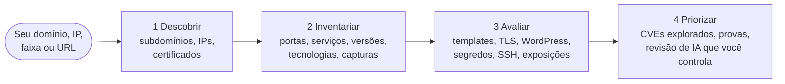

<p align="center">
  
</p>

<h3 align="center">A plataforma de avaliação de superfície de ataque externa mais avançada.</h3>

<p align="center">Descubra os ativos que você expõe e mapeie-os em um inventário estilo Shodan.</p>

<p align="center">Avalie cada host com scanners padrão do setor e corrija primeiro o que importa.</p>

<p align="center">
  <a href="CHANGELOG.md"></a>
  <a href="LICENSE"></a>
  
</p>

<p align="center">
  
</p>

<p align="center"><sub>cvENGINE 1.4.1 com dados de demonstração.</sub></p>

---

**O cvENGINE vigia os feeds de CVE 24 horas por dia e mostra a você, com provas, quais CVEs novos realmente chegam aos seus hosts.**

### Todo CVE novo, verificado contra seus hosts

1. **Vigie os feeds.** Novos CVEs e notícias frescas de exploração chegam o dia todo das fontes que importam.
2. **Descubra quem está exposto.** Cada CVE é pareado com os hosts que executam o produto e a versão afetados.
3. **Escreva a verificação.** Quando não existe verificação aprovada, sua IA redige uma somente leitura que o cvENGINE valida primeiro.
4. **Prove nos seus hosts.** Um Sentinel reproduz cada correspondência com uma verificação somente leitura e guarda a evidência.
5. **Corte o ruído.** A IA revisa a evidência: o que é real sobe e os prováveis falsos positivos afundam.

**Traga sua própria IA:** Anthropic, OpenAI ou OpenRouter com sua própria chave, ou totalmente local com Ollama, LM Studio ou vLLM. Ela fica desligada até você ligar, e nunca fecha um achado que uma verificação provou. Sem modelo, o cvENGINE continua descobrindo, escaneando, pareando e validando.

<details>
<summary><b>Como funciona, exatamente</b></summary>

- **Feeds.** O feed do [cve.now](https://cve.now) é lido a cada 30 minutos. CISA KEV, ENISA EUVD, FIRST EPSS, Exploit-DB, Metasploit e, com chave, VulnCheck KEV são lidos a cada hora — assim, um CVE que passa a ser explorado vira hot em até uma hora.
- **Pareamento.** Um CVE só vira correspondência quando um host executa o mesmo produto em uma versão dentro de um intervalo afetado limitado. Um produto visto sem versão nunca gera correspondência.
- **Verificações que a IA escreve.** Para CVEs hot, dentro de um orçamento diário, a IA lê o aviso e registra como detectá-lo. Quando não existe template Nuclei aprovado, ela pode redigir um somente leitura, que só roda em um host depois que o sistema o validou: sintaxe e um controle de loopback inofensivo em um Sentinel, um teste offline contra uma resposta afetada e uma corrigida, e uma segunda passada de IA. Isso sai desligado: um administrador ativa **Validar automaticamente verificações escritas pela IA**.
- **Prova.** A cada cinco minutos, até 20 correspondências, as fire primeiro, são reproduzidas em um Sentinel com uma de seis verificações somente leitura: um template Nuclei aprovado, `nmap -sV` na porta única, uma requisição de banner de versão, a verificação de banco de dados sem credenciais, uma sonda de versão e identidade, ou uma leitura de biblioteca JavaScript. O comando e o resultado exatos são mantidos. Uma verificação que não reproduz um achado nunca o rebaixa.
- **Triagem.** Correspondências de CVE, achados de scanners, bancos de dados abertos, rotas de administração abertas, rotas que expõem credenciais e achados de higiene de severidade média ou pior são classificados como confirmed, likely, needs validation, likely false positive ou not applicable, dentro de limites diários (por padrão 500 por projeto e 2.000 no total).
- **Revisor de IA.** Lê cada achado aberto uma vez, até 300 por dia por padrão, e registra se é real. Só fecha um falso positivo quando você permite, e somente quando o achado não tem evidência sólida e nenhuma pessoa trabalhou nele.
- **Pisos.** A evidência sólida fixa um piso abaixo do qual o modelo não pode descer: um acerto de template, um banco de dados que respondeu ou um acerto de validação é confirmed, e uma versão dentro do intervalo afetado é no mínimo needs validation. O modelo sozinho nunca pode confirmar um achado.
- **Sua IA, seus controles.** Para triagem e revisão, o modelo vê evidências estruturadas com nomes de host suprimidos, não tem ferramentas e o servidor confere cada resposta antes que ela conte. Os jobs de IA têm limites diários, e a página de uso mostra chamadas, tokens e estimativas de custo. O revisor de IA, as verificações escritas pela IA e o auto-fire (confirmação e testes de IA assim que um CVE hot novo pousa) saem desligados.

Mais em [Pipeline](docs/PIPELINE.md#triage-and-validation), [Inteligência de CVE](docs/PIPELINE.md#cve-intelligence) e [Revisor de IA](docs/AI-REVIEWER.md).

</details>

### Saiba tudo o que você expõe

O cvENGINE é uma plataforma auto-hospedada de avaliação de superfície de ataque externa e vulnerabilidades. Dê a ela seus domínios e ela continua descobrindo os subdomínios, endereços e certificados que você expõe, em um inventário pesquisável estilo Shodan de cada host, porta, serviço, tecnologia e certificado. Ativos esquecidos e sombra vêm à tona, e novos hosts, portas abertas e mudanças de versão pousam em uma linha do tempo assim que um scan os vê. Cada host é avaliado com scanners de código aberto padrão do setor, e o [Situations](docs/SITUATIONS.md) classifica o que corrigir primeiro: prova antes de probabilidade, exploração conhecida antes de severidade isolada.

## O cvENGINE 1.4.0 chegou

| | |
| --- | --- |
| **Escaneie de onde você precisar** | Você escolhe onde o scan acontece: no seu servidor, com o scanner embutido que acompanha cada instalação em seu próprio contêiner; em [Sentinels](docs/SENTINELS.md) remotos que você posiciona em qualquer lugar, em outras nuvens ou regiões ou dentro de redes privadas para alcançar ativos internos; ou ambos. Adicione Sentinels para escalar. |
| **IA que reduz falsos positivos** | O novo revisor de IA, em seu próprio contêiner isolado, lê cada achado aberto uma vez (até um limite diário) e registra se é real, e as verificações escritas pela IA são validadas pelo sistema antes de rodar, inclusive nos seus próprios Sentinels. Ambos ficam desligados até você ligar. |
| **Configure no navegador** | O `install.sh` é apenas um bootstrap fino. Um [assistente de configuração](docs/DEPLOYMENT.md#setup-wizard) recebe sua organização, projeto e primeiro domínio, e a descoberta começa na hora. |
| **O que precisa de você, classificado** | O [Situations](docs/SITUATIONS.md) lista os hosts que precisam de uma pessoa, os mais urgentes primeiro. Achados que uma verificação reproduziu mostram sua prova primeiro, e um achado marcado como corrigido é verificado de novo. |
| **Segredos expostos e SSH** | Um inventário de segredos do projeto alimentado pelo Kingfisher, e inspeção SSH com sshamble que confere chaves de host contra uma lista de chaves ruins conhecidas e nunca faz login. |
| **Nada liga sem você ver** | Verificações de credenciais, o revisor de IA e qualquer outra coisa que custe dinheiro ou amplie um scan ficam desligadas até um administrador dizer sim. Tokens de API e agentes de IA não podem ligá-las. |
| **Roda sozinho** | Um [watchdog](docs/WATCHDOG.md) conserta workers travados, o auto-tuning confere cada mudança que faz e desfaz o que machucou, e você pode publicar por um [Cloudflare Tunnel](docs/HOSTING-ONLINE.md) sem porta de entrada. |

Atualizando da 1.3? Leia primeiro [atualizar para 1.4](docs/UPGRADE.md#upgrading-to-14) e as [notas do operador](docs/1.4-OPERATOR-NOTES.md): faça backup, confira o espaço livre em disco e atualize seus Sentinels. Todas as mudanças estão no [changelog](CHANGELOG.md).

## Do domínio ao veredito



1. **Descobrir.** Aponte o cvENGINE para um domínio e ele encontra os subdomínios, endereços e certificados que pertencem a você, continua vigiando a transparência de certificados e repete uma varredura profunda toda semana.
2. **Inventariar.** Cada host, porta aberta, serviço, versão de produto, tecnologia, certificado e página inicial entra em um inventário que você pode [pesquisar como Shodan](docs/SEARCH.md): `port:3389 -host:vpn`, `tech:"apache tomcat" sev:high`. Novos hosts, portas abertas e mudanças de versão pousam em uma linha do tempo.
3. **Avaliar.** Cada host é testado com scanners padrão do setor e as verificações somente leitura próprias do cvENGINE, e um CVE só é pareado com um host quando o produto é o mesmo e a versão cai dentro do intervalo afetado.
4. **Priorizar.** Cada CVE é classificado como [fire, smoke ou ice](docs/FIRE-SMOKE-ICE.md) a partir de dados reais de exploração, cada host recebe uma nota de 0 a 100, e a triagem de IA, quando você a liga, organiza os achados em confirmed, likely ou needs validation. A IA nunca fecha um achado que uma verificação provou.

O escaneamento roda onde você escolher: no scanner embutido do seu servidor, em [Sentinels](docs/SENTINELS.md) posicionados em outro lugar, ou ambos. O [pipeline](docs/PIPELINE.md) descreve cada estágio.

## As ferramentas por trás disso

O cvENGINE executa as melhores ferramentas de segurança de código aberto. A imagem do scanner fixa cada ferramenta que instala em uma versão exata, e as fixações são conferidas antes de cada lançamento. A página About da sua instalação as lista com as versões, e o [THIRD-PARTY.md](THIRD-PARTY.md) dá cada licença.

| Estágio | Ferramenta | Para que o cvENGINE a usa |
| --- | --- | --- |
| **Descoberta** | [bbot](https://github.com/blacklanternsecurity/bbot) | Descoberta de subdomínios, endereços e ativos, transmitida para o inventário enquanto roda |
| | [baddns](https://github.com/blacklanternsecurity/baddns) | Candidatos de DNS pendurado e tomada de subdomínios, executado dentro do bbot |
| | [crt.sh](https://crt.sh) | Consultas de transparência de certificados que pegam nomes novos entre scans |
| **Inventário e fingerprinting** | [naabu](https://github.com/projectdiscovery/naabu) | Uma varredura de todas as 65.535 portas TCP de cada endereço |
| | [Nmap](https://nmap.org) | Fingerprints de serviço, versão e SO, scripts revisados e um scan lento de exposição UDP |
| | [Nuclei](https://github.com/projectdiscovery/nuclei) | Um passe de tecnologia que nomeia o que cada host web executa |
| | [wafw00f](https://github.com/EnableSecurity/wafw00f) | Nomeia o firewall de aplicação web na frente de um site |
| | [Playwright](https://playwright.dev) com Chromium headless | Capturas de cada página web que um host serve |
| | [gowitness](https://github.com/sensepost/gowitness) | Capturas da página inicial durante a descoberta, instalado pelo bbot |
| | [aardwolf](https://github.com/skelsec/aardwolf) | A captura da tela de login de um servidor RDP que a permite sem credenciais |
| **Avaliação** | [Nuclei](https://github.com/projectdiscovery/nuclei) e [nuclei-templates](https://github.com/projectdiscovery/nuclei-templates) | A biblioteca de templates da comunidade, passes direcionados por IA e verificações por CVE; templates de negação de serviço e de credenciais ficam de fora por padrão |
| | [testssl.sh](https://github.com/testssl/testssl.sh) | Protocolos, cifras e as vulnerabilidades TLS nomeadas em cada porta TLS |
| | [WPScan](https://github.com/wpscanteam/wpscan) | Vulnerabilidades de núcleo, plugins e temas do WordPress (adicione um token do [wpscan.com](https://wpscan.com/) para os dados de vulnerabilidade) |
| | [Kingfisher](https://github.com/mongodb/kingfisher) | Chaves de API, tokens e chaves privadas que suas páginas e scripts servem, guardados em um inventário de Segredos |
| | [sshamble](https://github.com/runZeroInc/sshamble) | Handshake SSH e chaves de host, conferidas contra a lista de bloqueio [badkeys](https://badkeys.info); nunca faz login |
| | [detector node2shell](https://github.com/assetnote/node2shell-scanner) | A verificação somente leitura da Assetnote para CVE-2026-111497; desligada por padrão |
| | Verificações próprias do cvENGINE | Bancos de dados expostos, armazenamento em nuvem público e pendurado (S3, Google Cloud Storage, Azure Blob), rotas web e seu estado de login, sondas de versão e higiene de DNS e e-mail baseada no [MailFail](https://github.com/ACK-J/MailFail) |
| **Inteligência de exploração** | [cve.now](https://cve.now), [CISA KEV](https://www.cisa.gov/known-exploited-vulnerabilities-catalog), [ENISA EUVD](https://euvd.enisa.europa.eu/), [VulnCheck KEV](https://vulncheck.com), [FIRST EPSS](https://www.first.org/epss/), [Exploit-DB](https://gitlab.com/exploit-database/exploitdb), [Metasploit](https://github.com/rapid7/metasploit-framework), [CVE List V5](https://github.com/CVEProject/cvelistV5), [OSV](https://osv.dev), [rastreador de segurança do Debian](https://security-tracker.debian.org) | Quais CVEs são explorados hoje e quais correções uma distribuição backportou |
| **Complementos opcionais** | [OpenVAS](https://greenbone.github.io/docs/latest/) (Greenbone Community Edition) | Um segundo scanner de vulnerabilidades de rede em um Sentinel, para seus hosts mais quentes. Desligado por padrão ([OpenVAS](docs/OPENVAS.md)) |
| | [Tailscale](https://github.com/tailscale/tailscale) | Opcional: entre em uma tailnet, importe e escaneie seus dispositivos e confira a configuração ([Tailscale](docs/TAILSCALE.md)) |
| | [runZero](https://www.runzero.com) | Opcional: uma sincronização agendada dos dados de ativos do runZero com seu próprio token ([Configuração](docs/CONFIGURATION.md#runzero)) |
| | Fontes com chave do bbot | Opcional: Shodan, Censys, VirusTotal, SecurityTrails, GitHub, Chaos e mais, com suas próprias chaves de API ([Configuração](docs/CONFIGURATION.md#api-keys)) |
| **IA (traga a sua, desligada até você escolher)** | [Anthropic](https://www.anthropic.com), [OpenAI](https://openai.com), [OpenRouter](https://openrouter.ai), [Ollama](https://github.com/ollama/ollama), [LM Studio](https://lmstudio.ai), [vLLM](https://github.com/vllm-project/vllm) | Triagem de achados, direcionamento do Nuclei e o [revisor de IA](docs/AI-REVIEWER.md) em seu próprio contêiner. Sem modelo, o cvENGINE continua descobrindo, escaneando e pareando |
| | [Model Context Protocol](https://modelcontextprotocol.io) | Um servidor MCP e uma API REST para seus próprios agentes ([Agent API](docs/AGENT-API.md)) |

## Instale em minutos

Você precisa de um servidor Linux (Debian ou Ubuntu é o mais fácil) com pelo menos 4 GB de RAM (8 GB para conforto) e 20 GB de disco livre.

```bash
git clone https://github.com/hevnsnt/CVEngine.git
cd CVEngine
sudo ./install.sh
```

O instalador adiciona o que falta, gera todos os segredos, cria o certificado HTTPS, inicia o cvENGINE com o scanner embutido e imprime o endereço e onde está sua senha de administrador gerada. Entre e o assistente de configuração faz o resto. A automação pode passar `--sentinels=internal|both|external` e `-n`. O OpenVAS nunca é instalado por ele. Seu navegador avisa sobre o certificado privado até você confiar em `secrets/certs/ca.crt`.

Um nome público com certificado confiável, um Cloudflare Tunnel, Mac e Windows: veja [Deployment](docs/DEPLOYMENT.md) e [Hosting online](docs/HOSTING-ONLINE.md).

## Seguro por design

- **Somente leitura por padrão.** Sem listas de senhas. Verificações que enviam credenciais (templates de login padrão e força bruta do Nuclei) ficam desligadas até um App Admin permitir, e templates de negação de serviço são excluídos.
- **Você traça as linhas.** Endereços de loopback, link-local e de metadados de nuvem nunca são escaneados, e cada organização mantém uma lista de [endereços que nunca devemos escanear](docs/1.4-OPERATOR-NOTES.md#addresses-we-must-never-scan) com qualquer nome que leve até lá.
- **Você segura os interruptores.** A validação de IA, o revisor de IA, o OpenVAS e qualquer outra coisa que custe dinheiro começam desligados, e uma atualização pergunta antes de mudá-los.
- **Trancado.** Os dados da organização são isolados, os segredos armazenados são criptografados e o acesso é protegido por login em duas etapas, uma lista de IPs permitidos e um log de auditoria.

Escaneie apenas sistemas que você possui ou que está autorizado a testar.

## Documentação

| Doc | O que cobre |
| --- | --- |
| [Deployment](docs/DEPLOYMENT.md) e [Hosting online](docs/HOSTING-ONLINE.md) | Instalação, HTTPS, Cloudflare, backups, hosts pequenos |
| [Updates](docs/UPDATES.md), [Upgrade](docs/UPGRADE.md) e [notas do operador da 1.4](docs/1.4-OPERATOR-NOTES.md) | Manter-se atualizado e o que a 1.4 muda para um operador |
| [Sentinels](docs/SENTINELS.md) e [scanner embutido](docs/BUILTIN-SCANNER.md) | Onde cada scan roda, escalar e escanear redes privadas |
| [Pipeline](docs/PIPELINE.md) e [Arquitetura](docs/ARCHITECTURE.md) | Como funciona, estágio por estágio |
| [Search](docs/SEARCH.md), [Situations](docs/SITUATIONS.md) e [Fire, smoke e ice](docs/FIRE-SMOKE-ICE.md) | Encontrar o que importa e como os CVEs são classificados |
| [Configuração](docs/CONFIGURATION.md) | Cada configuração |
| [Revisor de IA](docs/AI-REVIEWER.md), [Uso de IA](docs/AI-USAGE.md) e [Segredos](docs/SECRETS-PLAN.md) | O revisor isolado, o custo da IA e o inventário de segredos expostos |
| [OpenVAS](docs/OPENVAS.md) e [Tailscale](docs/TAILSCALE.md) | Os complementos opcionais |
| [Tenancy](docs/TENANCY.md), [Agent API](docs/AGENT-API.md) e [Inventário de hosts](docs/HOST-INVENTORY.md) | Equipes e papéis, a API REST e MCP, e hosts que relatam seus próprios pacotes |
| [Bug bounty](docs/BUG-BOUNTY.md), [Watchdog](docs/WATCHDOG.md) e [Front end](docs/FRONTEND.md) | A bancada de recompensas, o autorreparo e a interface |

## Contribuindo e segurança

Issues e pull requests são bem-vindos: veja [CONTRIBUTING](.github/CONTRIBUTING.md). Por favor, relate vulnerabilidades em particular pela aba **Security** do repositório, como explica a [política de segurança](.github/SECURITY.md).

## Créditos e licença

O cvENGINE é um fork do [reNgine](https://github.com/yogeshojha/rengine) 2.x de Yogesh Ojha e colaboradores, e se baseia nos projetos acima. O cliente Sentinel vive em [hevnsnt/cvENGINE-sentinel](https://github.com/hevnsnt/cvENGINE-sentinel). Obrigado aos nossos beta testers, sobretudo ao [camstork](https://github.com/camstork), cujos relatórios cuidadosos moldaram a 1.3. Veja o [changelog](CHANGELOG.md), os [colaboradores](CONTRIBUTORS.md) e o [software de terceiros](THIRD-PARTY.md).

"Estilo Shodan" descreve o tipo de busca; o cvENGINE não tem afiliação com o Shodan.

Lançado sob a GPL-3.0. Veja [LICENSE](LICENSE).

[](https://m8ven.ai/mcp/hevnsnt-cvengine-s24yvi?s=readme)
