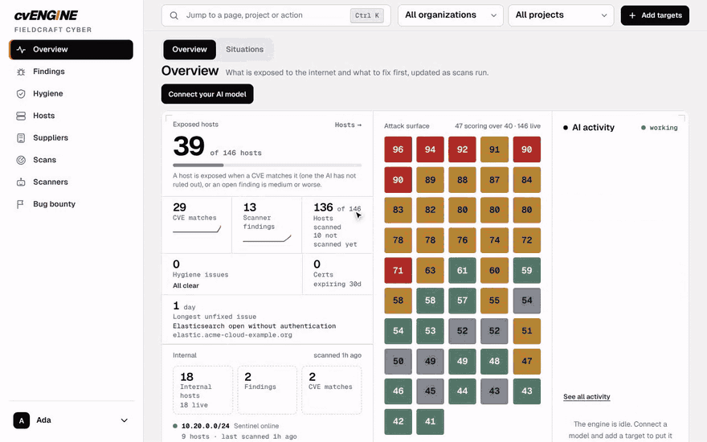
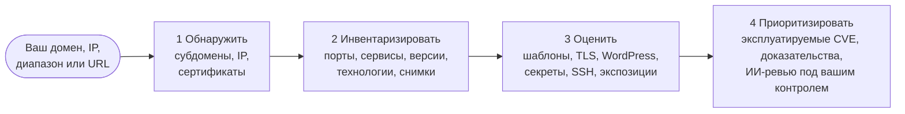

<p align="center">
  
</p>

<h3 align="center">Самая продвинутая платформа оценки внешней поверхности атаки.</h3>

<p align="center">Обнаруживайте активы, которые вы публикуете, и наносите их на карту в инвентаре в стиле Shodan.</p>

<p align="center">Оценивайте каждый хост отраслевыми сканерами и исправляйте в первую очередь то, что действительно важно.</p>

<p align="center">
  <a href="CHANGELOG.md"></a>
  <a href="LICENSE"></a>
  
</p>

<p align="center">
  
</p>

<p align="center"><sub>cvENGINE 1.4.1 на демо-данных.</sub></p>

---

**cvENGINE круглосуточно следит за лентами CVE и показывает вам с доказательствами, какие новые CVE действительно достигают ваших хостов.**

### Каждый новый CVE сверяется с вашими хостами

1. **Следите за лентами.** Новые CVE и свежие новости об эксплуатации поступают весь день из источников, которые имеют значение.
2. **Находите, кто открыт.** Каждый CVE сопоставляется с хостами, на которых работают затронутые продукт и версия.
3. **Пишите проверку.** Когда проверенной проверки нет, ваш ИИ составляет проверку только для чтения, которую cvENGINE сначала валидирует.
4. **Докажите это на своих хостах.** Sentinel воспроизводит каждое совпадение проверкой только для чтения и сохраняет доказательство.
5. **Срежьте шум.** ИИ изучает доказательства: реальное поднимается, вероятные ложные срабатывания опускаются.

**Принесите свой ИИ:** Anthropic, OpenAI или OpenRouter на вашем собственном ключе, или полностью локально с Ollama, LM Studio или vLLM. Он выключен, пока вы его не включите, и никогда не закрывает находку, которую доказала проверка. Без модели cvENGINE всё равно обнаруживает, сканирует, сопоставляет и валидирует.

<details>
<summary><b>Как это работает, точно</b></summary>

- **Ленты.** Лента [cve.now](https://cve.now) читается каждые 30 минут. CISA KEV, ENISA EUVD, FIRST EPSS, Exploit-DB, Metasploit и, при наличии ключа, VulnCheck KEV читаются каждый час — так что CVE, который начали эксплуатировать, становится hot в течение часа.
- **Сопоставление.** CVE становится совпадением только когда на хосте работает тот же продукт версии внутри ограниченного затронутого диапазона. Продукт, увиденный без версии, никогда не даёт совпадения.
- **Проверки, которые пишет ИИ.** Для hot CVE, в пределах дневного бюджета, ИИ читает бюллетень и записывает, как его обнаружить. Когда проверенного шаблона Nuclei нет, он может составить шаблон только для чтения, который запускается на хосте только после валидации системой: синтаксис и безвредная проверка loopback на Sentinel, офлайн-тест на затронутом и исправленном ответе и второй проход ИИ. Это поставляется выключенным: администратор включает **Автоматически валидировать проверки, написанные ИИ**.
- **Доказательство.** Каждые пять минут до 20 совпадений, сначала fire, воспроизводятся на Sentinel одной из шести проверок только для чтения: проверенный шаблон Nuclei, `nmap -sV` на одном порту, запрос баннера версии, проверка базы данных без учётных данных, зонд версии и идентичности или чтение JavaScript-библиотеки. Точная команда и результат сохраняются. Проверка, которая не воспроизводит находку, никогда её не понижает.
- **Триаж.** Совпадения CVE, находки сканеров, открытые базы данных, открытые административные маршруты, маршруты, раскрывающие учётные данные, и находки гигиены средней тяжести или хуже оцениваются как confirmed, likely, needs validation, likely false positive или not applicable в пределах дневных лимитов (по умолчанию 500 на проект и 2 000 всего).
- **ИИ-рецензент.** Читает каждую открытую находку один раз, по умолчанию до 300 в день, и записывает, реальна ли она. Закрывает ложное срабатывание только с вашего разрешения, и только если у находки нет жёстких доказательств и с ней никто не работал.
- **Нижние границы.** Жёсткие доказательства задают нижнюю границу, ниже которой модель не может опуститься: попадание шаблона, ответившая база данных или попадание валидации — это confirmed, а версия внутри затронутого диапазона — как минимум needs validation. Модель сама по себе никогда не может подтвердить находку.
- **Ваш ИИ, ваши рычаги.** Для триажа и рецензирования модель видит структурированные доказательства с вымаранными именами хостов, у неё нет инструментов, и сервер проверяет каждый ответ, прежде чем он засчитается. У ИИ-задач есть дневные лимиты, а страница использования показывает вызовы, токены и оценку стоимости. ИИ-рецензент, проверки, написанные ИИ, и auto-fire (подтверждение и тесты ИИ, как только приземляется новый hot CVE) поставляются выключенными.

Подробнее в [Pipeline](docs/PIPELINE.md#triage-and-validation), [CVE-разведка](docs/PIPELINE.md#cve-intelligence) и [ИИ-рецензент](docs/AI-REVIEWER.md).

</details>

### Знайте всё, что вы публикуете

cvENGINE — это самостоятельно размещаемая платформа оценки внешней поверхности атаки и уязвимостей. Дайте ей свои домены, и она продолжит находить субдомены, адреса и сертификаты, которые вы публикуете, в поисковом инвентаре в стиле Shodan по каждому хосту, порту, сервису, технологии и сертификату. Забытые и теневые активы выходят на свет, а новые хосты, открытые порты и изменения версий попадают на таймлайн, как только их видит скан. Каждый хост оценивается отраслевыми опенсорс-сканерами, а [Situations](docs/SITUATIONS.md) ранжирует, что чинить в первую очередь: доказательство раньше вероятности, известная эксплуатация раньше одной лишь тяжести.

## cvENGINE 1.4.0 уже здесь

| | |
| --- | --- |
| **Сканируйте откуда нужно** | Вы выбираете, где происходит сканирование: на вашем сервере, встроенным сканером, который идёт с каждой установкой в собственном контейнере; на удалённых [Sentinels](docs/SENTINELS.md), которые вы размещаете где угодно — в других облаках или регионах или внутри частных сетей, чтобы дотянуться до внутренних активов; или и там, и там. Добавляйте Sentinels для масштабирования. |
| **ИИ, который сокращает ложные срабатывания** | Новый ИИ-рецензент в собственном изолированном контейнере читает каждую открытую находку один раз (до дневного лимита) и записывает, реальна ли она, а проверки, написанные ИИ, валидируются системой перед запуском — в том числе на ваших собственных Sentinels. Оба остаются выключенными, пока вы их не включите. |
| **Настройка в браузере** | `install.sh` — это лишь тонкий бутстрап. [Мастер настройки](docs/DEPLOYMENT.md#setup-wizard) принимает вашу организацию, проект и первый домен, и обнаружение начинается сразу. |
| **Что требует вас, ранжировано** | [Situations](docs/SITUATIONS.md) перечисляет хосты, которым нужен человек, — самые срочные первыми. Находки, воспроизведённые проверкой, показывают доказательство первыми, а находка, помеченная как исправленная, проверяется снова. |
| **Раскрытые секреты и SSH** | Инвентарь секретов проекта, питаемый Kingfisher, и SSH-инспекция с sshamble, которая сверяет ключи хостов со списком известных плохих ключей и никогда не выполняет вход. |
| **Ничто не включается незаметно** | Проверки учётных данных, ИИ-рецензент и всё остальное, что стоит денег или расширяет скан, остаются выключенными, пока администратор не скажет «да». API-токены и ИИ-агенты не могут их включить. |
| **Работает само** | [Watchdog](docs/WATCHDOG.md) чинит зависшие воркеры, автотюнинг проверяет каждое своё изменение и откатывает то, что навредило, а публиковаться можно через [Cloudflare Tunnel](docs/HOSTING-ONLINE.md) без входящего порта. |

Обновляетесь с 1.3? Сначала прочтите [обновление до 1.4](docs/UPGRADE.md#upgrading-to-14) и [заметки оператора](docs/1.4-OPERATOR-NOTES.md): сделайте бэкап, проверьте свободное место и обновите свои Sentinels. Все изменения — в [журнале изменений](CHANGELOG.md).

## От домена к вердикту



1. **Обнаружить.** Направьте cvENGINE на домен, и он найдёт принадлежащие вам субдомены, адреса и сертификаты, продолжит следить за прозрачностью сертификатов и повторяет глубокое сканирование каждую неделю.
2. **Инвентаризировать.** Каждый хост, открытый порт, сервис, версия продукта, технология, сертификат и главная страница попадают в один инвентарь, который можно [искать как Shodan](docs/SEARCH.md): `port:3389 -host:vpn`, `tech:"apache tomcat" sev:high`. Новые хосты, открытые порты и изменения версий попадают на таймлайн.
3. **Оценить.** Каждый хост тестируется отраслевыми сканерами и собственными проверками только для чтения cvENGINE, а CVE сопоставляется с хостом только когда продукт тот же и его версия попадает в затронутый диапазон.
4. **Приоритизировать.** Каждый CVE оценивается как [fire, smoke или ice](docs/FIRE-SMOKE-ICE.md) по реальным данным эксплуатации, каждый хост получает оценку от 0 до 100, а ИИ-триаж, когда вы его включите, сортирует находки на confirmed, likely или needs validation. ИИ никогда не закрывает находку, которую доказала проверка.

Сканирование выполняется там, где вы выберете: во встроенном сканере на вашем сервере, на [Sentinels](docs/SENTINELS.md), размещённых в другом месте, или и там, и там. [Pipeline](docs/PIPELINE.md) описывает каждый этап.

## Инструменты за этим

cvENGINE запускает лучшие опенсорс-инструменты безопасности. Образ сканера фиксирует каждый устанавливаемый инструмент на точной версии, и фиксации проверяются перед каждым релизом. Страница About вашей установки перечисляет их с версиями, а [THIRD-PARTY.md](THIRD-PARTY.md) приводит каждую лицензию.

| Этап | Инструмент | Для чего его использует cvENGINE |
| --- | --- | --- |
| **Обнаружение** | [bbot](https://github.com/blacklanternsecurity/bbot) | Обнаружение субдоменов, адресов и активов, стримится в инвентарь по ходу работы |
| | [baddns](https://github.com/blacklanternsecurity/baddns) | Кандидаты на висячий DNS и захват субдоменов, работает внутри bbot |
| | [crt.sh](https://crt.sh) | Запросы прозрачности сертификатов, ловящие новые имена между сканами |
| **Инвентаризация и снятие отпечатков** | [naabu](https://github.com/projectdiscovery/naabu) | Проход по всем 65 535 TCP-портам каждого адреса |
| | [Nmap](https://nmap.org) | Отпечатки сервисов, версий и ОС, проверенные скрипты и медленный скан UDP-экспозиции |
| | [Nuclei](https://github.com/projectdiscovery/nuclei) | Технологический проход, который называет, что работает на каждом веб-хосте |
| | [wafw00f](https://github.com/EnableSecurity/wafw00f) | Называет веб-файрвол перед сайтом |
| | [Playwright](https://playwright.dev) с headless Chromium | Скриншоты каждой веб-страницы, которую отдаёт хост |
| | [gowitness](https://github.com/sensepost/gowitness) | Скриншоты главных страниц при обнаружении, устанавливается bbot |
| | [aardwolf](https://github.com/skelsec/aardwolf) | Скриншот экрана входа RDP-сервера, который разрешает его без учётных данных |
| **Оценка** | [Nuclei](https://github.com/projectdiscovery/nuclei) и [nuclei-templates](https://github.com/projectdiscovery/nuclei-templates) | Библиотека шаблонов сообщества, целевые проходы ИИ и проверки по каждому CVE; шаблоны отказа в обслуживании и учётных данных исключаются по умолчанию |
| | [testssl.sh](https://github.com/testssl/testssl.sh) | Протоколы, шифры и известные TLS-уязвимости на каждом TLS-порту |
| | [WPScan](https://github.com/wpscanteam/wpscan) | Уязвимости ядра, плагинов и тем WordPress (добавьте токен [wpscan.com](https://wpscan.com/) для его данных об уязвимостях) |
| | [Kingfisher](https://github.com/mongodb/kingfisher) | API-ключи, токены и приватные ключи, которые отдают ваши страницы и скрипты; хранятся в инвентаре секретов |
| | [sshamble](https://github.com/runZeroInc/sshamble) | SSH-рукопожатие и ключи хостов, сверяются с блок-листом [badkeys](https://badkeys.info); никогда не выполняет вход |
| | [детектор node2shell](https://github.com/assetnote/node2shell-scanner) | Проверка только для чтения от Assetnote для CVE-2026-111497; по умолчанию выключена |
| | Собственные проверки cvENGINE | Открытые базы данных, публичное и висячее облачное хранилище (S3, Google Cloud Storage, Azure Blob), веб-маршруты и их состояние входа, зонды версий, а также гигиена DNS и почты на основе [MailFail](https://github.com/ACK-J/MailFail) |
| **Разведка эксплуатации** | [cve.now](https://cve.now), [CISA KEV](https://www.cisa.gov/known-exploited-vulnerabilities-catalog), [ENISA EUVD](https://euvd.enisa.europa.eu/), [VulnCheck KEV](https://vulncheck.com), [FIRST EPSS](https://www.first.org/epss/), [Exploit-DB](https://gitlab.com/exploit-database/exploitdb), [Metasploit](https://github.com/rapid7/metasploit-framework), [CVE List V5](https://github.com/CVEProject/cvelistV5), [OSV](https://osv.dev), [трекер безопасности Debian](https://security-tracker.debian.org) | Какие CVE эксплуатируются сегодня и какие исправления дистрибутив забэкпортил |
| **Опциональные дополнения** | [OpenVAS](https://greenbone.github.io/docs/latest/) (Greenbone Community Edition) | Второй сетевой сканер уязвимостей на Sentinel для ваших самых горячих хостов. По умолчанию выключен ([OpenVAS](docs/OPENVAS.md)) |
| | [Tailscale](https://github.com/tailscale/tailscale) | Опционально: присоединиться к tailnet, импортировать и сканировать его устройства и проверить конфигурацию ([Tailscale](docs/TAILSCALE.md)) |
| | [runZero](https://www.runzero.com) | Опционально: плановая синхронизация данных активов runZero с вашим собственным токеном ([Конфигурация](docs/CONFIGURATION.md#runzero)) |
| | Ключевые источники bbot | Опционально: Shodan, Censys, VirusTotal, SecurityTrails, GitHub, Chaos и другие, с вашими собственными API-ключами ([Конфигурация](docs/CONFIGURATION.md#api-keys)) |
| **ИИ (принесите свой, выключен, пока не выберете)** | [Anthropic](https://www.anthropic.com), [OpenAI](https://openai.com), [OpenRouter](https://openrouter.ai), [Ollama](https://github.com/ollama/ollama), [LM Studio](https://lmstudio.ai), [vLLM](https://github.com/vllm-project/vllm) | Триаж находок, целеуказание Nuclei и [ИИ-рецензент](docs/AI-REVIEWER.md) в собственном контейнере. Без модели cvENGINE всё равно обнаруживает, сканирует и сопоставляет |
| | [Model Context Protocol](https://modelcontextprotocol.io) | MCP-сервер и REST API для ваших собственных агентов ([Agent API](docs/AGENT-API.md)) |

## Установка за минуты

Нужен Linux-сервер (проще всего Debian или Ubuntu) с минимум 4 ГБ RAM (8 ГБ для комфорта) и 20 ГБ свободного места.

```bash
git clone https://github.com/hevnsnt/CVEngine.git
cd CVEngine
sudo ./install.sh
```

Установщик добавляет недостающее, генерирует все секреты, создаёт HTTPS-сертификат, запускает cvENGINE со встроенным сканером и печатает адрес и место, где лежит сгенерированный пароль администратора. Войдите — и мастер настройки сделает остальное. Автоматизация может передавать `--sentinels=internal|both|external` и `-n`. OpenVAS он никогда не устанавливает. Браузер будет предупреждать о приватном сертификате, пока вы не доверитесь `secrets/certs/ca.crt`.

Публичное имя с доверенным сертификатом, Cloudflare Tunnel, Mac и Windows: см. [Deployment](docs/DEPLOYMENT.md) и [Hosting online](docs/HOSTING-ONLINE.md).

## Безопасен по дизайну

- **Только чтение по умолчанию.** Никаких списков паролей. Проверки, отправляющие учётные данные (шаблоны дефолтного логина и брутфорса Nuclei), выключены, пока App Admin их не разрешит, а шаблоны отказа в обслуживании исключены.
- **Границы рисуете вы.** Адреса loopback, link-local и метаданных облака никогда не сканируются, и каждая организация ведёт список [адресов, которые мы никогда не должны сканировать](docs/1.4-OPERATOR-NOTES.md#addresses-we-must-never-scan), куда попадает любое имя, ведущее туда.
- **Рычаги в ваших руках.** ИИ-валидация, ИИ-рецензент, OpenVAS и всё остальное, что стоит денег, стартуют выключенными, а обновление спрашивает, прежде чем их менять.
- **Заперто.** Данные организаций изолированы, хранимые секреты зашифрованы, а доступ защищён двухшаговым входом, списком разрешённых IP и журналом аудита.

Сканируйте только системы, которыми вы владеете или которые уполномочены тестировать.

## Документация

| Документ | Что покрывает |
| --- | --- |
| [Deployment](docs/DEPLOYMENT.md) и [Hosting online](docs/HOSTING-ONLINE.md) | Установка, HTTPS, Cloudflare, бэкапы, небольшие хосты |
| [Updates](docs/UPDATES.md), [Upgrade](docs/UPGRADE.md) и [заметки оператора 1.4](docs/1.4-OPERATOR-NOTES.md) | Как оставаться актуальным и что 1.4 меняет для оператора |
| [Sentinels](docs/SENTINELS.md) и [встроенный сканер](docs/BUILTIN-SCANNER.md) | Где выполняется каждый скан, масштабирование и сканирование частных сетей |
| [Pipeline](docs/PIPELINE.md) и [Architecture](docs/ARCHITECTURE.md) | Как это работает, этап за этапом |
| [Search](docs/SEARCH.md), [Situations](docs/SITUATIONS.md) и [Fire, smoke и ice](docs/FIRE-SMOKE-ICE.md) | Находить то, что важно, и как оцениваются CVE |
| [Configuration](docs/CONFIGURATION.md) | Каждая настройка |
| [ИИ-рецензент](docs/AI-REVIEWER.md), [Использование ИИ](docs/AI-USAGE.md) и [Секреты](docs/SECRETS-PLAN.md) | Изолированный рецензент, стоимость ИИ и инвентарь раскрытых секретов |
| [OpenVAS](docs/OPENVAS.md) и [Tailscale](docs/TAILSCALE.md) | Опциональные дополнения |
| [Tenancy](docs/TENANCY.md), [Agent API](docs/AGENT-API.md) и [Инвентарь хостов](docs/HOST-INVENTORY.md) | Команды и роли, REST API и MCP, а также хосты, сообщающие о своих пакетах |
| [Bug bounty](docs/BUG-BOUNTY.md), [Watchdog](docs/WATCHDOG.md) и [Front end](docs/FRONTEND.md) | Баунти-верстак, самовосстановление и интерфейс |

## Вклад и безопасность

Issues и pull requests приветствуются: см. [CONTRIBUTING](.github/CONTRIBUTING.md). Пожалуйста, сообщайте об уязвимостях приватно через вкладку **Security** репозитория, как объясняет [политика безопасности](.github/SECURITY.md).

## Благодарности и лицензия

cvENGINE — форк [reNgine](https://github.com/yogeshojha/rengine) 2.x Йогеша Оджхи и его соавторов, и строится на проектах выше. Клиент Sentinel живёт в [hevnsnt/cvENGINE-sentinel](https://github.com/hevnsnt/cvENGINE-sentinel). Спасибо нашим бета-тестерам, прежде всего [camstork](https://github.com/camstork), чьи тщательные отчёты сформировали 1.3. См. [журнал изменений](CHANGELOG.md), [соавторов](CONTRIBUTORS.md) и [стороннее ПО](THIRD-PARTY.md).

«В стиле Shodan» описывает вид поиска; cvENGINE не связан с Shodan.

Выпускается под GPL-3.0. См. [LICENSE](LICENSE).

[](https://m8ven.ai/mcp/hevnsnt-cvengine-s24yvi?s=readme)
