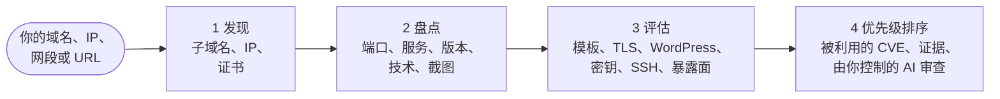

<p align="center">
  
</p>

<h3 align="center">最先进的外部暴露面评估平台。</h3>

<p align="center">发现你暴露的资产，并以类似 Shodan 的资产清单方式将它们绘制成图。</p>

<p align="center">用业界标准的扫描器评估每一台主机，并优先修复真正重要的问题。</p>

<p align="center">
  <a href="CHANGELOG.md"></a>
  <a href="LICENSE"></a>
  
</p>

<p align="center">
  
</p>

<p align="center"><sub>cvENGINE 1.4.1，基于演示数据。</sub></p>

---

**cvENGINE 全天候监视 CVE 情报源，并以证据向你展示哪些新 CVE 真正影响到了你的主机。**

### 每一个新 CVE，都与你的主机核对

1. **监视情报源。** 新的 CVE 和最新漏洞利用新闻全天源源不断地从重要来源抵达。
2. **找出暴露者。** 每个 CVE 都会与运行受影响产品和版本的主机进行匹配。
3. **编写检查。** 当没有经过审核的检查存在时，你的 AI 会起草一个只读检查，cvENGINE 会先对其进行验证。
4. **在你的主机上证明它。** Sentinel 用只读检查复现每个匹配，并保留证据。
5. **减少噪音。** AI 审查证据，真实的问题上升，可能的误报下沉。

**自带 AI：** 使用你自己的密钥接入 Anthropic、OpenAI 或 OpenRouter，或使用 Ollama、LM Studio 或 vLLM 完全本地运行。它在开启之前一直处于关闭状态，并且永远不会关闭一个已被检查证实的问题。没有模型时，cvENGINE 仍然可以发现、扫描、匹配和验证。

<details>
<summary><b>工作原理详解</b></summary>

- **情报源。** [cve.now](https://cve.now) 情报源每 30 分钟读取一次。CISA KEV、ENISA EUVD、FIRST EPSS、Exploit-DB、Metasploit 以及（使用密钥时）VulnCheck KEV 每小时读取一次，因此一个 CVE 一旦被利用，一小时内就会变为 hot（火）。
- **匹配。** 只有当主机运行相同的产品、且版本落在受影响范围内时，CVE 才会成为匹配。只看到产品而看不到版本，永远不会产生匹配。
- **AI 编写的检查。** 对于 hot CVE，在每日预算内，AI 阅读公告并记录如何检测它。当没有经过审核的 Nuclei 模板存在时，它可以起草一个只读模板，该模板只有在系统验证之后才会在主机上运行：在 Sentinel 上进行语法检查和无害的回环控制、针对受影响响应和已修复响应进行离线测试，以及第二次 AI 检查。该功能默认关闭：管理员需手动开启**自动验证 AI 编写的检查**。
- **证明。** 每五分钟，最多 20 个匹配（先到先得）会在 Sentinel 上用六种只读检查之一进行复现：经过审核的 Nuclei 模板、单端口 `nmap -sV`、版本横幅请求、免凭据数据库检查、版本与身份探测，或 JavaScript 库读取。确切的命令和结果都会被保留。无法复现问题的检查永远不会降低它的等级。
- **分类。** CVE 匹配、扫描器发现、暴露的数据库、暴露的管理路由、泄露凭据的路由，以及中等或更高严重度的卫生问题，会在每日上限内（默认每个项目 500 条、总计 2,000 条）被评为 confirmed（已证实）、likely（可能）、needs validation（待验证）、likely false positive（可能误报）或 not applicable（不适用）。
- **AI 审查员。** 每个未关闭的问题默认每天最多读取 300 条并记录其真实性。只有当问题没有硬证据、且没有人处理过时，它才会在你允许的情况下关闭误报。
- **底线。** 硬证据设定了模型不能低于的底线：模板命中、数据库应答或验证命中即为 confirmed，版本落在受影响范围内至少为 needs validation。模型单独永远无法证实一个问题。
- **你的 AI，你的控制权。** 在分类和审查中，模型看到的是经过结构化处理的证据（主机名已脱敏），它没有任何工具，且服务器会在采纳之前检查每个答案。AI 作业有每日上限，用量页面显示调用次数、token 和费用估算。AI 审查员、AI 编写的检查和自动开火（新 hot CVE 一落地就自动确认和测试）默认都是关闭的。

更多内容见 [Pipeline](docs/PIPELINE.md#triage-and-validation)、[CVE 情报](docs/PIPELINE.md#cve-intelligence) 和 [AI 审查员](docs/AI-REVIEWER.md)。

</details>

### 了解你暴露的一切

cvENGINE 是一个自托管的外部攻击面和漏洞评估平台。把域名交给它，它就会持续发现你暴露的子域名、地址和证书，形成一个可搜索的、类似 Shodan 的资产清单，涵盖每台主机、端口、服务、技术和证书。被遗忘的和影子资产都会浮出水面，新的主机、开放的端口和版本变化会在扫描发现的第一时间落到时间线上。每台主机都用业界标准的开源扫描器进行评估，[Situations](docs/SITUATIONS.md) 会按优先级排列该先修什么：证据优先于可能性，已知被利用优先于仅凭严重度。

## cvENGINE 1.4.0 已发布

| | |
| --- | --- |
| **在任何你需要的地方扫描** | 扫描在哪里进行由你决定：在你自己的服务器上，使用每次安装都自带、运行在独立容器中的内置扫描器；在远程 [Sentinels](docs/SENTINELS.md) 上（可部署在任何地方——其他云、其他区域或私有网络内部，以触达内部资产）；或两者并用。添加 Sentinel 即可横向扩展。 |
| **减少误报的 AI** | 新的 AI 审查员运行在自己隔离的容器中，读取每个未关闭的问题一次（受每日上限约束）并记录其真实性；AI 编写的检查在运行之前由系统验证（包括在你自己的 Sentinel 上）。两者在开启之前都保持关闭。 |
| **在浏览器中完成设置** | `install.sh` 只是一个轻量引导。一个[设置向导](docs/DEPLOYMENT.md#setup-wizard)会带你完成组织、项目和第一个域名的配置，发现立即开始。 |
| **需要人工处理的事项，按优先级排列** | [Situations](docs/SITUATIONS.md) 列出需要人工处理的主机，最紧急的排在最前。被检查复现的问题会先展示证据，标记为已修复的问题会被再次检查。 |
| **暴露的密钥和 SSH** | 由 Kingfisher 驱动的项目密钥清单，以及用 sshamble 进行的 SSH 检查：把主机密钥与已知恶意列表比对，且从不登录。 |
| **没有东西会悄然开启** | 凭据检查、AI 审查员以及任何花钱或扩大扫描范围的功能，在管理员同意之前都保持关闭。API 令牌和 AI 代理无法打开它们。 |
| **自行运转** | [看门狗](docs/WATCHDOG.md) 会修复卡住的工作进程，自动调优会检查它的每次更改并撤销有害的更改，你还可以通过 [Cloudflare Tunnel](docs/HOSTING-ONLINE.md) 对外发布，无需任何入站端口。 |

从 1.3 升级？请先阅读[升级到 1.4](docs/UPGRADE.md#upgrading-to-14) 和[运维说明](docs/1.4-OPERATOR-NOTES.md)：备份、检查可用磁盘空间并更新你的 Sentinels。所有更改都在[变更日志](CHANGELOG.md)中。

## 从域名到结论



1. **发现。** 让 cvENGINE 指向一个域名，它就会找到属于你的子域名、地址和证书，持续监视证书透明度，并每周重复一次深度扫描。
2. **盘点。** 每台主机、开放端口、服务、产品版本、技术、证书和首页都进入同一个清单，你可以[像 Shodan 一样搜索](docs/SEARCH.md)：`port:3389 -host:vpn`、`tech:"apache tomcat" sev:high`。新主机、开放的端口和版本变化会落到时间线上。
3. **评估。** 每台主机都用业界标准扫描器和 cvENGINE 自己的只读检查进行测试；只有当产品相同且版本落在受影响范围内时，CVE 才会与主机匹配。
4. **优先级排序。** 每个 CVE 都会根据真实利用数据被评为 [fire、smoke 或 ice](docs/FIRE-SMOKE-ICE.md)，每台主机获得 0 到 100 的评分；当你开启 AI 分类后，它会将问题分为 confirmed、likely 或 needs validation。AI 永远不会关闭一个已被检查证实的问题。

扫描在你选择的地方运行：你服务器上的内置扫描器、部署在其他地方的 [Sentinels](docs/SENTINELS.md)，或两者并用。[Pipeline](docs/PIPELINE.md) 描述了每个阶段。

## 背后的工具

cvENGINE 运行最好的开源安全工具。扫描器镜像把安装的每个工具都固定到确切版本，每次发布前都会检查这些版本固定。你安装实例的 About 页面会列出这些工具及其版本，[THIRD-PARTY.md](THIRD-PARTY.md) 给出了每个工具的许可证。

| 阶段 | 工具 | cvENGINE 用它做什么 |
| --- | --- | --- |
| **发现** | [bbot](https://github.com/blacklanternsecurity/bbot) | 子域名、地址和资产发现，运行过程中实时流入资产清单 |
| | [baddns](https://github.com/blacklanternsecurity/baddns) | 悬空 DNS 和子域名接管候选，在 bbot 内运行 |
| | [crt.sh](https://crt.sh) | 证书透明度查询，捕捉两次扫描之间出现的新名称 |
| **盘点与指纹识别** | [naabu](https://github.com/projectdiscovery/naabu) | 对每个地址的全部 65,535 个 TCP 端口进行扫描 |
| | [Nmap](https://nmap.org) | 服务、版本和操作系统指纹，经过审核的脚本，以及一次慢速 UDP 暴露扫描 |
| | [Nuclei](https://github.com/projectdiscovery/nuclei) | 技术识别，指出每台 Web 主机运行什么 |
| | [wafw00f](https://github.com/EnableSecurity/wafw00f) | 识别站点前面的 Web 应用防火墙 |
| | [Playwright](https://playwright.dev) + 无头 Chromium | 主机提供的每个网页的截图 |
| | [gowitness](https://github.com/sensepost/gowitness) | 发现阶段的首页截图，由 bbot 安装 |
| | [aardwolf](https://github.com/skelsec/aardwolf) | 允许免凭据登录的 RDP 服务器的登录界面截图 |
| **评估** | [Nuclei](https://github.com/projectdiscovery/nuclei) 和 [nuclei-templates](https://github.com/projectdiscovery/nuclei-templates) | 社区模板库、AI 定向扫描和逐 CVE 检查；拒绝服务和凭据类模板默认排除 |
| | [testssl.sh](https://github.com/testssl/testssl.sh) | 每个 TLS 端口上的协议、密码套件和已知 TLS 漏洞 |
| | [WPScan](https://github.com/wpscanteam/wpscan) | WordPress 核心、插件和主题漏洞（添加 [wpscan.com](https://wpscan.com/) 令牌可获取其漏洞数据） |
| | [Kingfisher](https://github.com/mongodb/kingfisher) | 你的页面和脚本暴露的 API 密钥、令牌和私钥，保存在密钥清单中 |
| | [sshamble](https://github.com/runZeroInc/sshamble) | SSH 握手和主机密钥，与 [badkeys](https://badkeys.info) 黑名单比对；从不登录 |
| | [node2shell 检测器](https://github.com/assetnote/node2shell-scanner) | Assetnote 针对 CVE-2026-111497 的只读检查；默认关闭 |
| | cvENGINE 自带检查 | 暴露的数据库、公开和悬空的云存储（S3、Google Cloud Storage、Azure Blob）、Web 路由及其登录状态、版本探测，以及基于 [MailFail](https://github.com/ACK-J/MailFail) 的 DNS 和邮件卫生 |
| **漏洞利用情报** | [cve.now](https://cve.now)、[CISA KEV](https://www.cisa.gov/known-exploited-vulnerabilities-catalog)、[ENISA EUVD](https://euvd.enisa.europa.eu/)、[VulnCheck KEV](https://vulncheck.com)、[FIRST EPSS](https://www.first.org/epss/)、[Exploit-DB](https://gitlab.com/exploit-database/exploitdb)、[Metasploit](https://github.com/rapid7/metasploit-framework)、[CVE List V5](https://github.com/CVEProject/cvelistV5)、[OSV](https://osv.dev)、[Debian 安全跟踪器](https://security-tracker.debian.org) | 今天哪些 CVE 正在被利用，以及发行版向后移植了哪些修复 |
| **可选附加组件** | [OpenVAS](https://greenbone.github.io/docs/latest/)（Greenbone Community Edition） | 在 Sentinel 上运行第二个网络漏洞扫描器，用于你最热的主机。默认关闭（[OpenVAS](docs/OPENVAS.md)） |
| | [Tailscale](https://github.com/tailscale/tailscale) | 可选：加入 tailnet、导入并扫描其设备、检查其配置（[Tailscale](docs/TAILSCALE.md)） |
| | [runZero](https://www.runzero.com) | 可选：使用你自己的令牌定时同步 runZero 的资产数据（[配置](docs/CONFIGURATION.md#runzero)） |
| | bbot 的密钥来源 | 可选：Shodan、Censys、VirusTotal、SecurityTrails、GitHub、Chaos 等，使用你自己的 API 密钥（[配置](docs/CONFIGURATION.md#api-keys)） |
| **AI（自带，不选则关闭）** | [Anthropic](https://www.anthropic.com)、[OpenAI](https://openai.com)、[OpenRouter](https://openrouter.ai)、[Ollama](https://github.com/ollama/ollama)、[LM Studio](https://lmstudio.ai)、[vLLM](https://github.com/vllm-project/vllm) | 问题分类、Nuclei 定向和独立容器中的 [AI 审查员](docs/AI-REVIEWER.md)。没有模型时 cvENGINE 仍然可以发现、扫描和匹配 |
| | [Model Context Protocol](https://modelcontextprotocol.io) | 供你自己的代理使用的 MCP 服务器和 REST API（[Agent API](docs/AGENT-API.md)） |

## 几分钟完成安装

你需要一台 Linux 服务器（Debian 或 Ubuntu 最简单），至少 4 GB 内存（建议 8 GB）和 20 GB 可用磁盘空间。

```bash
git clone https://github.com/hevnsnt/CVEngine.git
cd CVEngine
sudo ./install.sh
```

安装程序会补齐缺失的依赖、生成所有密钥、创建 HTTPS 证书、启动 cvENGINE 及其内置扫描器，并打印访问地址以及生成的管理员密码的位置。登录后，设置向导会完成其余工作。自动化可以传入 `--sentinels=internal|both|external` 和 `-n`。安装程序从不安装 OpenVAS。在你信任 `secrets/certs/ca.crt` 之前，浏览器会对私有证书发出警告。

公网域名和可信证书、Cloudflare Tunnel、Mac 和 Windows：请参阅[部署](docs/DEPLOYMENT.md)和[在线托管](docs/HOSTING-ONLINE.md)。

## 设计上安全

- **默认只读。** 没有密码字典。发送凭据的检查（Nuclei 的默认登录和暴力破解模板）在 App Admin 允许之前保持关闭，拒绝服务模板被排除。
- **边界由你划定。** 回环、链路本地和云元数据地址永远不会被扫描，每个组织都维护一份[我们绝不扫描的地址](docs/1.4-OPERATOR-NOTES.md#addresses-we-must-never-scan)清单，包含所有指向这些地址的名称。
- **开关在你手中。** AI 验证、AI 审查员、OpenVAS 以及其他任何花钱的功能默认关闭，更新在更改它们之前会先询问。
- **锁定。** 组织数据相互隔离，存储的密钥经过加密，访问受双重登录、IP 允许列表和审计日志保护。

只扫描你拥有或获授权测试的系统。

## 文档

| 文档 | 内容 |
| --- | --- |
| [部署](docs/DEPLOYMENT.md)和[在线托管](docs/HOSTING-ONLINE.md) | 安装、HTTPS、Cloudflare、备份、小主机 |
| [更新](docs/UPDATES.md)、[升级](docs/UPGRADE.md)和 [1.4 运维说明](docs/1.4-OPERATOR-NOTES.md) | 保持最新，以及 1.4 对运维者意味着什么变化 |
| [Sentinels](docs/SENTINELS.md)和[内置扫描器](docs/BUILTIN-SCANNER.md) | 每次扫描在哪里运行、横向扩展和扫描私有网络 |
| [Pipeline](docs/PIPELINE.md)和[架构](docs/ARCHITECTURE.md) | 工作原理，逐阶段说明 |
| [搜索](docs/SEARCH.md)、[Situations](docs/SITUATIONS.md)和[Fire、smoke 和 ice](docs/FIRE-SMOKE-ICE.md) | 找到真正重要的问题，以及 CVE 的评级方式 |
| [配置](docs/CONFIGURATION.md) | 每一项设置 |
| [AI 审查员](docs/AI-REVIEWER.md)、[AI 用量](docs/AI-USAGE.md)和[密钥](docs/SECRETS-PLAN.md) | 隔离的审查员、AI 成本，以及暴露密钥清单 |
| [OpenVAS](docs/OPENVAS.md)和[Tailscale](docs/TAILSCALE.md) | 可选附加组件 |
| [多租户](docs/TENANCY.md)、[Agent API](docs/AGENT-API.md)和[主机清单](docs/HOST-INVENTORY.md) | 团队与角色、REST API 和 MCP、主机自报软件包 |
| [漏洞赏金](docs/BUG-BOUNTY.md)、[看门狗](docs/WATCHDOG.md)和[前端](docs/FRONTEND.md) | 赏金工作台、自修复和界面 |

## 贡献与安全

欢迎提 issue 和 pull request：请参阅 [CONTRIBUTING](.github/CONTRIBUTING.md)。请按照[安全政策](.github/SECURITY.md)的说明，通过仓库的 **Security** 标签页私下报告漏洞。

## 致谢与许可证

cvENGINE 是 Yogesh Ojha 及其贡献者的 [reNgine](https://github.com/yogeshojha/rengine) 2.x 的一个分支，并构建于上述项目之上。Sentinel 客户端位于 [hevnsnt/cvENGINE-sentinel](https://github.com/hevnsnt/cvENGINE-sentinel)。感谢我们的 beta 测试者，尤其是 [camstork](https://github.com/camstork)，其细致报告塑造了 1.3。请参阅[变更日志](CHANGELOG.md)、[贡献者](CONTRIBUTORS.md)和[第三方软件](THIRD-PARTY.md)。

"类似 Shodan"描述的是搜索方式；cvENGINE 与 Shodan 无关联。

按 GPL-3.0 发布。见 [LICENSE](LICENSE)。

[](https://m8ven.ai/mcp/hevnsnt-cvengine-s24yvi?s=readme)
