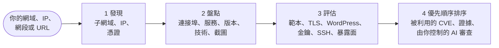

<p align="center">
  
</p>

<h3 align="center">最先進的外部暴露面評估平台。</h3>

<p align="center">找出你暴露的資產，並以類似 Shodan 的資產清單方式將它們繪製成圖。</p>

<p align="center">用業界標準的掃描器評估每一台主機，並優先修復真正重要的問題。</p>

<p align="center">
  <a href="CHANGELOG.md"></a>
  <a href="LICENSE"></a>
  
</p>

<p align="center">
  
</p>

<p align="center"><sub>cvENGINE 1.4.1，基於示範資料。</sub></p>

---

**cvENGINE 全天候監視 CVE 情報來源，並以證據向你展示哪些新 CVE 真正影響到你的主機。**

### 每一個新 CVE，都與你的主機核對

1. **監視情報來源。** 新的 CVE 和最新漏洞利用新聞全天源源不斷地從重要來源抵達。
2. **找出暴露者。** 每個 CVE 都會與執行受影響產品和版本的主機進行比對。
3. **撰寫檢查。** 當沒有經過審核的檢查存在時，你的 AI 會起草一個唯讀檢查，cvENGINE 會先對其進行驗證。
4. **在你的主機上證明它。** Sentinel 用唯讀檢查重現每個比對，並保留證據。
5. **減少噪音。** AI 審查證據，真實的問題上升，可能的誤報下沉。

**自備 AI：** 使用你自己的金鑰接入 Anthropic、OpenAI 或 OpenRouter，或使用 Ollama、LM Studio 或 vLLM 完全在本機執行。它在開啟之前一直處於關閉狀態，並且永遠不會關閉一個已被檢查證實的問題。沒有模型時，cvENGINE 仍然可以發現、掃描、比對和驗證。

<details>
<summary><b>運作原理詳解</b></summary>

- **情報來源。** [cve.now](https://cve.now) 情報來源每 30 分鐘讀取一次。CISA KEV、ENISA EUVD、FIRST EPSS、Exploit-DB、Metasploit 以及（使用金鑰時）VulnCheck KEV 每小時讀取一次，因此一個 CVE 一旦被利用，一小時內就會變為 hot（火）。
- **比對。** 只有當主機執行相同的產品、且版本落在受影響範圍內時，CVE 才會成為比對。只看到產品而看不到版本，永遠不會產生比對。
- **AI 撰寫的檢查。** 對於 hot CVE，在每日預算內，AI 閱讀公告並記錄如何偵測它。當沒有經過審核的 Nuclei 範本存在時，它可以起草一個唯讀範本，該範本只有在系統驗證之後才會在主機上執行：在 Sentinel 上進行語法檢查和無害的回送控制、針對受影響回應和已修復回應進行離線測試，以及第二次 AI 檢查。此功能預設關閉：管理員需手動開啟**自動驗證 AI 撰寫的檢查**。
- **證明。** 每五分鐘，最多 20 個比對（先到先得）會在 Sentinel 上用六種唯讀檢查之一進行重現：經過審核的 Nuclei 範本、單連接埠 `nmap -sV`、版本橫幅請求、免憑證資料庫檢查、版本與身分探測，或 JavaScript 函式庫讀取。確切的指令和結果都會被保留。無法重現問題的檢查永遠不會降低它的等級。
- **分類。** CVE 比對、掃描器發現、暴露的資料庫、暴露的管理路由、洩露憑證的路由，以及中等或更高嚴重度的衛生問題，會在每日上限內（預設每個專案 500 條、總計 2,000 條）被評為 confirmed（已證實）、likely（可能）、needs validation（待驗證）、likely false positive（可能誤報）或 not applicable（不適用）。
- **AI 審查員。** 每個未關閉的問題預設每天最多讀取 300 條並記錄其真實性。只有當問題沒有硬證據、且沒有人處理過時，它才會在你允許的情況下關閉誤報。
- **底線。** 硬證據設定了模型不能低於的底線：範本命中、資料庫應答或驗證命中即為 confirmed，版本落在受影響範圍內至少為 needs validation。模型單獨永遠無法證實一個問題。
- **你的 AI，你的控制權。** 在分類和審查中，模型看到的是經過結構化處理的證據（主機名稱已去識別化），它沒有任何工具，且伺服器會在採納之前檢查每個答案。AI 作業有每日上限，用量頁面顯示呼叫次數、token 和費用估算。AI 審查員、AI 撰寫的檢查和自動開火（新 hot CVE 一落地就自動確認和測試）預設都是關閉的。

更多內容見 [Pipeline](docs/PIPELINE.md#triage-and-validation)、[CVE 情報](docs/PIPELINE.md#cve-intelligence) 和 [AI 審查員](docs/AI-REVIEWER.md)。

</details>

### 了解你暴露的一切

cvENGINE 是一個自託管的外部攻擊面和漏洞評估平台。把網域交給它，它就會持續發現你暴露的子網域、位址和憑證，形成一個可搜尋的、類似 Shodan 的資產清單，涵蓋每台主機、連接埠、服務、技術和憑證。被遺忘的和影子資產都會浮出水面，新的主機、開放的連接埠和版本變化會在掃描發現的第一時間落到時間軸上。每台主機都用業界標準的開源掃描器進行評估，[Situations](docs/SITUATIONS.md) 會依優先順序排列該先修什麼：證據優先於可能性，已知被利用優先於僅憑嚴重度。

## cvENGINE 1.4.0 已發布

| | |
| --- | --- |
| **在任何你需要的地方掃描** | 掃描在哪裡進行由你決定：在你自己的伺服器上，使用每次安裝都自帶、執行在獨立容器中的內建掃描器；在遠端 [Sentinels](docs/SENTINELS.md) 上（可部署在任何地方——其他雲端、其他區域或私有網路內部，以觸達內部資產）；或兩者並用。新增 Sentinel 即可橫向擴充。 |
| **減少誤報的 AI** | 新的 AI 審查員執行在自己隔離的容器中，讀取每個未關閉的問題一次（受每日上限約束）並記錄其真實性；AI 撰寫的檢查在執行之前由系統驗證（包括在你自己的 Sentinel 上）。兩者在開啟之前都保持關閉。 |
| **在瀏覽器中完成設定** | `install.sh` 只是一個輕量引導。一個[設定精靈](docs/DEPLOYMENT.md#setup-wizard)會帶你完成組織、專案和第一個網域的設定，發現立即開始。 |
| **需要人工處理的事項，依優先順序排列** | [Situations](docs/SITUATIONS.md) 列出需要人工處理的主機，最緊急的排在最前。被檢查重現的問題會先展示證據，標記為已修復的問題會被再次檢查。 |
| **暴露的金鑰和 SSH** | 由 Kingfisher 驅動的專案金鑰清單，以及用 sshamble 進行的 SSH 檢查：把主機金鑰與已知惡意清單比對，且從不登入。 |
| **沒有東西會悄然開啟** | 憑證檢查、AI 審查員以及任何花錢或擴大掃描範圍的功能，在管理員同意之前都保持關閉。API 權杖和 AI 代理無法開啟它們。 |
| **自行運轉** | [看門狗](docs/WATCHDOG.md) 會修復卡住的工作程序，自動調校會檢查它的每次更改並撤銷有害的更改，你還可以透過 [Cloudflare Tunnel](docs/HOSTING-ONLINE.md) 對外發布，無需任何入站連接埠。 |

從 1.3 升級？請先閱讀[升級到 1.4](docs/UPGRADE.md#upgrading-to-14) 和[維運說明](docs/1.4-OPERATOR-NOTES.md)：備份、檢查可用磁碟空間並更新你的 Sentinels。所有更改都在[變更日誌](CHANGELOG.md)中。

## 從網域到結論



1. **發現。** 讓 cvENGINE 指向一個網域，它就會找到屬於你的子網域、位址和憑證，持續監視憑證透明度，並每週重複一次深度掃描。
2. **盤點。** 每台主機、開放連接埠、服務、產品版本、技術、憑證和首頁都進入同一個清單，你可以[像 Shodan 一樣搜尋](docs/SEARCH.md)：`port:3389 -host:vpn`、`tech:"apache tomcat" sev:high`。新主機、開放的連接埠和版本變化會落到時間軸上。
3. **評估。** 每台主機都用業界標準掃描器和 cvENGINE 自己的唯讀檢查進行測試；只有當產品相同且版本落在受影響範圍內時，CVE 才會與主機比對。
4. **優先順序排序。** 每個 CVE 都會根據真實利用資料被評為 [fire、smoke 或 ice](docs/FIRE-SMOKE-ICE.md)，每台主機獲得 0 到 100 的評分；當你開啟 AI 分類後，它會將問題分為 confirmed、likely 或 needs validation。AI 永遠不會關閉一個已被檢查證實的問題。

掃描在你選擇的地方執行：你伺服器上的內建掃描器、部署在其他地方的 [Sentinels](docs/SENTINELS.md)，或兩者並用。[Pipeline](docs/PIPELINE.md) 描述了每個階段。

## 背後的工具

cvENGINE 執行最好的開源安全工具。掃描器映像把安裝的每個工具都固定到確切版本，每次發布前都會檢查這些版本固定。你安裝實例的 About 頁面會列出這些工具及其版本，[THIRD-PARTY.md](THIRD-PARTY.md) 給出了每個工具的授權條款。

| 階段 | 工具 | cvENGINE 用它做什麼 |
| --- | --- | --- |
| **發現** | [bbot](https://github.com/blacklanternsecurity/bbot) | 子網域、位址和資產發現，執行過程中即時流入資產清單 |
| | [baddns](https://github.com/blacklanternsecurity/baddns) | 懸空 DNS 和子網域接管候選，在 bbot 內執行 |
| | [crt.sh](https://crt.sh) | 憑證透明度查詢，捕捉兩次掃描之間出現的新名稱 |
| **盤點與指紋識別** | [naabu](https://github.com/projectdiscovery/naabu) | 對每個位址的全部 65,535 個 TCP 連接埠進行掃描 |
| | [Nmap](https://nmap.org) | 服務、版本和作業系統指紋，經過審核的腳本，以及一次慢速 UDP 暴露掃描 |
| | [Nuclei](https://github.com/projectdiscovery/nuclei) | 技術識別，指出每台 Web 主機執行什麼 |
| | [wafw00f](https://github.com/EnableSecurity/wafw00f) | 識別站點前面的 Web 應用程式防火牆 |
| | [Playwright](https://playwright.dev) + 無頭 Chromium | 主機提供的每個網頁的截圖 |
| | [gowitness](https://github.com/sensepost/gowitness) | 發現階段的首頁截圖，由 bbot 安裝 |
| | [aardwolf](https://github.com/skelsec/aardwolf) | 允許免憑證登入的 RDP 伺服器的登入畫面截圖 |
| **評估** | [Nuclei](https://github.com/projectdiscovery/nuclei) 和 [nuclei-templates](https://github.com/projectdiscovery/nuclei-templates) | 社群範本庫、AI 定向掃描和逐 CVE 檢查；拒絕服務和憑證類範本預設排除 |
| | [testssl.sh](https://github.com/testssl/testssl.sh) | 每個 TLS 連接埠上的協定、密碼套件和已知 TLS 漏洞 |
| | [WPScan](https://github.com/wpscanteam/wpscan) | WordPress 核心、外掛和佈景主題漏洞（新增 [wpscan.com](https://wpscan.com/) 權杖可取得其漏洞資料） |
| | [Kingfisher](https://github.com/mongodb/kingfisher) | 你的頁面和腳本暴露的 API 金鑰、權杖和私鑰，保存在金鑰清單中 |
| | [sshamble](https://github.com/runZeroInc/sshamble) | SSH 交握和主機金鑰，與 [badkeys](https://badkeys.info) 黑名單比對；從不登入 |
| | [node2shell 偵測器](https://github.com/assetnote/node2shell-scanner) | Assetnote 針對 CVE-2026-111497 的唯讀檢查；預設關閉 |
| | cvENGINE 自帶檢查 | 暴露的資料庫、公開和懸空的雲端儲存（S3、Google Cloud Storage、Azure Blob）、Web 路由及其登入狀態、版本探測，以及基於 [MailFail](https://github.com/ACK-J/MailFail) 的 DNS 和郵件衛生 |
| **漏洞利用情報** | [cve.now](https://cve.now)、[CISA KEV](https://www.cisa.gov/known-exploited-vulnerabilities-catalog)、[ENISA EUVD](https://euvd.enisa.europa.eu/)、[VulnCheck KEV](https://vulncheck.com)、[FIRST EPSS](https://www.first.org/epss/)、[Exploit-DB](https://gitlab.com/exploit-database/exploitdb)、[Metasploit](https://github.com/rapid7/metasploit-framework)、[CVE List V5](https://github.com/CVEProject/cvelistV5)、[OSV](https://osv.dev)、[Debian 安全追蹤器](https://security-tracker.debian.org) | 今天哪些 CVE 正在被利用，以及發行版向後移植了哪些修復 |
| **可選附加元件** | [OpenVAS](https://greenbone.github.io/docs/latest/)（Greenbone Community Edition） | 在 Sentinel 上執行第二個網路漏洞掃描器，用於你最熱的主機。預設關閉（[OpenVAS](docs/OPENVAS.md)） |
| | [Tailscale](https://github.com/tailscale/tailscale) | 可選：加入 tailnet、匯入並掃描其裝置、檢查其設定（[Tailscale](docs/TAILSCALE.md)） |
| | [runZero](https://www.runzero.com) | 可選：使用你自己的權杖定時同步 runZero 的資產資料（[設定](docs/CONFIGURATION.md#runzero)） |
| | bbot 的金鑰來源 | 可選：Shodan、Censys、VirusTotal、SecurityTrails、GitHub、Chaos 等，使用你自己的 API 金鑰（[設定](docs/CONFIGURATION.md#api-keys)） |
| **AI（自備，不選則關閉）** | [Anthropic](https://www.anthropic.com)、[OpenAI](https://openai.com)、[OpenRouter](https://openrouter.ai)、[Ollama](https://github.com/ollama/ollama)、[LM Studio](https://lmstudio.ai)、[vLLM](https://github.com/vllm-project/vllm) | 問題分類、Nuclei 定向和獨立容器中的 [AI 審查員](docs/AI-REVIEWER.md)。沒有模型時 cvENGINE 仍然可以發現、掃描和比對 |
| | [Model Context Protocol](https://modelcontextprotocol.io) | 供你自己的代理使用的 MCP 伺服器和 REST API（[Agent API](docs/AGENT-API.md)） |

## 幾分鐘完成安裝

你需要一台 Linux 伺服器（Debian 或 Ubuntu 最簡單），至少 4 GB 記憶體（建議 8 GB）和 20 GB 可用磁碟空間。

```bash
git clone https://github.com/hevnsnt/CVEngine.git
cd CVEngine
sudo ./install.sh
```

安裝程式會補齊缺失的相依套件、產生所有金鑰、建立 HTTPS 憑證、啟動 cvENGINE 及其內建掃描器，並列印存取位址以及產生的管理員密碼的位置。登入後，設定精靈會完成其餘工作。自動化可以傳入 `--sentinels=internal|both|external` 和 `-n`。安裝程式從不安裝 OpenVAS。在你信任 `secrets/certs/ca.crt` 之前，瀏覽器會對私有憑證發出警告。

公網網域和可信憑證、Cloudflare Tunnel、Mac 和 Windows：請參閱[部署](docs/DEPLOYMENT.md)和[線上託管](docs/HOSTING-ONLINE.md)。

## 設計上安全

- **預設唯讀。** 沒有密碼字典。傳送憑證的檢查（Nuclei 的預設登入和暴力破解範本）在 App Admin 允許之前保持關閉，拒絕服務範本被排除。
- **邊界由你劃定。** 回送、連結本地和雲端中繼資料位址永遠不會被掃描，每個組織都維護一份[我們絕不掃描的位址](docs/1.4-OPERATOR-NOTES.md#addresses-we-must-never-scan)清單，包含所有指向這些位址的名稱。
- **開關在你手中。** AI 驗證、AI 審查員、OpenVAS 以及其他任何花錢的功能預設關閉，更新在更改它們之前會先詢問。
- **鎖定。** 組織資料相互隔離，儲存的金鑰經過加密，存取受雙重登入、IP 允許清單和稽核記錄保護。

只掃描你擁有或獲授權測試的系統。

## 文件

| 文件 | 內容 |
| --- | --- |
| [部署](docs/DEPLOYMENT.md)和[線上託管](docs/HOSTING-ONLINE.md) | 安裝、HTTPS、Cloudflare、備份、小主機 |
| [更新](docs/UPDATES.md)、[升級](docs/UPGRADE.md)和 [1.4 維運說明](docs/1.4-OPERATOR-NOTES.md) | 保持最新，以及 1.4 對維運者意味著什麼變化 |
| [Sentinels](docs/SENTINELS.md)和[內建掃描器](docs/BUILTIN-SCANNER.md) | 每次掃描在哪裡執行、橫向擴充和掃描私有網路 |
| [Pipeline](docs/PIPELINE.md)和[架構](docs/ARCHITECTURE.md) | 運作原理，逐階段說明 |
| [搜尋](docs/SEARCH.md)、[Situations](docs/SITUATIONS.md)和[Fire、smoke 和 ice](docs/FIRE-SMOKE-ICE.md) | 找到真正重要的問題，以及 CVE 的評級方式 |
| [設定](docs/CONFIGURATION.md) | 每一項設定 |
| [AI 審查員](docs/AI-REVIEWER.md)、[AI 用量](docs/AI-USAGE.md)和[金鑰](docs/SECRETS-PLAN.md) | 隔離的審查員、AI 成本，以及暴露金鑰清單 |
| [OpenVAS](docs/OPENVAS.md)和[Tailscale](docs/TAILSCALE.md) | 可選附加元件 |
| [多租戶](docs/TENANCY.md)、[Agent API](docs/AGENT-API.md)和[主機清單](docs/HOST-INVENTORY.md) | 團隊與角色、REST API 和 MCP、主機自報軟體套件 |
| [漏洞賞金](docs/BUG-BOUNTY.md)、[看門狗](docs/WATCHDOG.md)和[前端](docs/FRONTEND.md) | 賞金工作台、自我修復和介面 |

## 貢獻與安全

歡迎提 issue 和 pull request：請參閱 [CONTRIBUTING](.github/CONTRIBUTING.md)。請按照[安全政策](.github/SECURITY.md)的說明，透過倉庫的 **Security** 頁籤私下回報漏洞。

## 致謝與授權條款

cvENGINE 是 Yogesh Ojha 及其貢獻者的 [reNgine](https://github.com/yogeshojha/rengine) 2.x 的一個分支，並建構於上述專案之上。Sentinel 用戶端位於 [hevnsnt/cvENGINE-sentinel](https://github.com/hevnsnt/cvENGINE-sentinel)。感謝我們的 beta 測試者，尤其是 [camstork](https://github.com/camstork)，其細緻報告塑造了 1.3。請參閱[變更日誌](CHANGELOG.md)、[貢獻者](CONTRIBUTORS.md)和[第三方軟體](THIRD-PARTY.md)。

"類似 Shodan"描述的是搜尋方式；cvENGINE 與 Shodan 無關聯。

依 GPL-3.0 發布。見 [LICENSE](LICENSE)。

[](https://m8ven.ai/mcp/hevnsnt-cvengine-s24yvi?s=readme)
